Analytics shows how your business is doing from the payments Kelviq already processes: what you earned, how your subscriptions are moving, who is converting from trial, where payments fail and how much comes back. Open **Analytics** in the dashboard sidebar. It has a BETA tag while the set of metrics is still growing.

Every tab shares the same filter bar, compares the period with the one before it, and can be copied as a link that opens with the same filters set.

For the headline numbers at a glance, see [Home](/home). **View details** on a Home card opens the matching metric here.

## Tabs

| Tab | What it answers | Main cards |
| --- | --- | --- |
| **Revenue** | How much did we make, and where from? | Gross volume, Net volume, Average order value, Payouts received, Dispute rate, Revenue by type, Coupons redeemed, Refunds, Revenue by product, country and currency |
| **Subscriptions** | How is recurring revenue moving? | Monthly recurring revenue, Active subscriptions, Projected ARR, Quick ratio, MRR growth, MRR by plan, Upcoming renewals |
| **Customers** | Who pays us, and how much each? | Active customers, New customers, Average revenue per user, Modeled LTV, Customers by spend band, Multi-product customers, Repeat purchase rate, Top customers |
| **Trials** | Do trials turn into paying customers? | New, Active and Converted trials, Conversion rate, Trial funnel, Paid after 60 days |
| **Churn** | Who is leaving, and what does it cost? | Customer churn rate, Revenue churn rate, Net revenue retention, MRR lost, Subscriber retention by cohort, Churn by reason |
| **Success rate** | How many payments go through? | Payment success rate, Checkout conversion, Customer-initiated vs recurring, Failed payments by reason, Success rate by card country and payment method |
| **Recovery** | How much of what failed came back? | Recovery rate, Renewal failure rate, Recovered by method, Time to recover, Recovery by decline reason, Checkout recovery, In recovery now |

Each card shows the value for the selected range, the change against the previous period, and a chart. Click **View details** on a card to open the metric on its own, with a day-by-day table and a total under the chart.

<Tabs>
  <Tab title="Revenue">
    <Frame>
      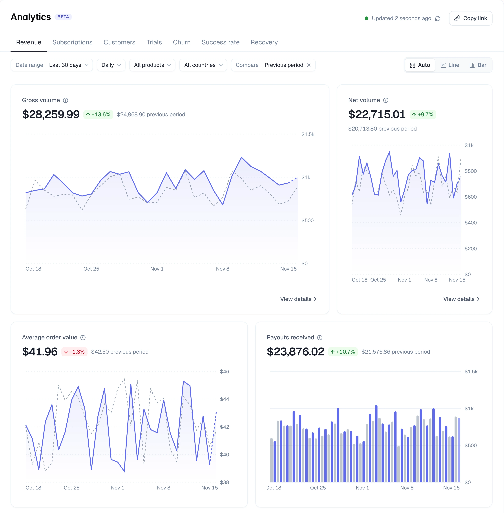
    </Frame>
  </Tab>
  <Tab title="Subscriptions">
    <Frame>
      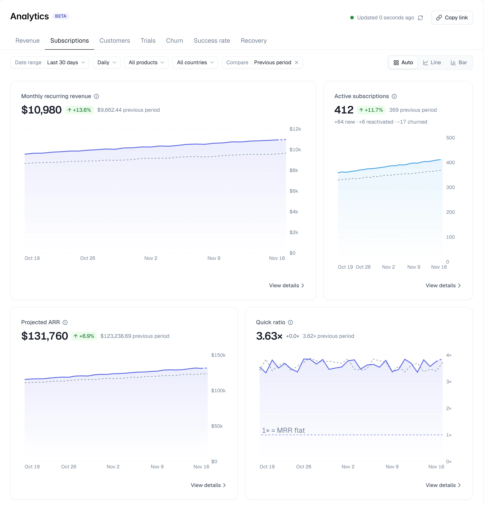
    </Frame>
  </Tab>
  <Tab title="Customers">
    <Frame>
      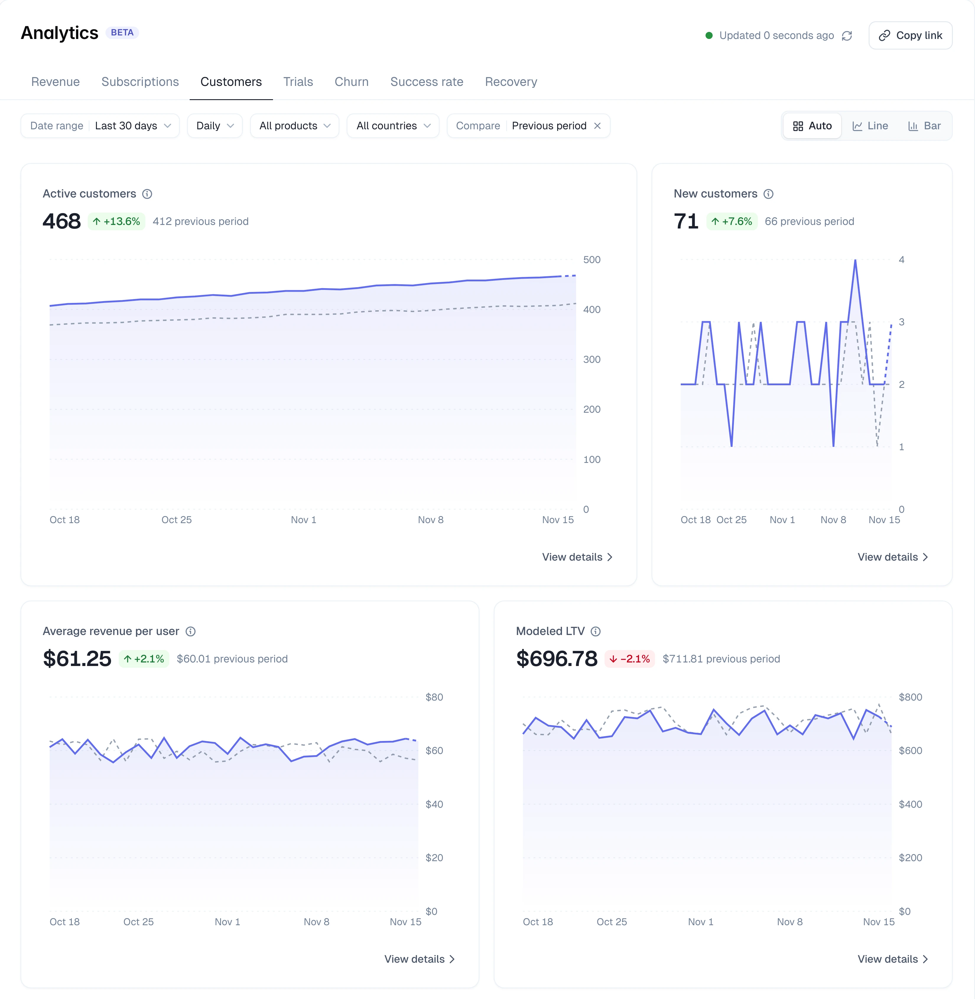
    </Frame>
  </Tab>
  <Tab title="Trials">
    <Frame>
      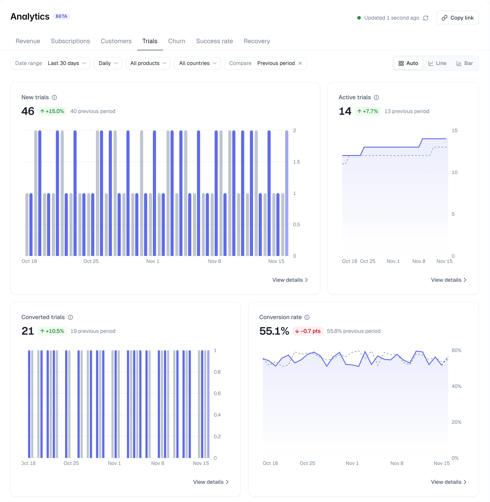
    </Frame>
  </Tab>
  <Tab title="Churn">
    <Frame>
      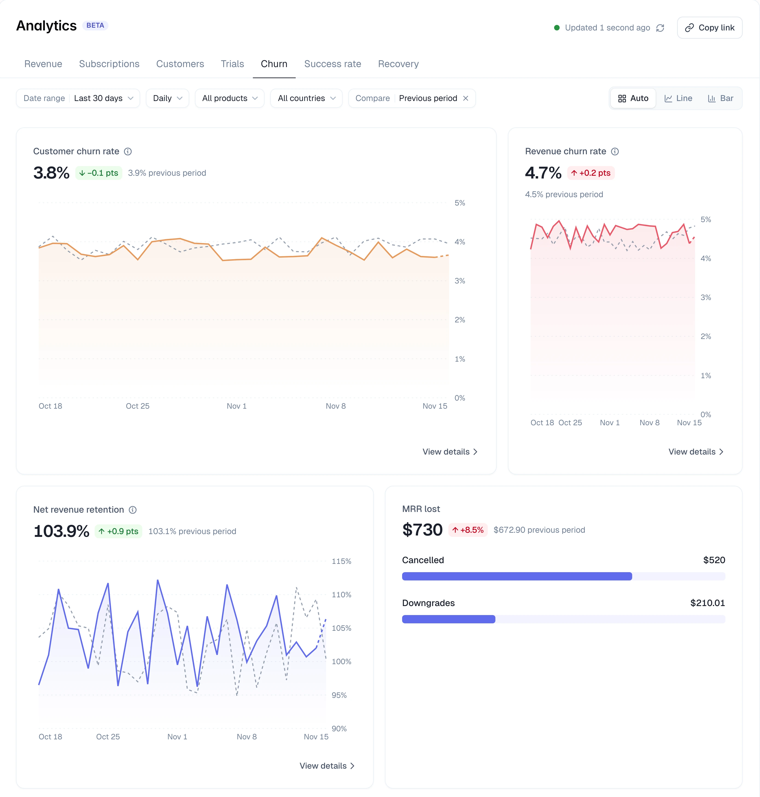
    </Frame>
  </Tab>
  <Tab title="Success rate">
    <Frame>
      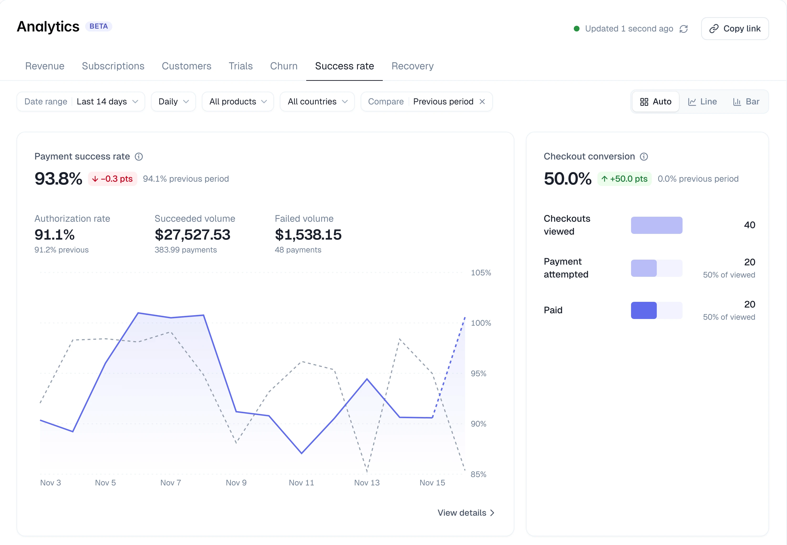
    </Frame>
  </Tab>
  <Tab title="Recovery">
    <Frame>
      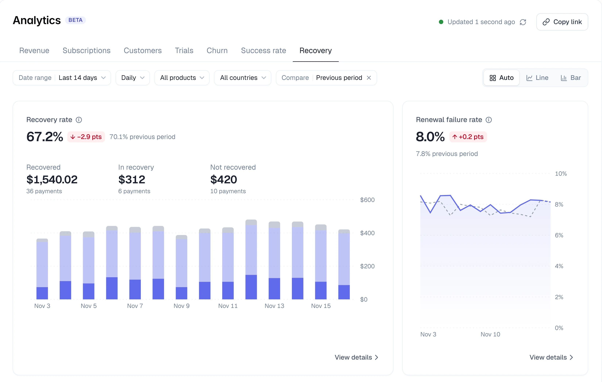
    </Frame>
  </Tab>
</Tabs>

The charts above use sample data.

<Frame caption="Gross volume">
  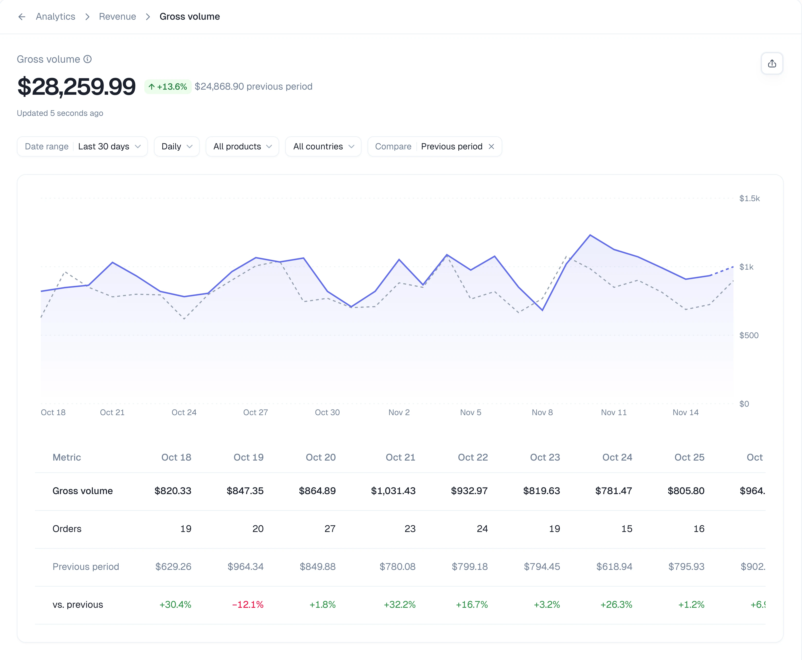
</Frame>

<Frame caption="Active customers">
  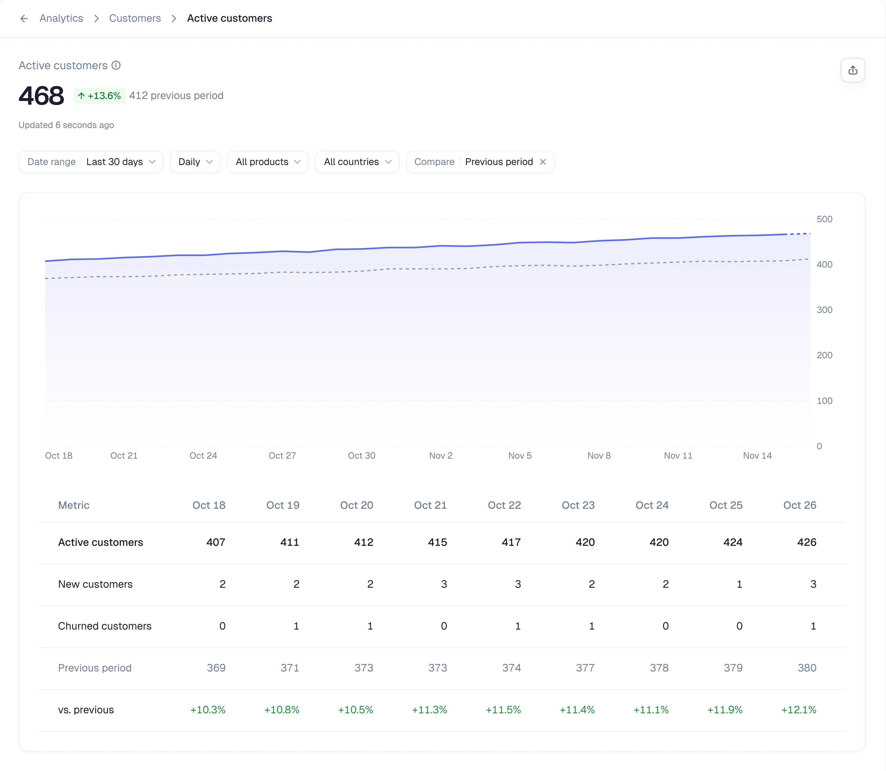
</Frame>

## What the numbers mean

The definitions below are the ones shown when you hover the info icon next to a card.

### Revenue

| Metric | Definition |
| --- | --- |
| Gross volume | Revenue before tax, fees, refunds and disputes. |
| Net volume | What reached your balance: gross minus tax, fees, refunds and disputes. |
| Average order value | Gross volume divided by paid orders. |
| Payouts received | Payouts paid or transferred in the period. Organization-wide: the product and country filters don't apply. |
| Dispute rate | Disputes as a share of payments, with the count and amount under the chart. |
| Refunds | Amount refunded, with the number of refunded orders and the share of gross volume. |

### Subscriptions

| Metric | Definition |
| --- | --- |
| Monthly recurring revenue | MRR at the end of each period. |
| Active subscriptions | Running count at the end of each period, including free and trialing. The card also shows new, reactivated and churned for the range. |
| Projected ARR | MRR × 12. |
| Quick ratio | (New + expansion + reactivation MRR) ÷ (contraction + churned MRR). Empty when nothing was lost. |
| MRR growth | New, expansion, reactivation, contraction and churned MRR, and the net new figure they add up to. |
| Upcoming renewals | What is due to renew in the next 30 days, split into four date ranges and by whether the card on file is still valid at renewal. Scheduled cancellations are excluded. |

### Customers

| Metric | Definition |
| --- | --- |
| Active customers | Unique customers with at least one successful payment in the period. Each customer is counted once, however many times they paid. |
| New customers | Customers whose first successful payment happened in this period. |
| Average revenue per user | Revenue ÷ active customers. |
| Modeled LTV | ARPU divided by monthly customer churn. An estimate of lifetime revenue per subscriber, not observed revenue. |
| Customers by spend band | How many customers sit in each band, from under \$10 to \$1k and above. |
| Multi-product customers | Customers on two or more products, with revenue per customer and churn for that segment next to single-product customers and everyone. |

### Trials

| Metric | Definition |
| --- | --- |
| New trials | Trials started in the period. |
| Active trials | Trials started and not yet ended at the end of the period. |
| Converted trials | Trials whose first successful payment or activation is in the period. |
| Conversion rate | Converted ÷ ended trials. |
| Trial funnel | Started, ended and converted, each as a share of the step before. |
| Paid after 60 days | Of the trials that converted at least 60 days ago, how many are still paying. Younger conversions show as not yet measurable. |

### Churn

| Metric | Definition |
| --- | --- |
| Customer churn rate | Subscriptions cancelled or paused ÷ active at the start of the period. |
| Revenue churn rate | (Cancelled + downgraded MRR) ÷ MRR at the start of the period. |
| Net revenue retention | What the MRR present at the range start has become, cumulative along the range. |
| MRR lost | The MRR that left, split into cancellations and downgrades. |
| Subscriber retention by cohort | For each day's cohort of new subscribers, the share still subscribed over time. Switch between subscribers and revenue. |
| Churn by reason | Subscribers lost and MRR lost per cancellation reason. |

### Success rate

| Metric | Definition |
| --- | --- |
| Payment success rate | Succeeded ÷ attempted payments. The card also shows the authorization rate and the succeeded and failed volume. |
| Checkout conversion | Paid ÷ viewed checkout sessions, with the steps between: viewed, payment attempted, paid. |
| Customer-initiated vs recurring | Success rate of payments the customer started at checkout against automatic renewals. |
| Failed payments by reason | Failures grouped into before the bank (3DS not completed, blocked by risk rules) and declined by the bank (insufficient funds, generic decline, expired card, other), each with a suggested action. |

The Success rate and Recovery tabs open on the last 14 days by default. The other tabs open on the last 30 days.

### Recovery

| Metric | Definition |
| --- | --- |
| Recovery rate | Recovered ÷ failed invoices, by the period of the first failure. The card splits the amount into recovered, in recovery and not recovered. |
| Renewal failure rate | Share of renewal invoices whose first attempt failed. |
| Recovered by method | How recovered payments were recovered: automatic retries, a card updated from the email, a card updated in the portal, or the card updater and manual payments. |
| Time to recover | Median days from the first failure to the successful retry, with a spread from same day to 22+ days. |
| Checkout recovery | Checkouts that weren't completed, how many got a reminder email, and how many came back and paid. See [Abandoned cart recovery](/sales/abandoned-cart-recovery). |
| In recovery now | Failed payments Kelviq is still retrying. |

Kelviq retries failed renewals and emails the customer on its own. [Subscriptions](/product-catalog/subscriptions#failed-subscription-payments) covers the schedule.

## Filters

The filter bar at the top applies to every card on the tab:

<Frame>
  
</Frame>

| Filter | Options |
| --- | --- |
| **Date range** | Today, Last 7, 14, 30 or 90 days, Last 12 months, Month, Quarter or Year to date, or pick two dates on the calendar and click **Update**. |
| **Daily / Weekly / Monthly** | How the chart is bucketed. |
| **All products** | Tick one or more products. |
| **All countries** | Search and tick one or more countries. **Clear** empties the list. |
| **Compare** | **Previous period** or **Previous year**. Click **×** on the chip to compare with nothing. |

Once a filter differs from the default, **Reset** appears next to the chips and puts everything back. On the right, **Auto**, **Line** and **Bar** switch the chart type for the whole tab.

**Updated … ago** at the top says when the numbers were last loaded. The icon next to it reloads them.

## Copy a link with your filters

Click **Copy link** at the top right. The URL you get carries the tab and the filters you have set, so whoever opens it sees the same view, as long as they are a member of your organization. Use it to pin a view in a Slack channel or a weekly doc instead of describing the filters each time.

## Share a milestone

Any card can become an image to post. Hover the card and click the share icon, or open **View details** and click it there.

The **Share milestone** dialog shows the chart on a card with the metric name, the month, the value and the Kelviq logo. Pick one of eight themes (Mint, Sky, Midnight, Sunset, Forest, Ember, Pastel or Crimson) and a bar or line chart, then **Copy image** or **Download image**.

<Frame caption="Mint theme, line chart">
  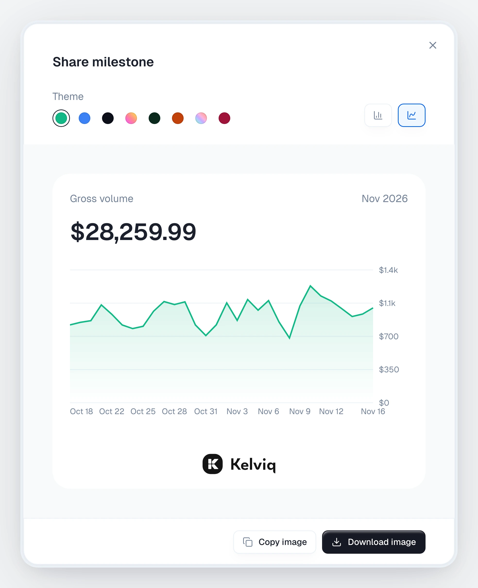
</Frame>

<Frame caption="Sunset theme, line chart">
  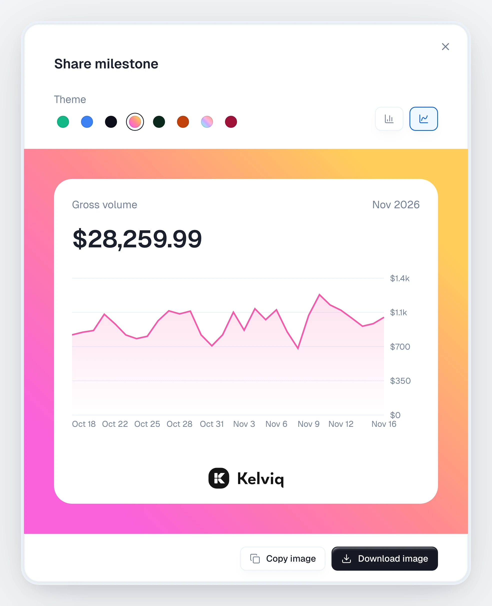
</Frame>

The downloaded image is ready to post:

<Frame>
  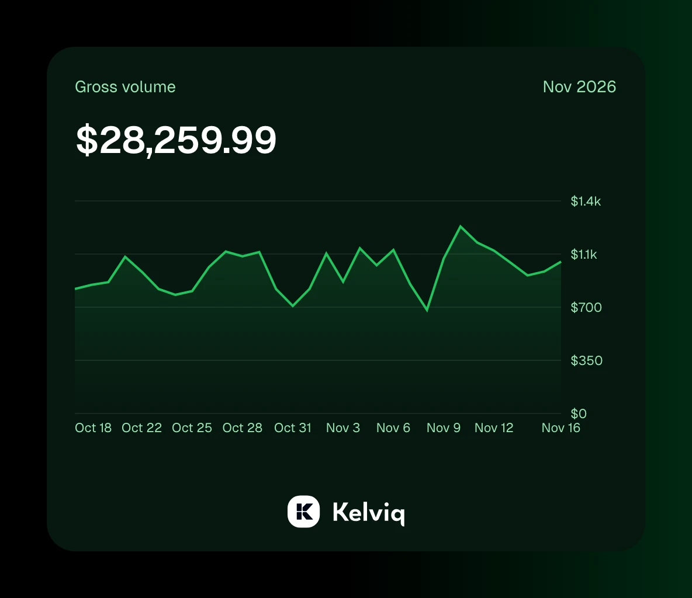
</Frame>

## Questions

<AccordionGroup>
  <Accordion title="Why doesn't a product or country filter change Payouts received?">
    Payouts are paid for the whole organization, not per product or country, so that card ignores both filters.
  </Accordion>
  <Accordion title="Why is Quick ratio or Modeled LTV shown as a dash?">
    Quick ratio needs some lost MRR to divide by, and Modeled LTV needs some customer churn. Until there is, the card shows a dash instead of a number.
  </Accordion>
  <Accordion title="Can I see these numbers in sandbox?">
    Yes. Analytics works in sandbox on your test data, which is a good way to see every card filled before you go live.
  </Accordion>
</AccordionGroup>
