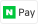

Most people in South Korea pay with a domestic Korean card or a local wallet, not an international Visa or Mastercard. Kelviq checkout offers the three methods they expect:

| Method | What the customer does |
| --- | --- |
| Korean cards | Pays with a card issued by a Korean bank or card company. |
| Kakao Pay | Approves the payment in the Kakao Pay app. |
| Naver Pay | Approves the payment in Naver Pay. |

You don't sign up with a Korean payment provider. Kelviq is the merchant of record, so these methods show up at checkout and the money reaches you in your normal [payout](/payouts/overview).

## Who sees them at checkout

Korean cards, Kakao Pay and Naver Pay appear when the checkout is priced in **KRW**. They only work in won, so a checkout in any other currency never shows them.

To get there, add a localized KRW price to your plan with [Price localization](/product-catalog/location-based-pricing). Customers in South Korea then see the won price, with the Korean methods next to international cards and the other wallets.

<Note>
KRW has no minor unit, so set whole-won prices, for example ₩29,000.
</Note>

## One-time payments and subscriptions

All three methods work for both. For a subscription, the customer pays the first charge at checkout, and Kelviq charges the same card or wallet for each renewal automatically.

International cards keep working in a KRW checkout, so customers with a Visa or Mastercard issued abroad can still pay.

## Related

* [Payment methods](/checkout/payment-methods): every method Kelviq checkout supports
* [Price localization](/product-catalog/location-based-pricing): add a KRW price to a plan
