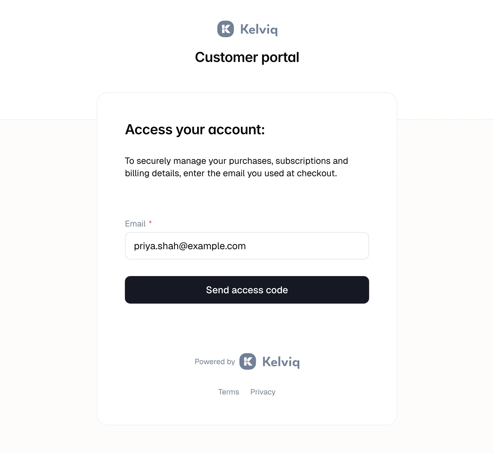
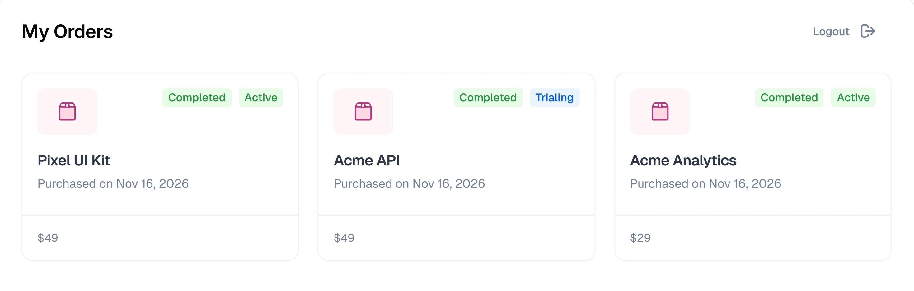
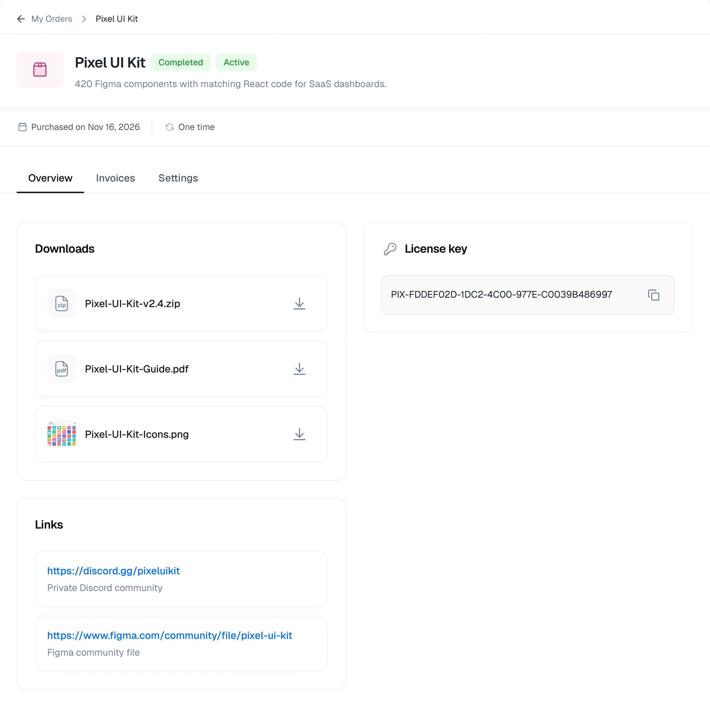
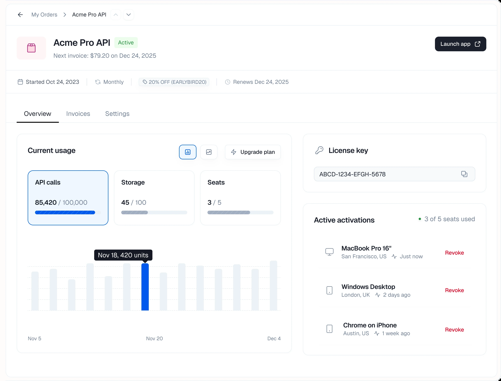
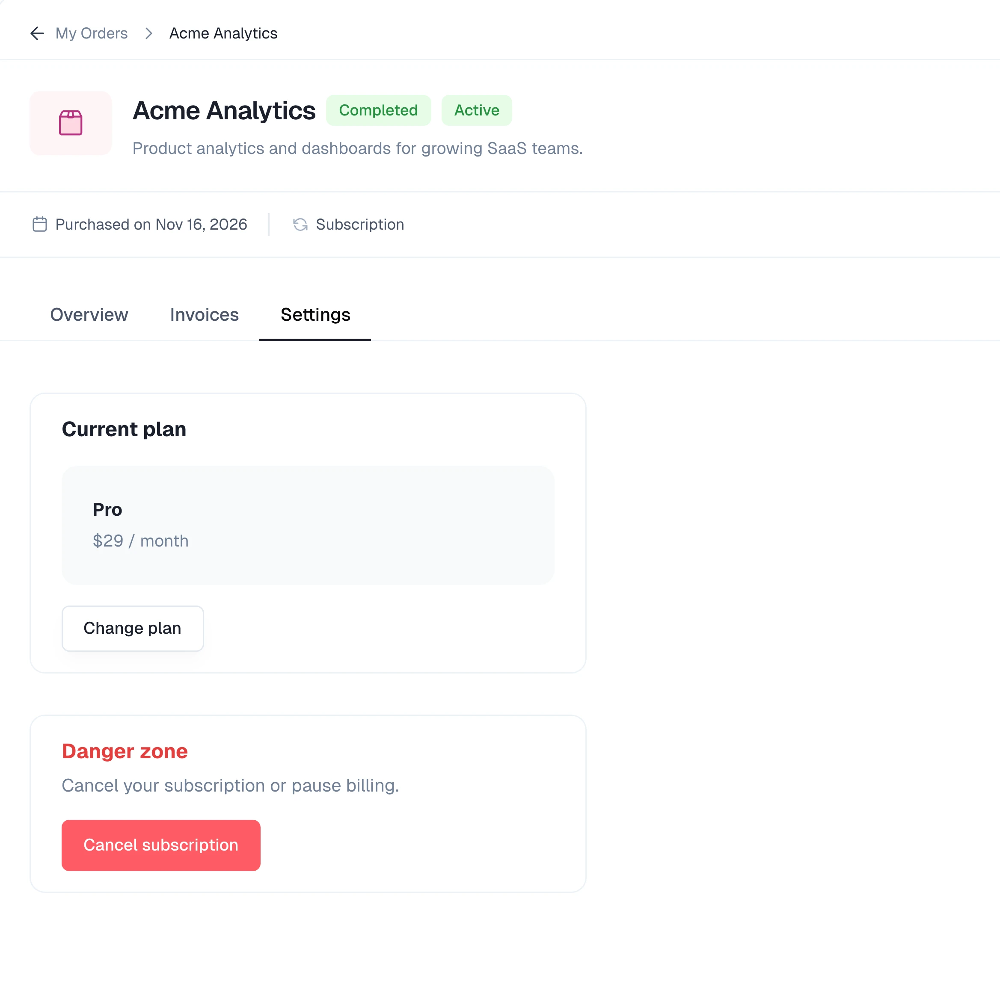
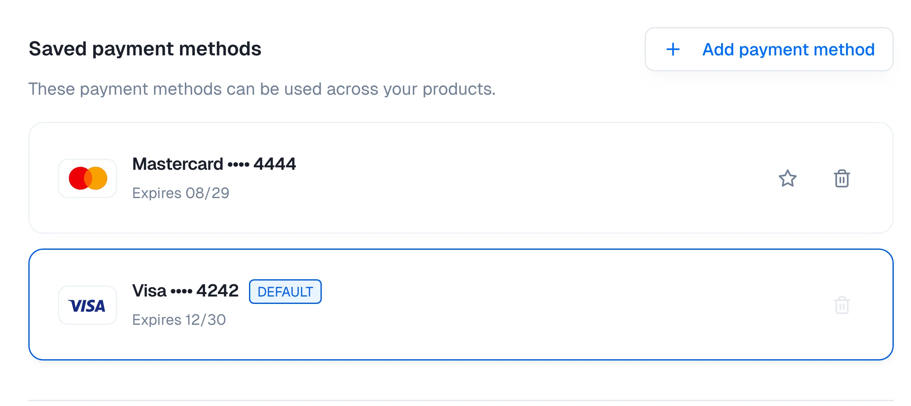
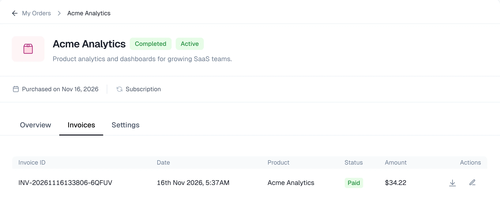
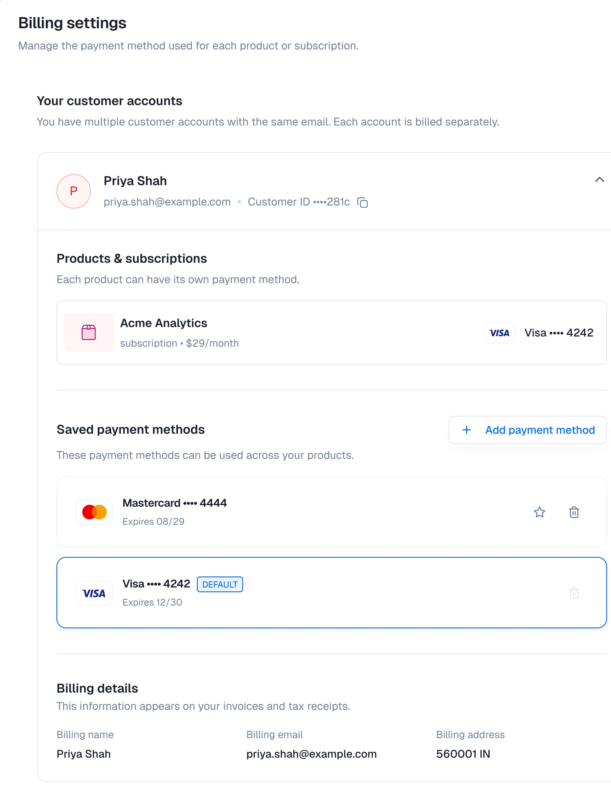

Kelviq provides a hosted customer portal.

This is a self-serve environment. Your customers manage their own subscriptions, access files, and handle billing details. You don't need to build this. It ensures you don't have to manually answer support tickets for basic tasks like upgrading plans or downloading invoices.

## Access and login

The portal uses passwordless, secure access.

<Steps>
  <Step title="Purchase and invite">
    When a customer completes a purchase, they get access immediately.
  </Step>
  <Step title="Login">
    Customers enter the email they used at checkout and click **Send access code**.
  </Step>
  <Step title="Secure entry">
    We email them a one-time access code. They enter it and click **Sign in**. No passwords to remember.
  </Step>
</Steps>

<Frame>
  
</Frame>

## My Orders

This is the home screen. It lists everything the customer owns. They can click on a specific product to see details.

<Frame>
  
</Frame>

### Product details
Each product has three tabs: **Overview**, **Invoices**, and **Settings**. **Overview** holds the customer's deliverables.

* **Digital downloads**
  Access files, e-books, or software binaries.
* **External links**
  Private links to Discord servers or Notion templates.
* **License key**
  View and copy their license key.

<Frame>
  
</Frame>

{/* 
### Usage tracking
For metered products, customers see real-time data. They can track API calls, storage used, or any metric you bill for. This transparency helps prevent billing disputes.

<Frame>
  
</Frame>
*/}

## Subscription management

Customers have control over their lifecycle without contacting you. They manage a subscription from the product's **Settings** tab.

<Frame>
  
</Frame>

* **Change plans**
  Click **Change plan** to upgrade to a higher tier or downgrade.
* **Cancel**
  Click **Cancel subscription** under **Danger zone**. With [retention offers](/customer-portal/retention) on, customers see an offer first, such as a pause. A paused subscription shows **Resume subscription**.
* **Payment methods**
  In **Billing settings**, customers add cards, set a default and remove cards. Each product or subscription shows the card it's billed to. See [Managing payment methods](/customer-portal/managing-payment-methods).

<Frame>
  
</Frame>

## Invoices

The product's **Invoices** tab lists its invoices. Customers can download each invoice as a PDF, and click **Pay now** on an unpaid one.

<Frame>
  
</Frame>

## Billing settings

**Billing settings** in the portal sidebar lists each customer record with its products and subscriptions, the payment method each one uses, and the record's **Saved payment methods**.

<Frame>
  
</Frame>
