Managing customers sits at the center of Kelviq. Each customer connects directly to their subscriptions, the plans behind them, and the features they own. You need to understand these relationships to handle the full customer lifecycle.

## View customer list

Select **Customers** in the main navigation to see your list.

You can do a few things here.
* **Search** by name, email, or identifier.
* **Add a new customer** with **New customer** in the top right.
* **Manage a customer** by clicking their row to see details.

<Frame>
  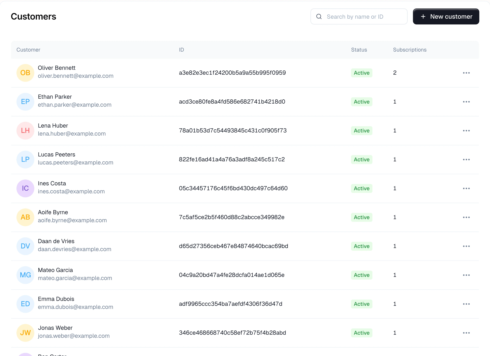
</Frame>

## Add a new customer

You can create records manually.

<Steps>
  <Step title="Open the dialog">
    Click **New customer** in the top right of the list page.
  </Step>
  <Step title="Fill in details">
    You need to provide a few key pieces of info.
    * **Customer name** is required. Use the person's full name or company name.
    * **Identifier** is the unique ID the API uses. We auto-generate this based on the name, but you can edit it. Use the ID from your own database so the API and your app match.
    * **Email ID** is required.
  </Step>
  <Step title="Create">
    Click **Create** to finish.
  </Step>
</Steps>

<Frame>
  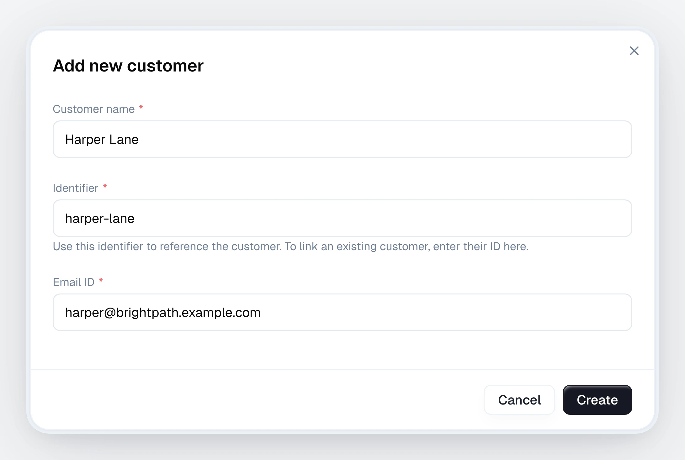
</Frame>

<Note>
  More than one customer record can use the same email address, but every record must have a unique **Identifier**. The API calls this value `customerId`.

  When recreating a test customer, you can reuse the email address, but you must provide a new Identifier. An Identifier cannot be reused after its customer is archived. If you receive a `customer already exists` error, check the Identifier first.
</Note>

## Manage existing customers

You can edit or delete a customer from the list view.

### Edit a customer
Click the **three dots** on the right side of the customer row and select **Edit**.

<Frame>
  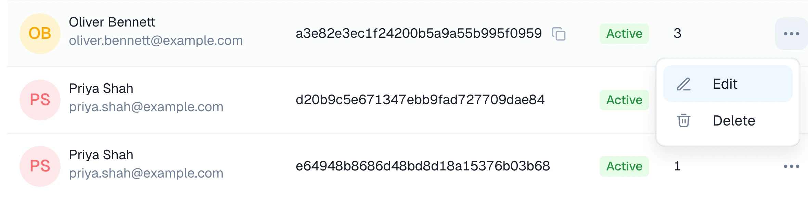
</Frame>

You can update the **Customer name** and **Email ID**. The Identifier is fixed after creation and cannot be changed.

### Delete a customer
Click the **three dots** and select **Delete**, then click **Delete** in the confirmation. The customer loses access to all features.

Kelviq archives the record rather than erasing it. The archived record keeps its Identifier, so that value cannot be reused. To create another customer with the same email address, use a new Identifier.

<Note>
  To delete a customer with an active subscription, cancel the subscription first.
</Note>

## Customer details

Click on any customer row to open their full profile. The header shows their status, email, the date they were created and their Identifier, with a copy button. Its **⋯** menu has **Edit customer**, **Copy customer ID**, **Copy signed portal link** and **Archive customer**.

<Frame>
  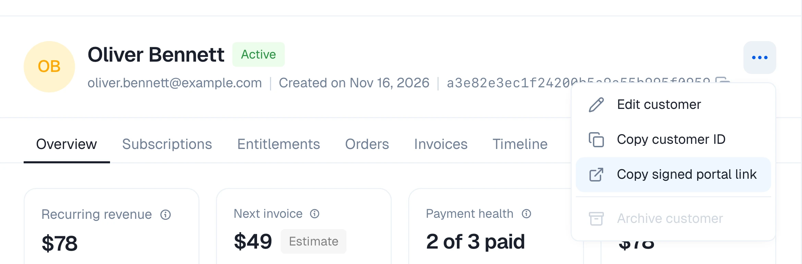
</Frame>

The page has six tabs: **Overview**, **Subscriptions**, **Entitlements**, **Orders**, **Invoices** and **Timeline**. **Overview** sums up the customer at a glance:

* **Recurring revenue**, **Next invoice**, **Payment health** and **Lifetime paid** cards.
* Their **Subscriptions**, with **View all**.
* **Recent orders** and **Invoices**, each with **View all**.
* **Entitlements usage**, with **See details**.
* **Billing details**: address, country and sales tax number.
* **Recent activity**, with **View timeline** for the full history.

<Frame>
  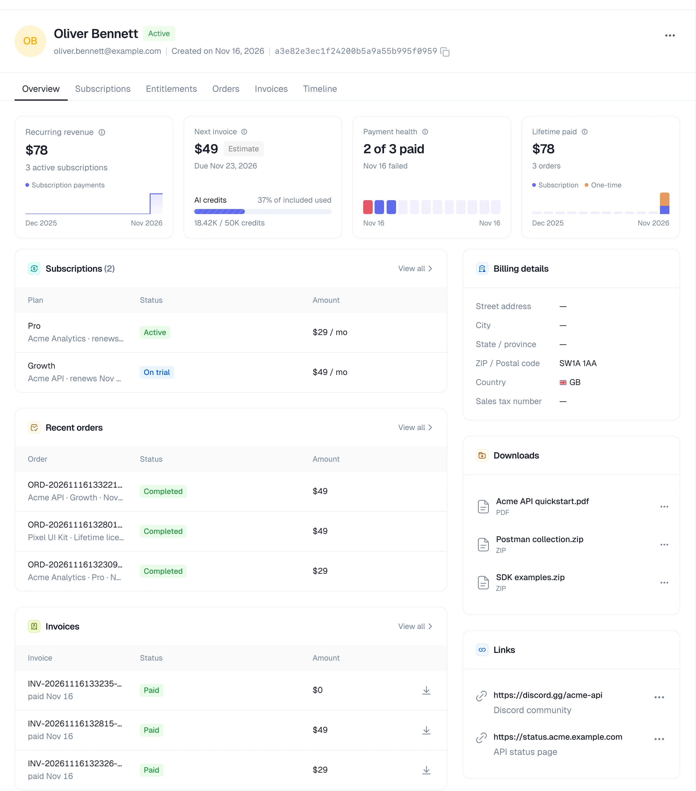
</Frame>

### Subscriptions

The **Subscriptions** tab lists active and past plans, with billing and the next invoice date. Each row shows the status, such as Active or Canceled; for a canceled subscription, the date it was canceled appears alongside the status.

Use the **three dots** on a row to **View details**, **Copy subscription ID** or **Cancel subscription**. When you cancel, choose when it ends: **At the end of the billing period** (access continues until then), **Immediately**, or **On a specific date**, and optionally pick a reason.

<Frame>
  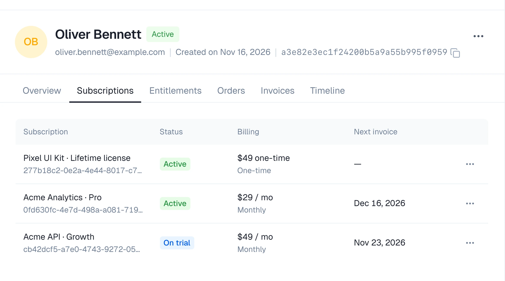
</Frame>

#### Add a subscription

Only for accounts that connect their own Stripe account. If Kelviq is your merchant of record, you won't see this button.

You can create a checkout link for a customer from here. You need at least one published plan.

<Frame>
  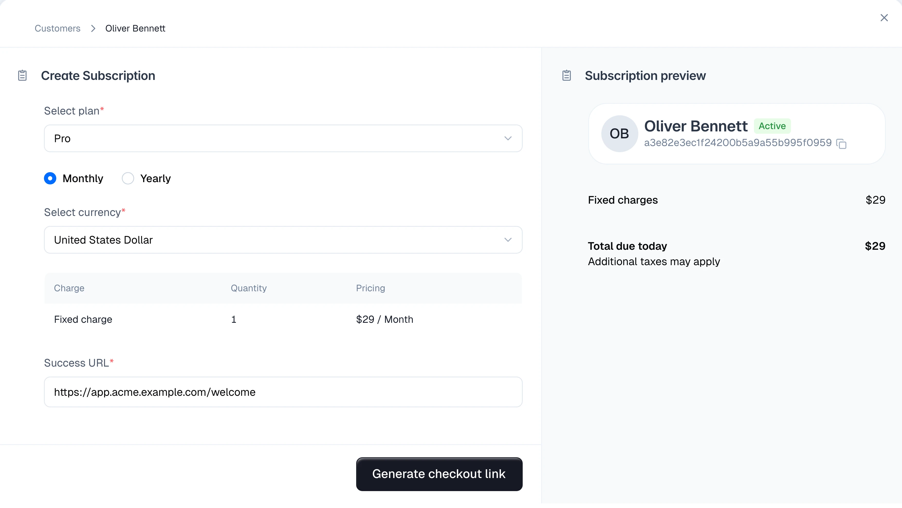
</Frame>

1. On the **Subscriptions** tab, click **Add Subscription**. The **Create Subscription** dialog opens.
2. Under **Select plan**, choose a published plan.
3. Choose the currency and billing period.
4. Enter a **Quantity** for priced features when the plan has them.
5. Enter the **Success URL**, where the customer lands after paying.
6. Check the **Subscription preview** and **Total due today**, then click **Generate checkout link**.
7. Click **Copy link** and send it to the customer.

The subscription starts only after the customer completes checkout. This flow doesn't create a plan or accept a negotiated custom amount. For either, see [Create an Enterprise plan](/product-catalog/create-an-enterprise-plan).

### Orders and invoices

The **Orders** tab lists every order the customer placed, with its status and amount. **Invoices** lists their invoices; download any of them as a PDF.

<Frame caption="Orders">
  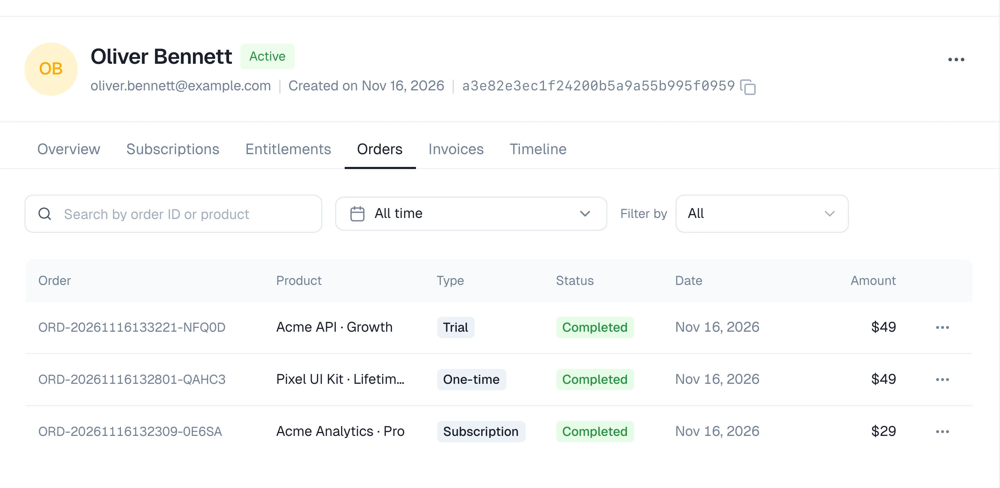
</Frame>

<Frame caption="Invoices">
  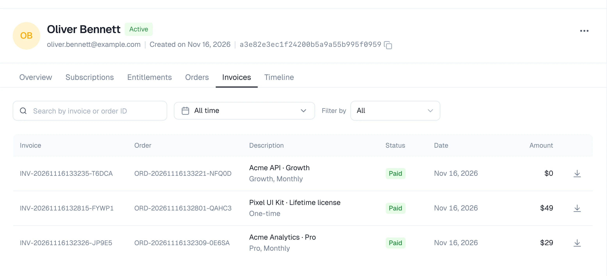
</Frame>

### Timeline

**Timeline** is the customer's full history: checkouts, orders, invoices, payments, subscription changes, trials, refunds, disputes, payment methods and emails. Filter it by category and status, and turn on **Show system events** for the background steps.

<Frame>
  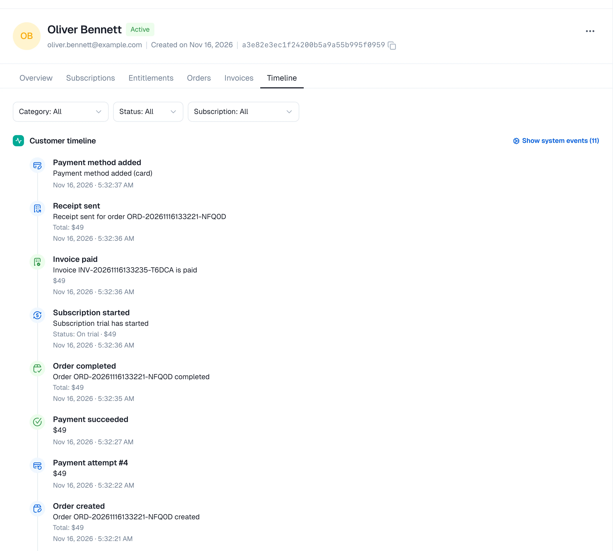
</Frame>

### Files, links, and license keys

The **Overview** tab also shows the deliverables the customer received through their plans:

* **Downloads**: download a file or copy its link.
* **Links**: open the private or external links attached to the plan.
* **License key**: copy, regenerate, or deactivate the key, edit its activation limit, or manage its expiry.

These sections let support teams confirm access without opening each order separately.

For catalog setup, see [Digital Downloads](/product-catalog/digital-downloads), [Links](/product-catalog/links), and [License Key Management](/product-catalog/license-keys).

### Entitlements

This view shows exactly what the customer can do right now based on their plan.

<Frame>
  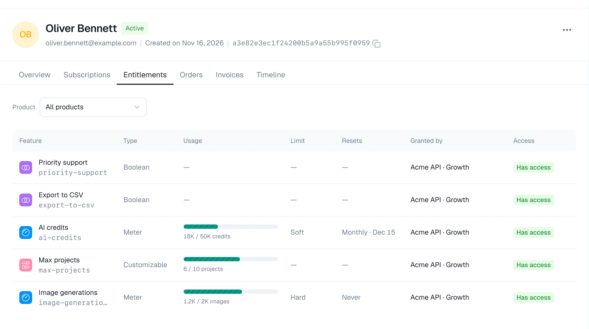
</Frame>

**Overrides**
You often need to make exceptions for specific users. You can do that here without changing the underlying plan. Click **⋯** on a feature:
* **Override usage** changes the feature's value or usage limit.
* **Reset usage** sets a Meter feature's current usage back to zero.

<Frame>
  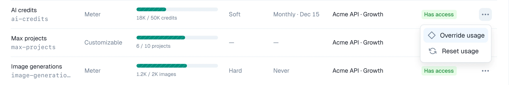
</Frame>

Changes made here apply only to this specific customer.

