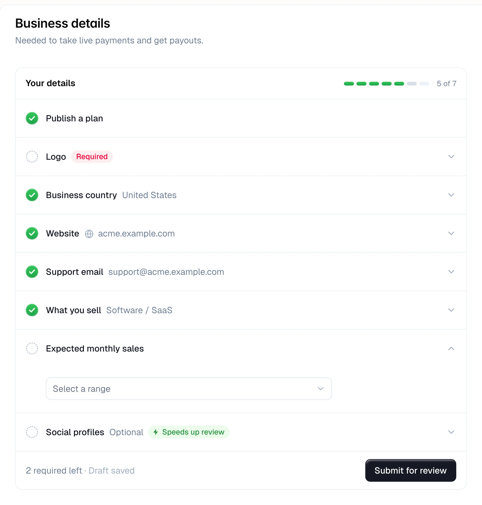
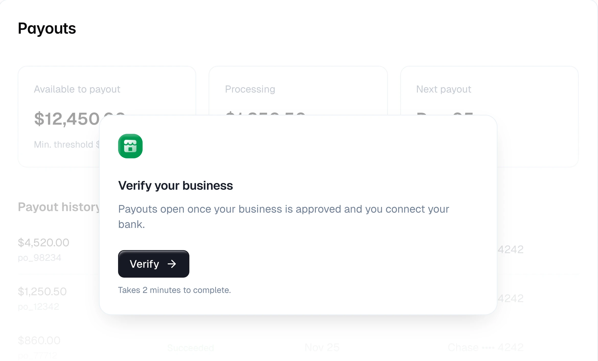
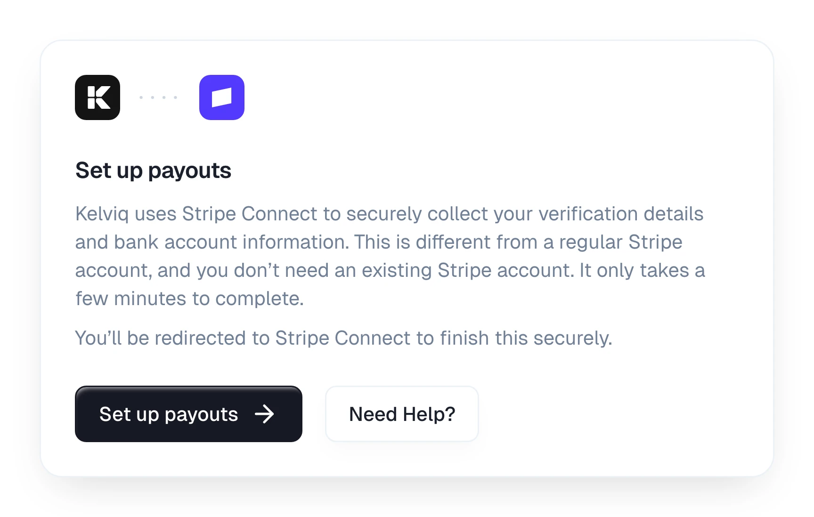

Kelviq is the merchant of record for every sale, so we check each business before it takes live payments. You can build and test in sandbox right away. A review usually takes 1–2 business days.

This guide outlines what we support, what we prohibit, and how our review process works.

## 1. Supported Business Models

Kelviq is optimized for **digital products and software**. We are the best fit for:

* **SaaS & Software:** B2B or B2C web applications, desktop software, AI tools, and browser extensions.
* **Digital Downloads:** E-books, PDFs, design templates, audio files, video courses, and fonts.
* **Membership Sites:** Newsletters, research communities, and gated content.
* **Professional Services:** *Only if sold alongside a software product (e.g., "Setup Fee" or "Priority Support").*

> **The Golden Rule:**
> Your product should be **digital**, **owned by you** (or properly licensed), and **deliverable immediately** upon purchase.

**AI products** are a core use case. If your product generates text, images, or voice, the review also checks that you have safeguards against harmful, deceptive, or adult output.

### What Kelviq doesn't cover

1.  **Physical goods** or shipping.
2.  **Services where the main product is your own time**, such as 1-on-1 coaching, consulting, or agency work.
3.  **Marketplaces.** You sell products you created or are licensed to sell, not other sellers' products.

## 2. Global Compliance & High-Risk Categories (Prohibited)

We are required by law and our financial partners to block any product or service that is illegal, deceptive, or creates a high financial risk.

This list is not exhaustive, and we reserve the right to review, suspend, or terminate any account that we believe violates the spirit of these rules.

### A. Illegal, Deceptive, or Hateful Content
* Any product or service that is illegal in the U.S. or your customer's location.
* Content that infringes on someone else's Intellectual Property (IP), copyright, or trademark. (e.g., pirated software, stolen ebooks, cracked license keys).
* Hate speech or content that promotes violence, self-harm, or discrimination against any group.
* Deceptive marketing practices, fake testimonials, or unrealistic "get rich quick" schemes.
* Low-value, exploitative content (e.g., rapidly AI-generated ebooks with minimal substance sold at a high price).
* Identity services, fake IDs, or products that support academic cheating.

### B. Financial and Legal Services
* **Regulated Financial Products:** We cannot sell investment advice, trading signals, cryptocurrency, NFTs, lending services, or act as a money transmitter.
* **Gambling:** All forms of gambling, betting, or games of chance.
* **Regulated Professional Services:** We cannot sell legal, tax, or accounting advice.
* **Donations:** We cannot process donations where no specific product is delivered.
* **Regulatory Evasion:** Any service designed to help others evade taxes, mask their identity, or bypass financial regulations.

### C. Adult & Regulated Industries
* **Adult Content:** Explicitly sexual content (videos, images, text), whether real or **AI-generated**. This includes "AI Girlfriend/Boyfriend" services, NSFW chatbots, and services related to OnlyFans.
* **Controlled Substances:** Alcohol, tobacco, vaping products, drugs, or drug paraphernalia.
* **Weapons:** Firearms, ammunition, explosives, or combat training.
* **Pharmaceuticals:** Prescription drugs or unverified medical/wellness supplements.

### D. Platform & Technology Abuse
* **Spam & Scraping:** Tools for mass cold emailing, lead scraping, or sending bulk SMS/WhatsApp messages.
* **Hacking & Cheating:** Tools designed to cheat in games, bypass software rules, or gain unauthorized access.
* **Circumvention Tools:** Services that bypass API limits, platform rules, or geo-restrictions (e.g., IP cloaking).
* **Surveillance Tech:** Products that violate user privacy or enable unauthorized surveillance (e.g., keyloggers, stalkerware).

## 3. Restricted Businesses (Requires Extensive Review)

We review each of these businesses individually. Some are approved with conditions, such as a reserve on funds. Email [hi@kelviq.com](mailto:hi@kelviq.com) early and we'll tell you what applies to your product.

* **Marketing Services:** Some marketing tools may be allowed, but we must review them to ensure they do not facilitate spam or mass outreach.
* **Pre-Orders & Paid Waitlists:** Pre-orders and paid waitlists need approval, which we give mainly to established creators. If approved, funds are paid out once the product ships.

## 4. Prohibited & Supported Countries

### Prohibited Countries
As a U.S. company, Kelviq is required to comply with U.S. sanctions laws (OFAC). We are **strictly prohibited** from doing business with any individual or entity located in:

* North Korea
* Iran
* Cuba
* Syria
* Russia
* Belarus
* The regions of Crimea, Donetsk, and Luhansk

### Supported Payout Countries
We support businesses registered in **120 countries**. You can receive payouts in your local bank account in currencies including USD, EUR, GBP, CAD, AUD, INR, and more.

| | | |
| :--- | :--- | :--- |
| 🇦🇱 Albania | 🇩🇿 Algeria | 🇦🇴 Angola |
| 🇦🇬 Antigua & Barbuda | 🇦🇷 Argentina | 🇦🇲 Armenia |
| 🇦🇺 Australia | 🇦🇹 Austria | 🇦🇿 Azerbaijan |
| 🇧🇸 Bahamas | 🇧🇭 Bahrain | 🇧🇩 Bangladesh |
| 🇧🇪 Belgium | 🇧🇯 Benin | 🇧🇹 Bhutan |
| 🇧🇴 Bolivia | 🇧🇦 Bosnia & Herzegovina | 🇧🇼 Botswana |
| 🇧🇳 Brunei | 🇧🇬 Bulgaria | 🇰🇭 Cambodia |
| 🇨🇦 Canada | 🇨🇱 Chile | 🇨🇴 Colombia |
| 🇨🇷 Costa Rica | 🇭🇷 Croatia | 🇨🇾 Cyprus |
| 🇨🇿 Czech Republic | 🇨🇮 Côte d'Ivoire | 🇩🇰 Denmark |
| 🇩🇴 Dominican Republic | 🇪🇨 Ecuador | 🇪🇬 Egypt |
| 🇸🇻 El Salvador | 🇪🇪 Estonia | 🇪🇹 Ethiopia |
| 🇫🇮 Finland | 🇫🇷 France | 🇬🇦 Gabon |
| 🇬🇲 Gambia | 🇩🇪 Germany | 🇬🇭 Ghana |
| 🇬🇮 Gibraltar | 🇬🇷 Greece | 🇬🇹 Guatemala |
| 🇬🇾 Guyana | 🇭🇰 Hong Kong SAR China | 🇭🇺 Hungary |
| 🇮🇸 Iceland | 🇮🇳 India | 🇮🇩 Indonesia |
| 🇮🇪 Ireland | 🇮🇱 Israel | 🇮🇹 Italy |
| 🇯🇲 Jamaica | 🇯🇵 Japan | 🇯🇴 Jordan |
| 🇰🇿 Kazakhstan | 🇰🇪 Kenya | 🇰🇼 Kuwait |
| 🇱🇦 Laos | 🇱🇻 Latvia | 🇱🇮 Liechtenstein |
| 🇱🇹 Lithuania | 🇱🇺 Luxembourg | 🇲🇴 Macao SAR China |
| 🇲🇬 Madagascar | 🇲🇾 Malaysia | 🇲🇹 Malta |
| 🇲🇺 Mauritius | 🇲🇽 Mexico | 🇲🇩 Moldova |
| 🇲🇨 Monaco | 🇲🇳 Mongolia | 🇲🇦 Morocco |
| 🇲🇿 Mozambique | 🇳🇦 Namibia | 🇳🇱 Netherlands |
| 🇳🇿 New Zealand | 🇳🇪 Niger | 🇳🇬 Nigeria |
| 🇲🇰 North Macedonia | 🇳🇴 Norway | 🇴🇲 Oman |
| 🇵🇰 Pakistan | 🇵🇦 Panama | 🇵🇾 Paraguay |
| 🇵🇪 Peru | 🇵🇭 Philippines | 🇵🇱 Poland |
| 🇵🇹 Portugal | 🇶🇦 Qatar | 🇷🇴 Romania |
| 🇷🇼 Rwanda | 🇸🇲 San Marino | 🇸🇦 Saudi Arabia |
| 🇸🇳 Senegal | 🇷🇸 Serbia | 🇸🇬 Singapore |
| 🇸🇰 Slovakia | 🇸🇮 Slovenia | 🇿🇦 South Africa |
| 🇰🇷 South Korea | 🇪🇸 Spain | 🇱🇰 Sri Lanka |
| 🇱🇨 St Lucia | 🇸🇪 Sweden | 🇨🇭 Switzerland |
| 🇹🇼 Taiwan | 🇹🇿 Tanzania | 🇹🇭 Thailand |
| 🇹🇹 Trinidad & Tobago | 🇹🇳 Tunisia | 🇹🇷 Türkiye |
| 🇦🇪 United Arab Emirates | 🇬🇧 United Kingdom | 🇺🇸 United States |
| 🇺🇾 Uruguay | 🇺🇿 Uzbekistan | 🇻🇳 Vietnam |

*You can get paid when your business is registered in one of these countries. The list follows our payout provider. Don't see your country? Email [hi@kelviq.com](mailto:hi@kelviq.com) before you sign up.*

## 5. The Review Process

You can integrate and test in sandbox right away. Taking live payments needs approval, in two steps:

### Step 1: Business Verification

Open **Settings → Business details** in the Kelviq dashboard, or click **Verify** (or **Continue**, once you've started) next to **Verify your business** on Home.

**Your details** is a checklist of six required items and two optional ones, with a counter of how many required items are left:

| Item | What to give |
| --- | --- |
| **Publish a plan** | Ticked once any plan is published. Reviewers look at what you sell, so **Submit for review** stays off until you publish one. |
| **Logo** | Optional. PNG, up to 2 MB. It shows on checkout and receipts; you can add or change it later in **Checkout design**. |
| **Business country** | Where your business is registered. Kelviq places the country from your organization profile first, so check it. |
| **Website** | Where customers find your product. Reviewers check it. |
| **Support email** | Shown to buyers on receipts and checkout. Use an inbox you check. |
| **What you sell** | Pick a category (Software / SaaS, Digital downloads, E-books or courses, and others) and describe what the product does, who it's for and what buyers get, in at least 100 characters. Reviewers read this first. |
| **Expected monthly sales** | A rough estimate is fine. |
| **Social profiles** | Optional. An X, LinkedIn or other public profile helps reviewers confirm who you are. Only reviewers see it. |

<Frame>
  
</Frame>

When nothing required is left, click **Submit for review**. You can keep creating products and testing in sandbox while you wait.

**What happens next:**
- A review usually takes **1–2 business days**.
- If we need more information, we'll reach out to you via email.
- Once your verification is approved, you'll receive a confirmation email.

### Step 2: Set Up Payouts

After your business is verified, you need to set up payouts to receive money from your sales. We partner with **Stripe** to enable secure payouts.

Navigate to the **Payouts** section in your dashboard, or go directly to [app.kelviq.com/payout](https://app.kelviq.com/payout). Until your business is approved, the page shows a preview behind a card with your next step, such as **Publish your plan** or **Verify your business**. After you submit your details, the card reads **We’re reviewing your business details**.

<Frame>
  
</Frame>

Once you're approved, the page lets you set up payouts:

<Frame>
  
</Frame>

Click the **Set up payouts** button. You'll be redirected to Stripe to complete a quick setup:

1. **Verify your identity** - Stripe will ask for a few details to verify your identity and business.
2. **Connect your bank account** - Add your bank account details to receive payouts.

Once you complete the Stripe setup, you'll be redirected back to Kelviq.

### You're Ready to Go Live

Once both steps are completed (Business Verification and Payout Setup), you can start accepting real payments from customers.

## 6. Testing Payments

You have two ways to test without paying yourself (a payment provider can flag your card if you do):

1. **Sandbox** - Switch to sandbox in your dashboard to test the whole checkout flow with test card numbers.
2. **A 100% discount code** - Create a discount code for 100% off to test checkout in live mode without being charged.

## 7. Staying in good standing

Once you are live, we continuously monitor account activity to prevent fraud and ensure ongoing compliance.

* **Refund rate:** We monitor refund rates on every live account. If your refund rate goes above 10%, we'll contact you to help with product or support issues.
* **Disputes:** A high dispute rate starts an account review.
* **Prohibited activity:** Selling prohibited products, money laundering, or fraud leads to suspension, and funds can be held to cover open disputes.

## 8. Have a Question About Your Product?

Our simple gut check: **Is this a high-quality, legitimate product that you are proud of, that you own the rights to, and that is delivered digitally?** If the answer to all three is yes, your product is a good fit.

If you're unsure, email [hi@kelviq.com](mailto:hi@kelviq.com) before you launch.
