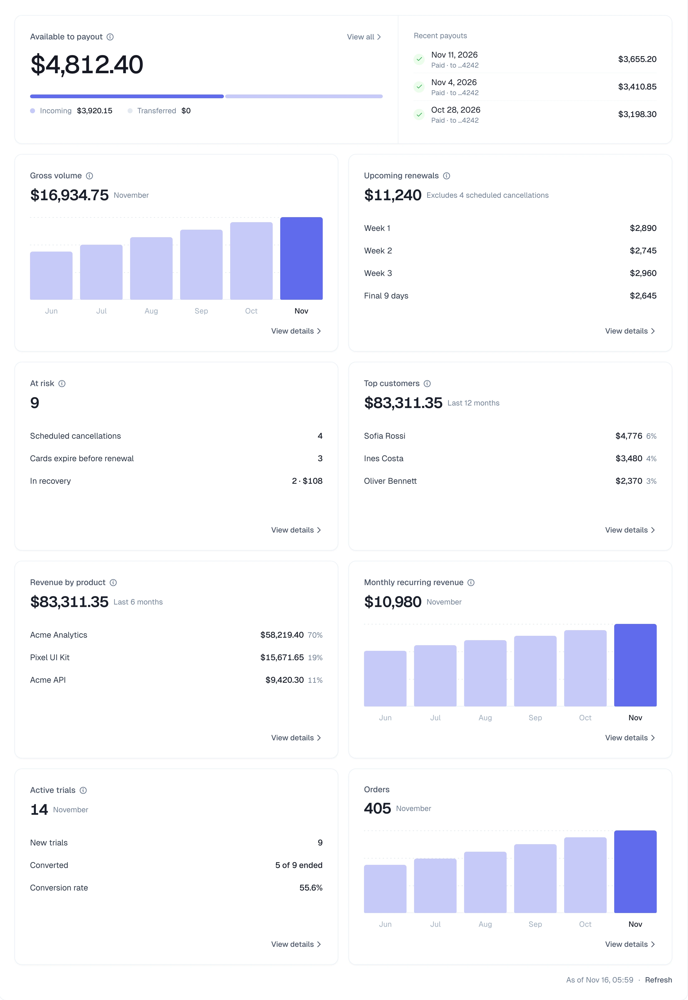
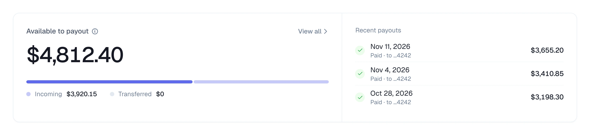
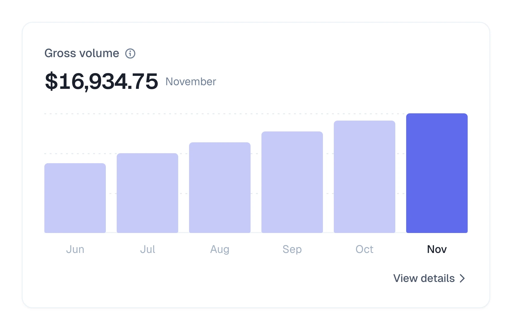
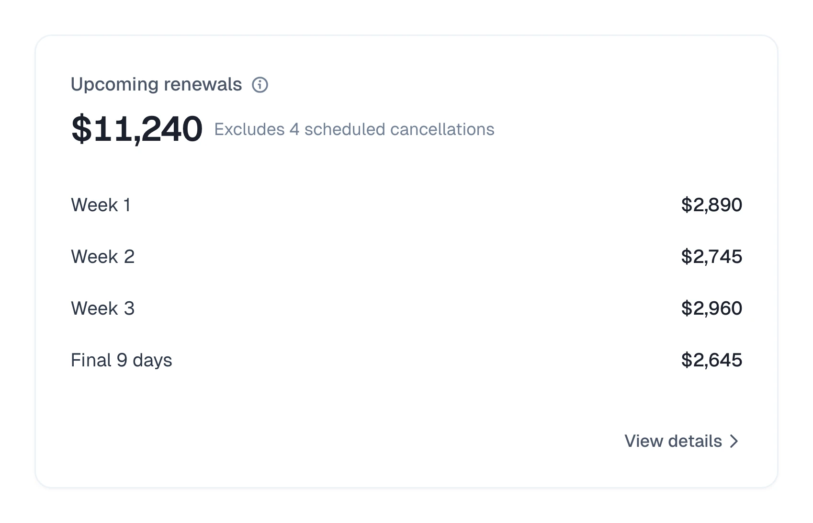
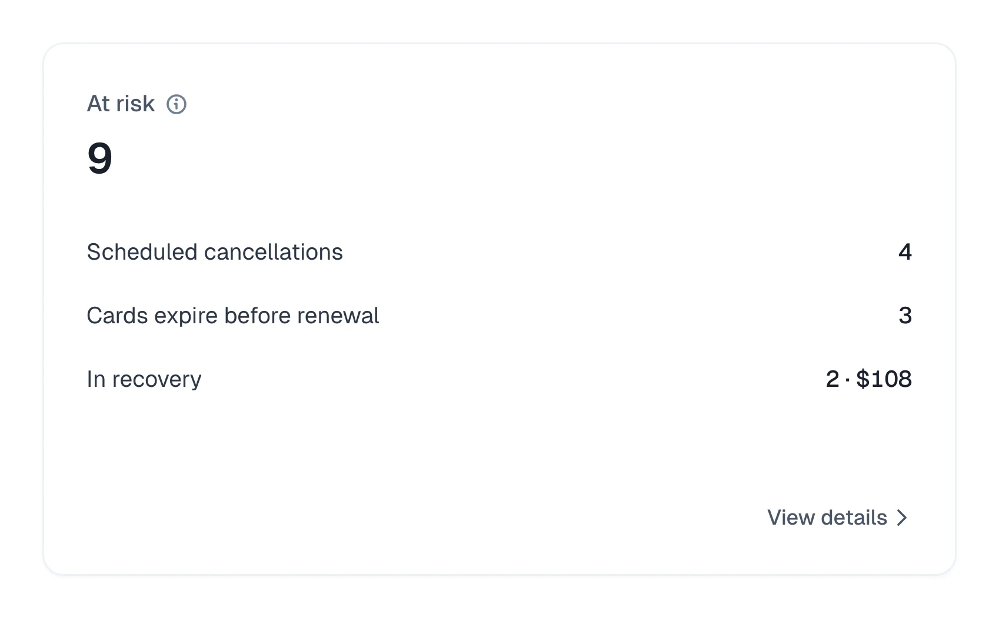
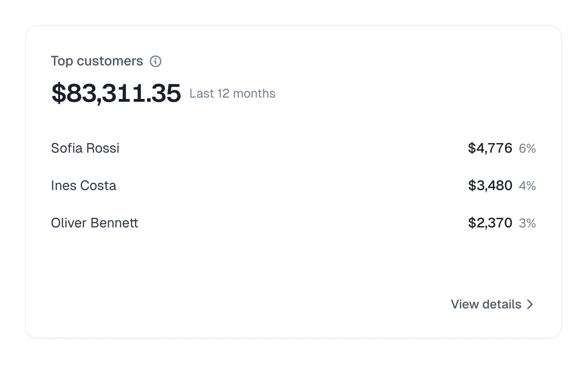
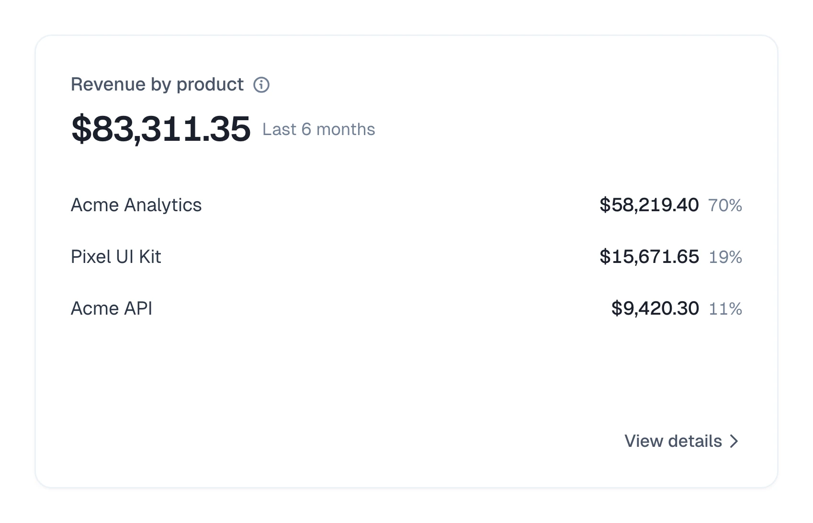
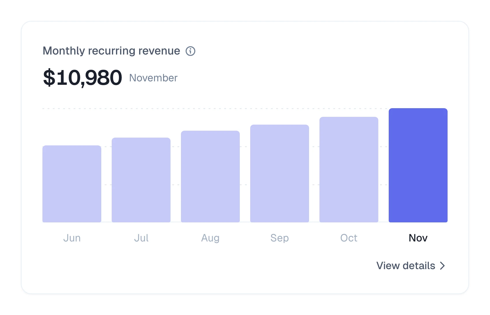
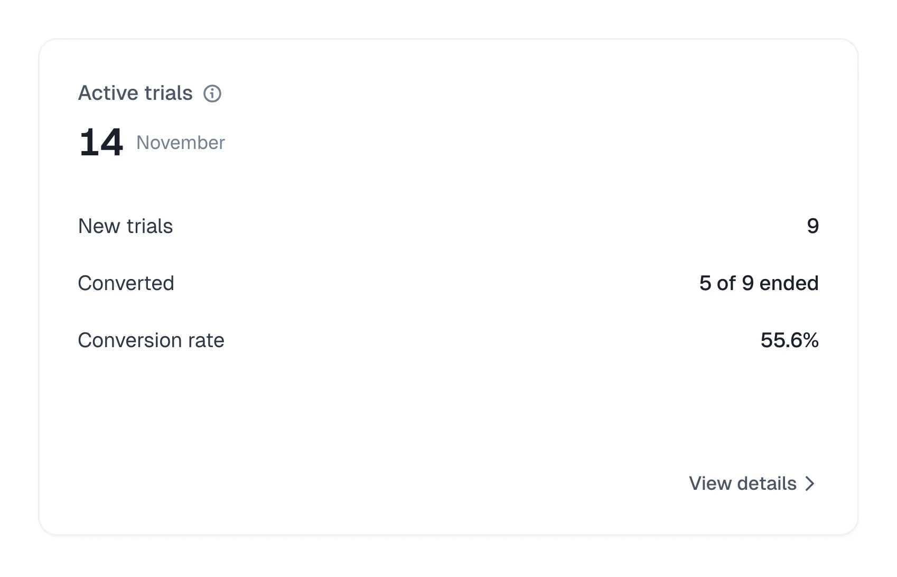
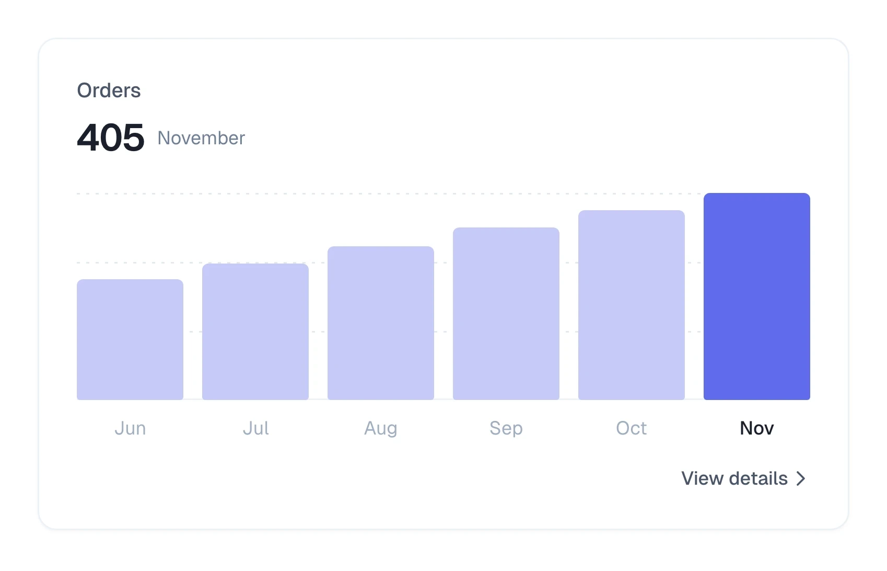

**Home** is the first page you see in the dashboard. Its cards show how your business is doing today, using the payments Kelviq already processes. For trends over time, filters and every metric, open [Analytics](/analytics/overview).

<Frame>
  
</Frame>

## Cards

| Card | What it shows |
| --- | --- |
| **Available to payout** | What you can be paid now, and your recent payouts. New earnings move to your available balance after 7 days. |
| **Gross volume** | Paid order revenue before tax, fees, refunds and disputes, by month. |
| **Upcoming renewals** | What's due to renew in the next 30 days, split into date ranges. Scheduled cancellations are excluded. |
| **At risk** | Scheduled cancellations, cards that expire before renewal, and open failed invoices with a retry scheduled. |
| **Top customers** | The three customers with the most revenue. |
| **Revenue by product** | Gross volume per product. |
| **Monthly recurring revenue** | MRR at the end of each month; today for the current month. |
| **Active trials** | Trials started and not yet ended as of today, with new trials and the conversion rate. |
| **Orders** | Paid orders by month. |

<Frame>
  
</Frame>

<Columns cols={2}>
  <Frame>
    
  </Frame>
  <Frame>
    
  </Frame>
  <Frame>
    
  </Frame>
  <Frame>
    
  </Frame>
  <Frame>
    
  </Frame>
  <Frame>
    
  </Frame>
  <Frame>
    
  </Frame>
  <Frame>
    
  </Frame>
</Columns>

**View details** on a card opens the same metric in [Analytics](/analytics/overview), or the **Orders** list for the Orders card. **View all** on **Available to payout** opens **Payouts**.

Home shows when the numbers were last updated, for example "As of Nov 9, 14:30". Click **Refresh** to reload them.

<Frame>
  
</Frame>
