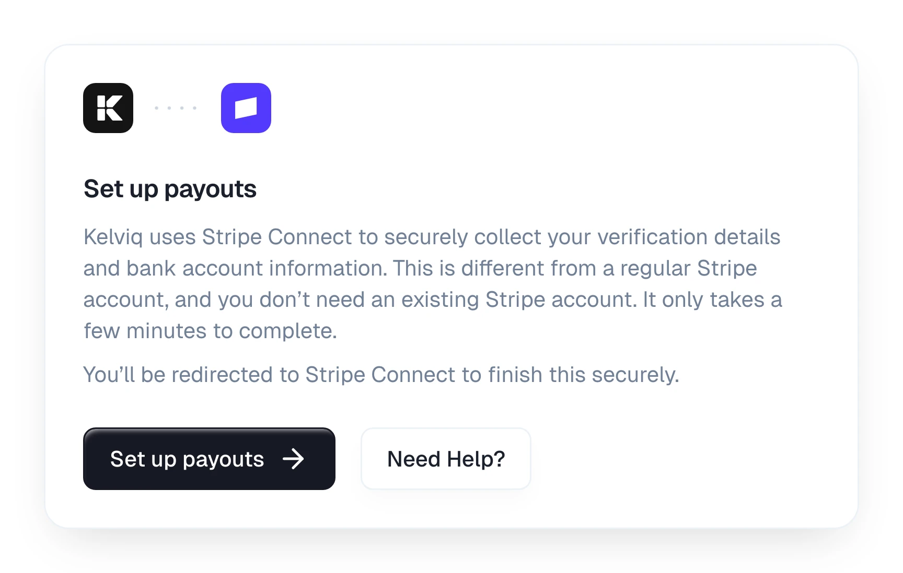
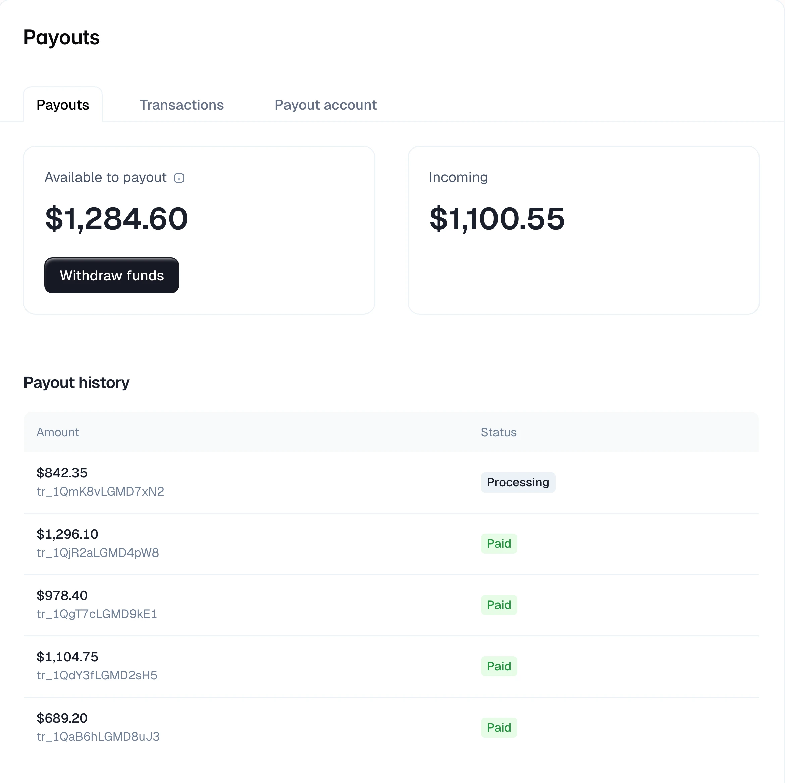

Kelviq pays your earnings to your bank account.

## Setup

To get paid, connect your bank account. You can do this once your business is verified; until then, **Payouts** shows your next step. See [Review process](/getstarted/review-process).

<Steps>
  <Step title="Connect account">
    Click **Payouts** in the sidebar, then click **Set up payouts**.
  </Step>
  <Step title="Complete onboarding">
    You're redirected to Stripe Connect to finish securely. Choose your account type (Individual or Company), verify your details and add your bank account. It takes a few minutes.
  </Step>
</Steps>

<Frame>
  
</Frame>

## Dashboard

Once set up, **Payouts** has three tabs: **Payouts**, **Transactions** and **Payout account**. The **Payouts** tab gives you a snapshot of your cash flow.

<Frame>
  
</Frame>

### Key metrics
* **Available to payout**
  The funds that have cleared and are ready to be transferred to your bank.
  Click **Withdraw funds** to send them to your bank now instead of waiting for the next scheduled payout.
* **Incoming**
  Sales that haven't cleared yet. Each one becomes available 7 days after the payment.

### Payout history
Below the metrics, **Payout history** lists every payout we have sent to your bank. Each row shows the amount, the transfer ID, and the status: **Pending**, **Processing**, **Transferred**, **Paid**, or **Failed**.

## Payout questions

### Do I need a Stripe account?

No. You don't need to sign up for Stripe or have a Stripe account to sell with Kelviq or to get paid.

When you click **Set up payouts**, you verify your identity and add your bank account in a short form run by Stripe Connect. This creates a payout account that only receives your earnings from Kelviq. It's different from a regular Stripe account: you don't sell through it, and Stripe's limits on which countries can open a regular account don't apply.

That's why sellers in countries where Stripe doesn't offer its own accounts, such as India, can still use Kelviq and receive payouts. Check that your country is in the [supported payout countries](/getstarted/review-process#supported-payout-countries) before you go live.

### How long does a payout take?

Funds from a sale are available to pay out 7 days after the payment. After Kelviq sends a payout, your bank takes a few business days to post it. Bank holidays can add time.

### What is the minimum payout?

The minimum payout amount is \$10, or the equivalent amount in the payout currency.

### Are there payout fees?

No. Your full cleared balance is sent to your bank account or eligible debit card. If your bank account uses a different currency, the amount is converted when the payout is sent.

[See the full fee schedule →](/getstarted/fees)

### Do I need a registered company?

No. You can complete payout onboarding as an individual. If you are a sole proprietor and do not have a separate registered company, select **Individual** and provide your own legal and tax details.

### Can I receive a payout in another currency?

Yes. For example, a seller in Canada can receive a payout in USD when the connected bank account accepts USD and that payout currency is available through Stripe Connect. The payout currency follows the connected bank account. Kelviq charges no payout fee. If your bank account is in another currency, Stripe converts the payout at its exchange rate, which can include a conversion fee.
