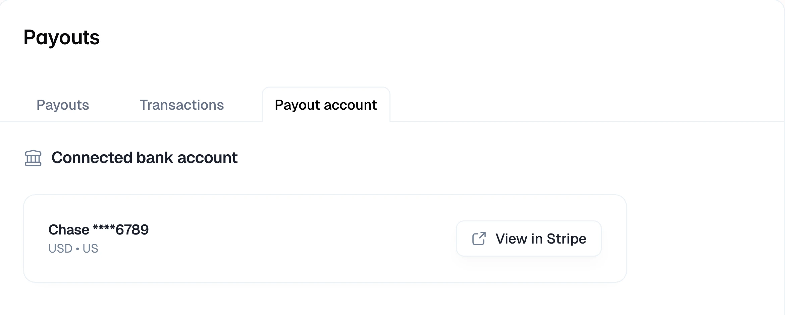
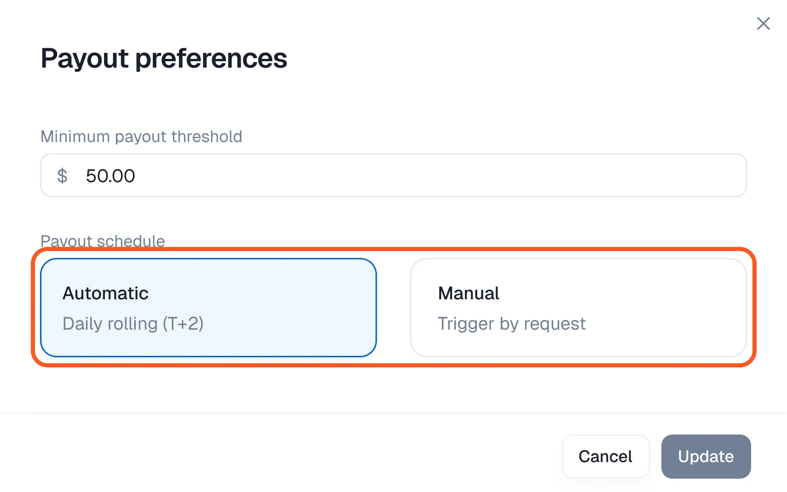

The **Payout account** tab on **Payouts** shows the bank account your earnings are paid to.

<Frame>
  
</Frame>

## Bank account
The card shows the bank, the last four digits, the currency and the country. Click **View in Stripe** to see your full verification status and bank details in Stripe Connect, or to change the account.

{/*
## Schedule & preferences
Click **Edit** to customize your payout logic.

### Payout schedule
Choose how often you want to receive funds.
<Frame>
  
</Frame>
* **Automatic:** Set transfers to occur daily, weekly, or monthly.
* **Manual:** Funds sit in your account until you explicitly click "Withdraw."

### Thresholds & Timing
* **Thresholds:** Set a minimum amount required before a payout is triggered (e.g. only pay me out when I hit $100).
* **Timing:** If you select weekly or monthly, you can adjust the specific day of the week or date of the month for the transfer.
*/}