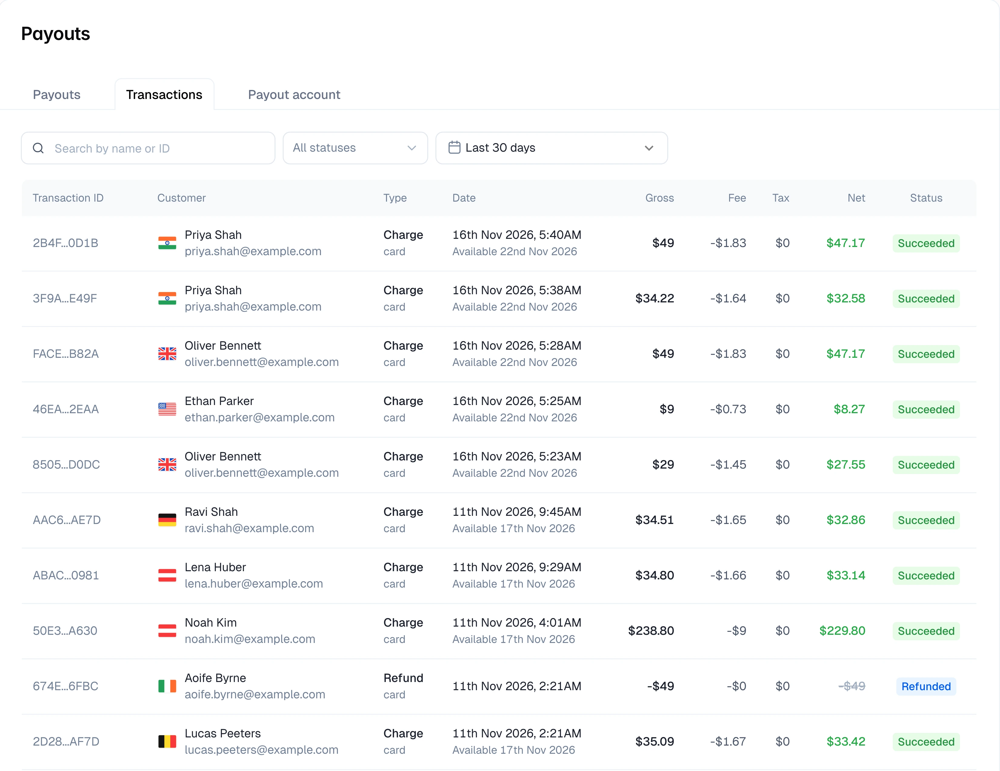
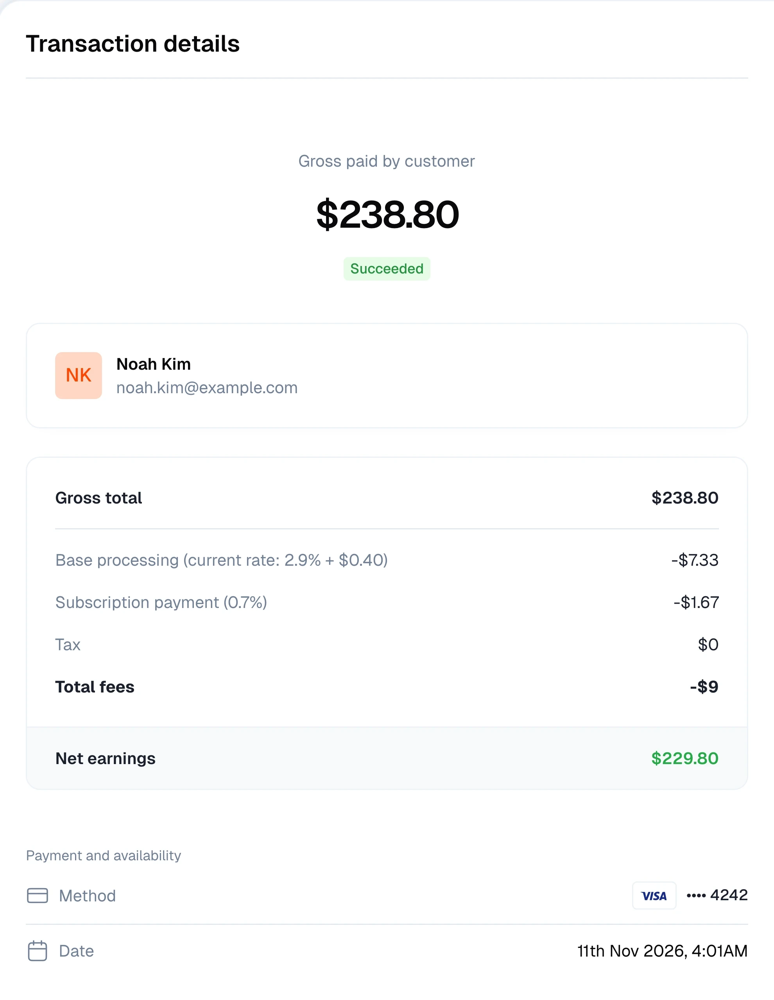

The **Transactions** tab shows successful payments, refunds, and failed payments. Use it to see what the customer paid, the fees and tax deducted, and the amount added to your balance.

<Frame>
  
</Frame>

## Filtering

Each row shows the transaction ID, customer, type, date, gross, fee, tax, net, and status. Filter the list by status to find specific issues:

* **Success:** Completed payments. Shown as **Succeeded**, or **Refunded** or **Disputed** if the money was later returned or charged back.
* **Failure:** Declined cards or failed transfers. Shown as **Failed**.
* **Pending:** Payments that have not finished processing.

The search field also matches payment method types. Search for `upi`, `card`, `link`, `amazon_pay`, or `sepa_debit` to see payments made through that method.

## Transaction details

Click a transaction row to open its details.

* **Gross total:** The full amount charged to the customer, including tax.
* **Total fees:** The combined transaction fees deducted by Kelviq, itemized line by line.
* **Tax:** Tax collected for the transaction and excluded from your net earnings.
* **Net earnings:** The amount added to your Kelviq balance after transaction fees and tax. There's no payout fee, so nothing more is deducted when the balance is sent to your bank.
* **Payment and availability:** The payment method and date.

<Frame>
  
</Frame>

For a successful transaction:

```text
Net = Gross - Fee - Tax
```

## How the Fee column is calculated

The **Fee** column shows one combined amount. Depending on the transaction, that amount can contain up to three components:

| Component | Rate | When it applies |
| --- | --- | --- |
| Base fee before &#36;5,000 in total volume | 2.9% + &#36;0.40 | Transactions processed before your organization reaches &#36;5,000 in cumulative sales |
| Base fee after &#36;5,000 in total volume | 3.5% + &#36;0.40 | Subsequent transactions after your organization reaches &#36;5,000 in cumulative sales |
| Recurring billing | +0.7% | Subscription payments and renewals |
| International card | +1.5% | Cards issued outside the United States |

Recurring and international-card fees are added to the base rate when they apply. For example, an international subscription payment processed after the &#36;5,000 threshold is charged 5.7% + &#36;0.40: 3.5% base, 0.7% recurring, and 1.5% international.

### Example

For a &#36;57.60 domestic, one-time payment processed after the &#36;5,000 threshold:

```text
Fee = ($57.60 × 3.5%) + $0.40
    = $2.42 after rounding

Net = $57.60 gross - $2.42 fee - $9.60 tax
    = $45.58
```

The percentage is calculated from the gross customer charge. The fixed &#36;0.40 is added once. Kelviq rounds the final fee to the smallest unit of the transaction currency.

[See the complete fee table and more examples →](/getstarted/fees)

<Info>
  There's no payout fee. See [Payout fees](/getstarted/fees#payout-fees).
</Info>
