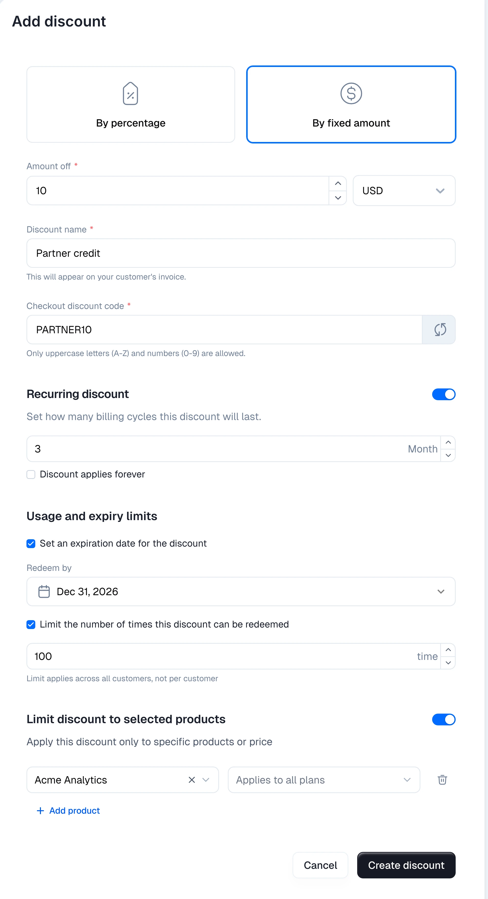
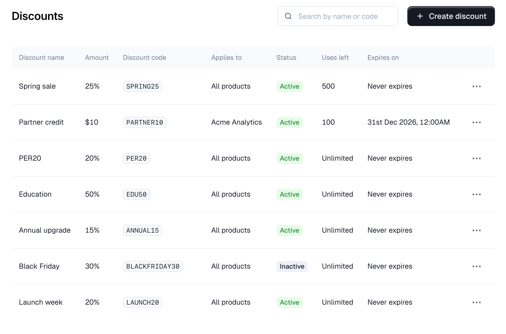
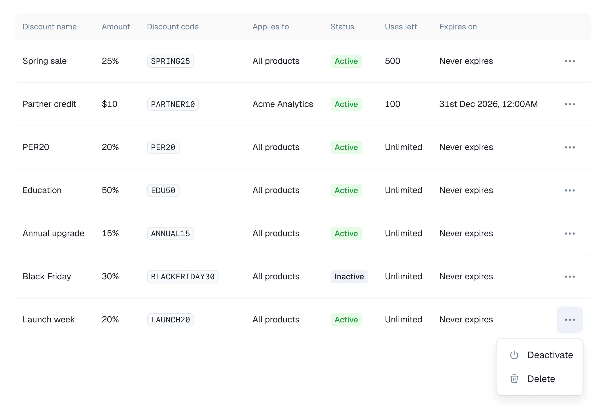

You can manage all your coupons from the **Product catalog**.

Go to **Product catalog → Discounts** to see a list of every active and inactive code.

You can create two types of discounts:

* **By percentage** — Reduces an eligible price by a percentage, such as 20%.
* **By fixed amount** — Subtracts a specific amount in a selected currency, such as USD 10 or INR 500.

For a fixed-amount discount, select the currency next to the amount. Kelviq places the currency from your organization profile first in the list, but you should still review the selection before creating the discount.

## Create a discount

<Steps>
  <Step title="Start creation">
    Click **Create discount** in the top right corner. The **Add discount** panel opens.
  </Step>
  <Step title="Define value">
    Choose the discount type (**By percentage** or **By fixed amount**) and enter the **Percentage off** or **Amount off**.
    * **Discount name:** Appears on your customer's invoice.
    * **Checkout discount code:** The text the customer enters at checkout. You can type your own or click the **refresh icon** to auto-generate a random code. Only uppercase letters (A-Z) and numbers (0-9), up to 32 characters.
  </Step>
  <Step title="Configure rules">
    Set the duration, limits, and product scope (detailed below).
  </Step>
  <Step title="Create">
    Click **Create discount** to make the code live immediately.
  </Step>
</Steps>

<Frame>
  
</Frame>

## Configuration options

You can control exactly how and when a discount applies.

### Duration
Recurring discount settings are enabled by default. Choose how long the discount should apply:

* Enter a number of billing cycles for a limited recurring discount.
* Select **Discount applies forever** to apply it to every eligible recurring invoice.
* Turn off **Recurring discount** when the code should apply only to the initial purchase.

### Usage and expiry limits
Control the scarcity of the coupon.
* **Set an expiration date for the discount:** Pick a **Redeem by** date after which the code stops working.
* **Limit the number of times this discount can be redeemed:** Set a total number of redemptions (e.g. "First 100 users"). The limit applies across all customers, not per customer.

### Product restrictions
By default, a discount applies to the entire catalog. To restrict it:

1. Enable **Limit discount to selected products**.
2. Select a product in every row. Click **Add product** to add another row.
3. Optionally select a specific plan price. Choose **Applies to all plans** to include every price under that product.

Kelviq will not create the discount while a restriction row has no product selected.

For fixed-amount discounts, the discount currency must match the currency of the selected price. Kelviq shows a validation error when the currencies do not match.

## Apply a discount at checkout

Customers can enter a code themselves, or you can pre-apply one through the Checkout API or a static checkout link. See [Apply a discount code at checkout](/checkout/apply-a-discount-code) for working examples and field names.

## Management

The main discounts tab shows the status of every code you have created.

<Frame>
  
</Frame>

* **Active:** The code is live and redeemable.
* **Inactive:** The code is turned off. Use the row menu to **Activate** or **Deactivate** a code.

<Frame>
  
</Frame>

The list also shows **Uses left** and **Expires on** for each code.
