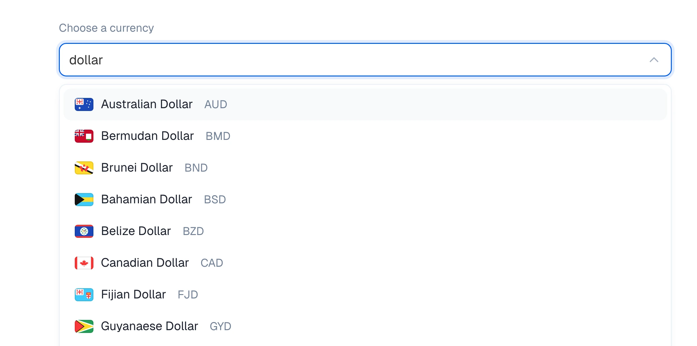
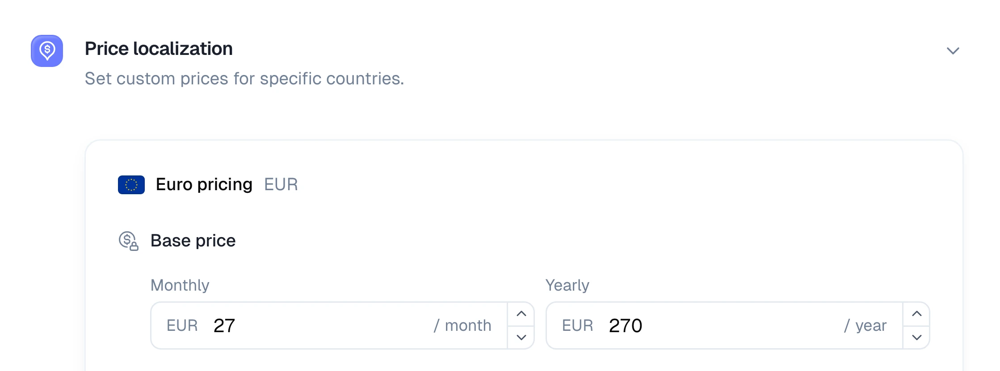
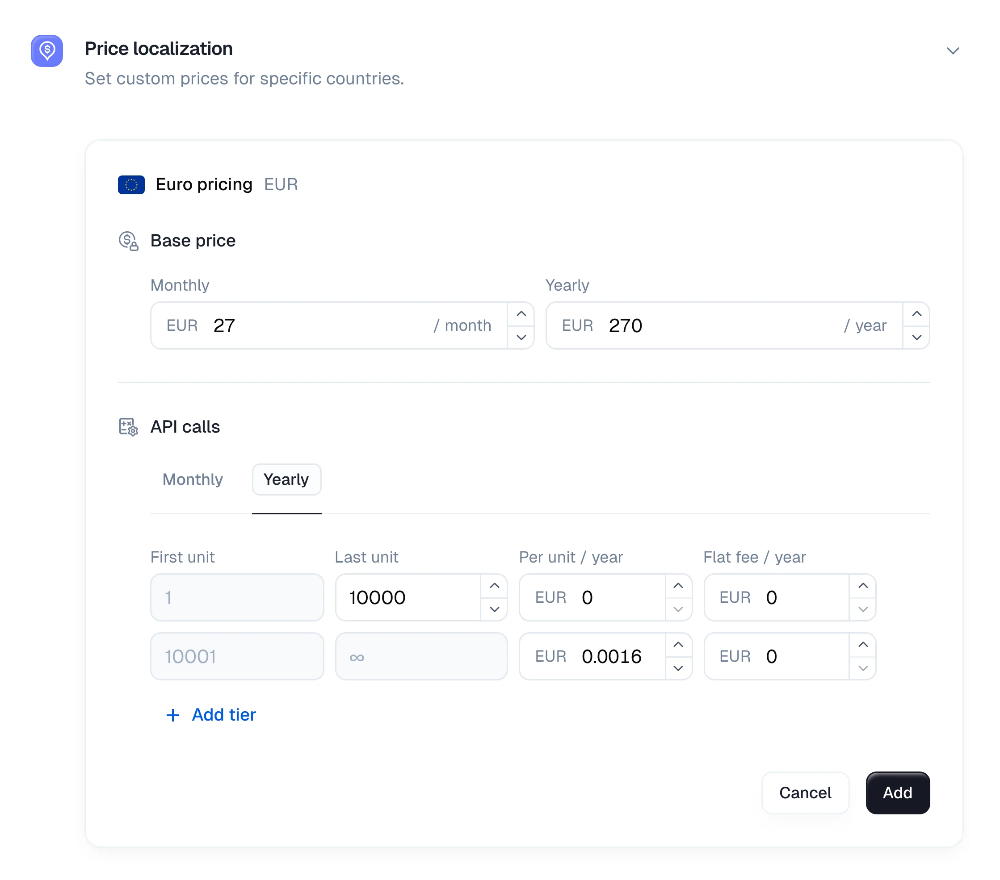
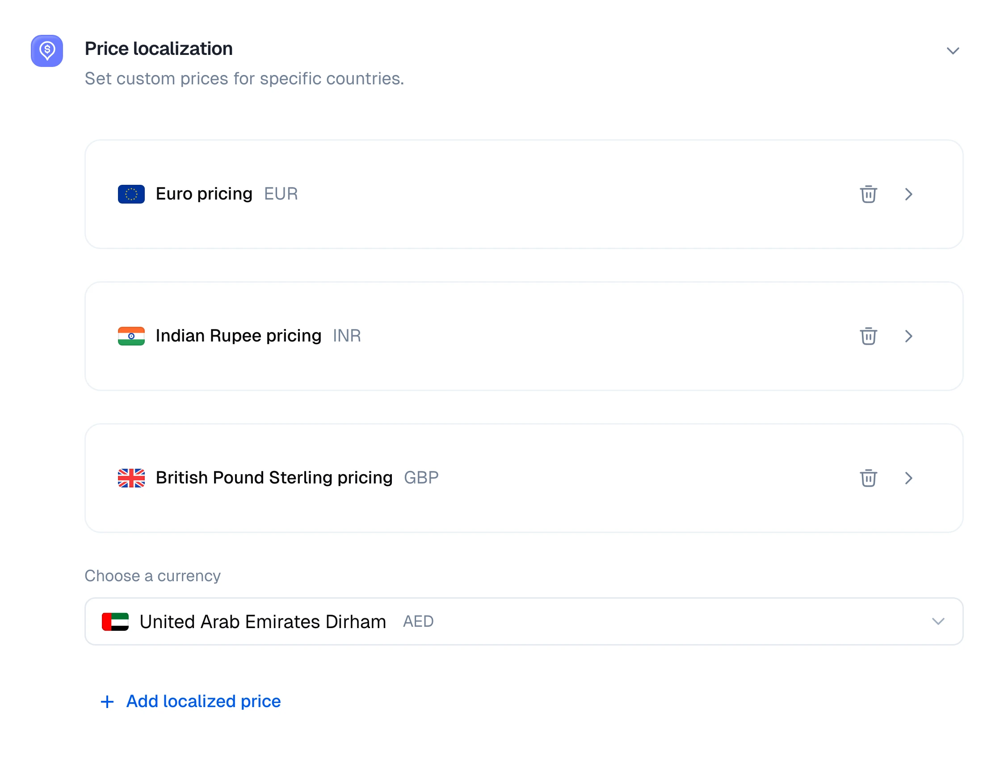

Price localization lets you set custom prices for specific countries to optimize global conversion.

## Set up localized prices

To offer a localized price, open your plan's pricing and expand the **Price localization** card.

<Info>
  Localized prices inherit the base price's usage reset, usage alert, and credit rollover settings. Price localization changes the localized monetary price; it does not create a separate usage-policy configuration.
</Info>

### 1. Choose a currency

Under **Choose a currency**, select your target currency, such as Euro or Indian Rupee. Click **Add localized price** to open the price card for that currency.

<Frame>
  
</Frame>

### 2. Set the fixed base charge

Kelviq automatically displays the billing cycles you already enabled for your default base price and usage-based pricing. Enter the exact localized amount you want to charge for each active interval.

<Frame>
  
</Frame>

### 3. Localize usage-based features

If your plan includes Meter features like API calls, Kelviq pulls those in automatically right below the fixed charge section. You can set localized unit prices and flat fees for every single usage tier.

You must configure these usage rates across all active billing periods. Use the tabs to switch between your monthly and yearly configurations and ensure every input has a defined price.

<Frame>
  
</Frame>

### 4. Save and stack regions

Click **Add** to save the localized price. The currency appears in your **Price localization** list.

<Frame>
  
</Frame>

You can repeat this process to add as many localized currencies as you need. 

