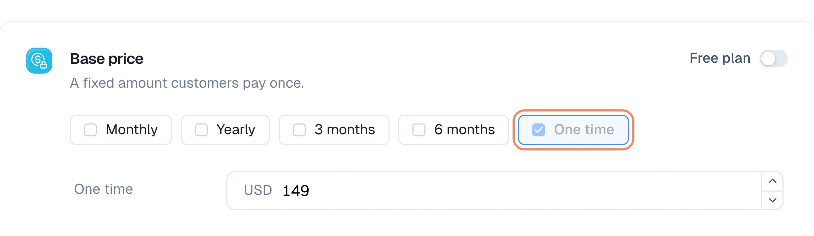

Not every product needs a subscription. If you are selling a lifetime software license, a template, or charging a one-time setup fee for an AI agent, you use a flat base price.

## Set up a one-time price

<Frame>
  
</Frame>

1. Open your draft plan and click **Set price** in the **Price** section (or the edit icon if the plan already has a price). Leave **Free plan** turned off.
2. Select **One time**.
3. Enter the amount customers pay.
4. Click **Save**.

<Info>
  Free trials work on recurring billing cycles. To offer one, add and enable a recurring billing cycle on the plan.
</Info>

Customers pay this amount exactly once during checkout. If you attach digital downloads or license keys to this plan they gain permanent access to those assets immediately after payment.

If an existing customer already has a saved payment method, you can also [create a one-time charge from your backend](/sales/create-a-one-time-charge) without sending them through checkout again.

## Combine with usage

To charge a fixed fee plus usage, use a **Monthly** price with a Pay as you go usage charge. Pay as you go bills monthly, so it pairs with Monthly prices. See [Pay as you go](/product-catalog/pay-as-you-go).
