A plan is the commercial package you offer to customers. It bundles your pricing logic with the actual value you deliver, such as software downloads, community access, or feature limits.

You can create multiple plans for a single product. For example, you might have a "Starter" plan for hobbyists and a "Pro" plan for businesses.

For sales-led pricing, see [Create an Enterprise plan](/product-catalog/create-an-enterprise-plan). It covers both reusable Enterprise tiers and bespoke customer amounts.

## Plan structure

Every plan consists of configurable components that define what the user gets.

<CardGroup cols={2}>
  <Card title="Pricing" icon="tag">
    Define the cost. Choose between recurring subscriptions (monthly/yearly) or one-time lifetime payments.
  </Card>
  <Card title="License keys" icon="key">
    Issue software licenses. Generate unique keys upon purchase and enforce activation limits.
  </Card>
  <Card title="Features & limits" icon="sliders">
    Set limits. Control access to specific features, API quotas, or seat limits via the SDK.
  </Card>
  <Card title="Downloads" icon="download">
    Attach files. Upload software binaries, e-books, or course content.
  </Card>
  <Card title="Links" icon="link">
    Grant access. Direct customers to private Discord servers or Notion templates.
  </Card>
</CardGroup>

## Plan lifecycle

You manage plans through a simple status flow.

* **Draft**
    The default state for new plans. These are not visible to customers.
* **Published**
    The plan is live and checkout is enabled.
* **Unpublished version**
    A draft version of an existing published plan. You are editing a copy, so your live plan remains safe until you hit publish again.

The status badge shows next to the plan's identifier on the plan page.

<Frame>
  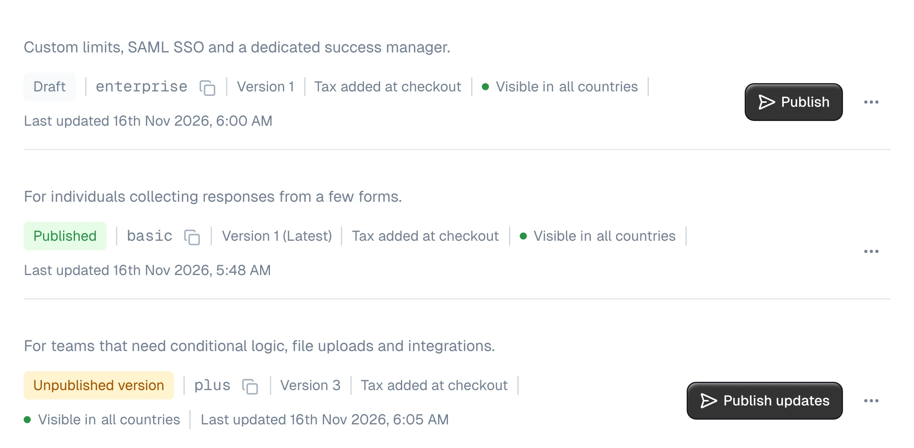
</Frame>

---

## Create a plan

You create plans directly inside a product container.

<Steps>
  <Step title="Start creation">
    Open the product and click **Create plan**.
    <Frame>
      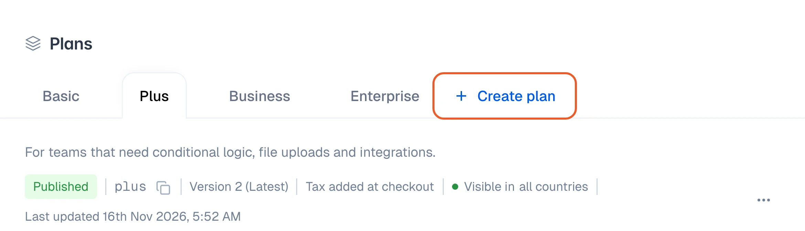
    </Frame>
  </Step>
  <Step title="Define basics">
    Fill in the plan details.
    * **Plan name:** The public name (e.g. "Pro", "Starter").
    * **Identifier:** The unique ID used in your code. You can override the auto-generated ID.
    * **Description:** Optional text shown on invoices and checkout.
    <Frame>
      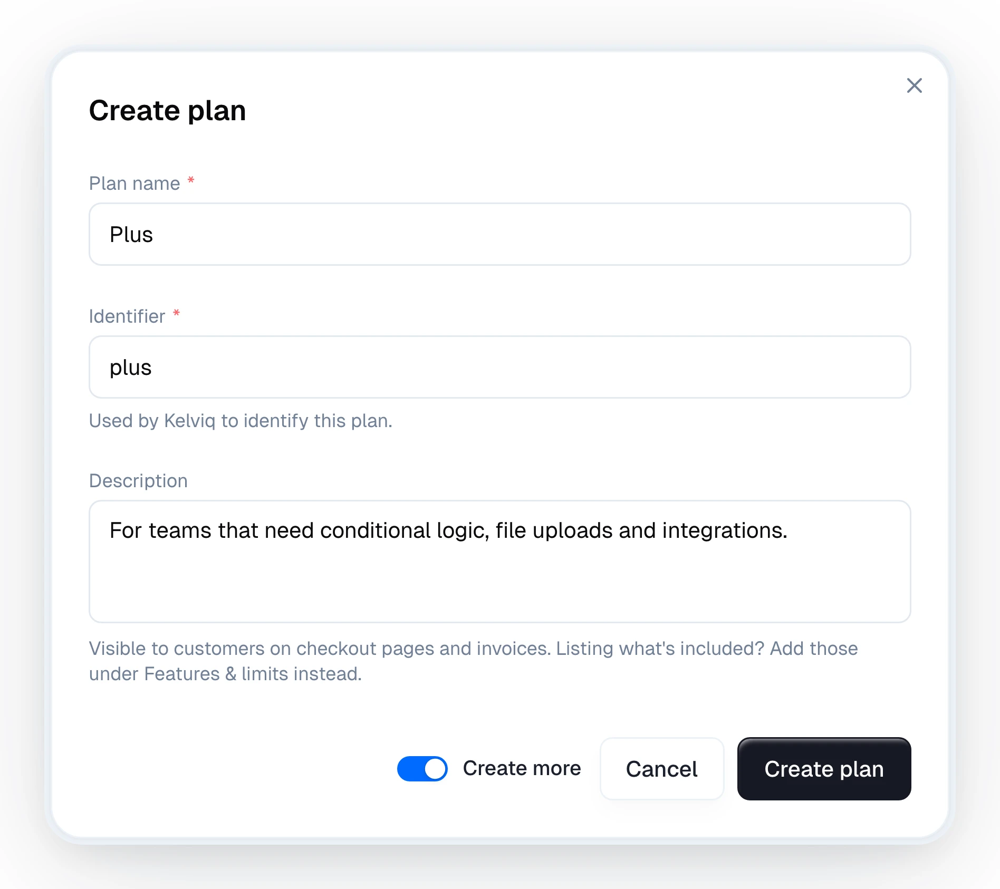
    </Frame>
    <Tip>
      Enable the **Create more** toggle to quickly add multiple plans in a row without closing the modal.
    </Tip>
  </Step>
  <Step title="Save draft">
    Click **Create plan**. The plan opens as a **Draft** until you publish it.
  </Step>
</Steps>

---

## Configure pricing

Open a draft plan and click **Set price** in the **Price** section. The price editor opens in place. The first step is to set how you charge.

## Pricing models

Once your plan draft exists you can configure how you charge. We split these into dedicated guides.

* [One-time payments](/product-catalog/one-time-payments)
* [Subscriptions](/product-catalog/subscriptions)
* [Enterprise and bespoke plans](/product-catalog/create-an-enterprise-plan)
* [Seat-based pricing](/product-catalog/seat-based-pricing)
* [Usage-based pricing](/product-catalog/usage-based-billing)
* [Free plans and trials](/product-catalog/free-and-trials)
* [Price localization](/product-catalog/location-based-pricing)

<Frame>
  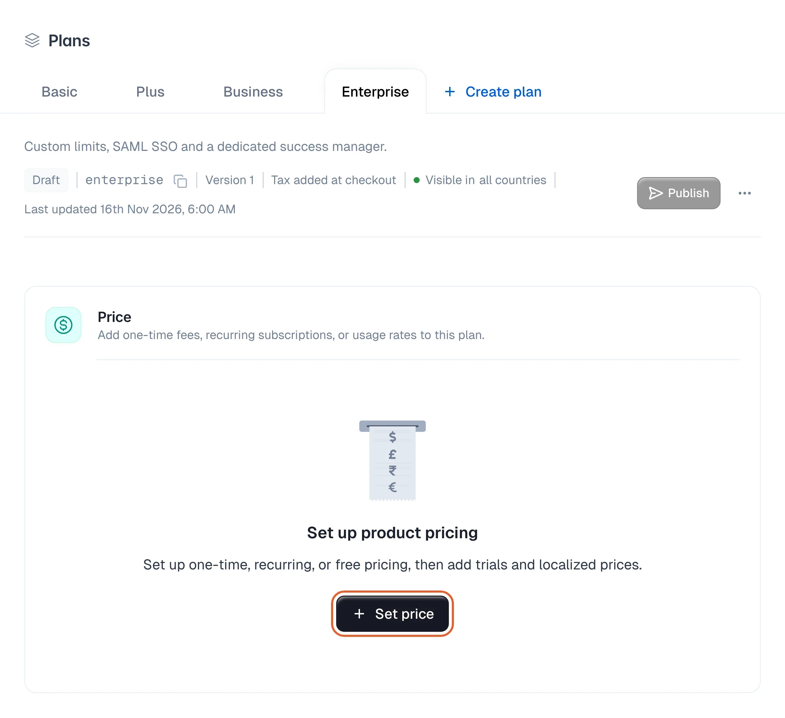
</Frame>

### Free vs. Paid
Turn on **Free plan** at the top right of **Base price** for a plan with no price.
<Frame>
  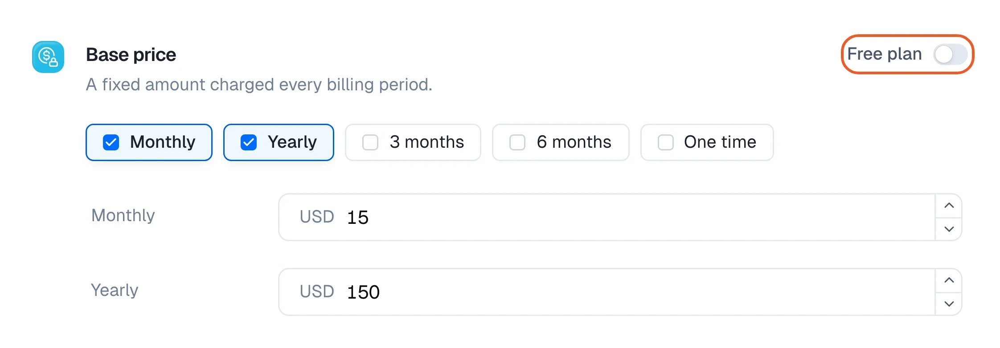
</Frame>
* **Free plan:** Users are not charged. Useful for lead magnets or open-source tiers.
* **Paid plan:** Unlocks the billing configuration options below.

### Billing cycles
Select the intervals you want to offer. You can enable multiple intervals for a single plan. The list shows only the periods enabled for your organization.
<Frame>
  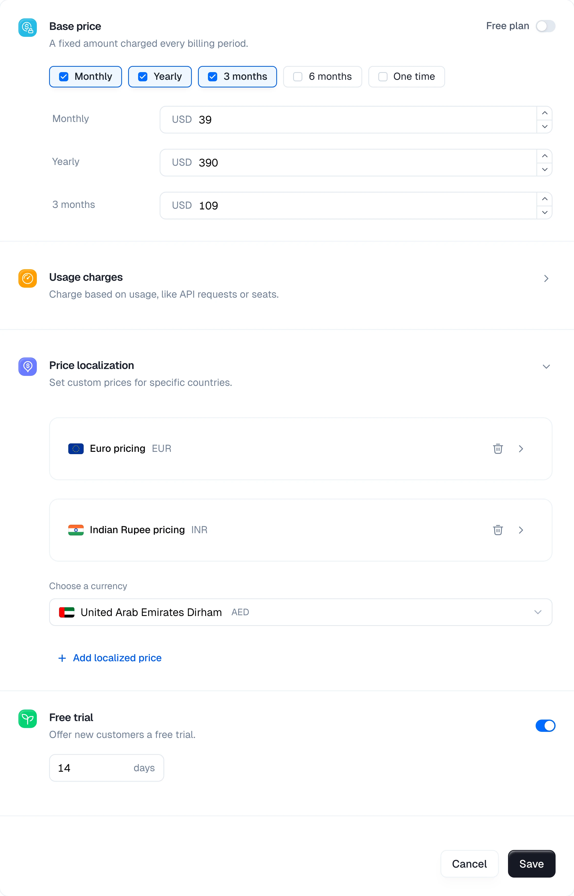
</Frame>
* **28 days:** A recurring four-week subscription. Shown once we enable it for your organization.
* **Monthly / Yearly:** Standard recurring subscriptions.
* **3 months:** Quarterly billing.
* **6 months:** Billing twice a year.
* **Weekly / Daily:** Short billing periods, shown once we enable them for your organization.
* **One time:** A single non-recurring payment (lifetime deal).

The 28-day period is useful when you need a consistent four-week renewal schedule rather than a calendar-month renewal.

<Tip>
  To test a renewal without waiting a full month, ask support to enable daily billing for your sandbox. See [Test a subscription renewal](/guides/sandbox#test-a-subscription-renewal).
</Tip>

### Price localization
You can set specific prices for different countries rather than relying on auto-conversion.
1. In the price editor, expand **Price localization**.
2. Under **Choose a currency**, select a currency (e.g. EUR, INR) and click **Add localized price**.
3. Enter the price for each billing cycle, then click **Add** in that currency's panel.
4. Click **Save** at the bottom of the price editor.

<Frame>
  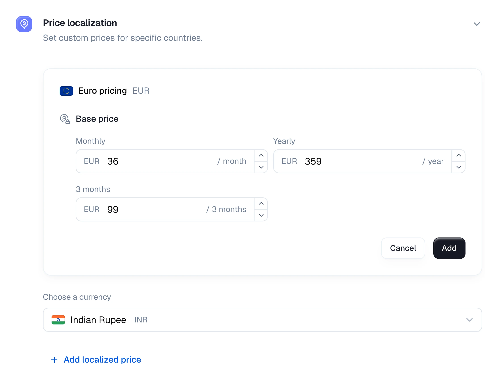
</Frame>

---

## Add deliverables

Configure what the customer receives immediately after purchase. These assets are delivered directly via the customer portal or email.

### Digital downloads
Upload files that are securely delivered after purchase.
1. Expand the **Digital downloads** accordion.
2. Drag and drop your files (up to 5 GB per file).
3. Customers will see these in their portal immediately after checkout.

### License keys
If you are selling software that requires activation, you can issue unique license keys.
1. Expand the **License keys** accordion.
2. **Activation limit:** Set how many machines or instances can use a single key (e.g. 1 for personal, 5 for team).
3. **License expiry:** Define how long the key remains valid (e.g. 1 Year).
4. Click **Save Changes**. On a published plan, this creates an unpublished version, so publish the update when you're ready.

### Links
Provide access to resources hosted elsewhere.
1. Expand the **Links** accordion.
2. Add the **Link name** (e.g. Private Discord community).
3. Add the **Link URL**.

---

## Features & limits
Configure feature access, usage quotas, and API limits.

* **Toggle features:** Turn specific capabilities on or off (e.g. "SSO Access").
* **Numeric limits:** Set quotas (e.g. "5 Projects", "10,000 API calls").

<Frame>
  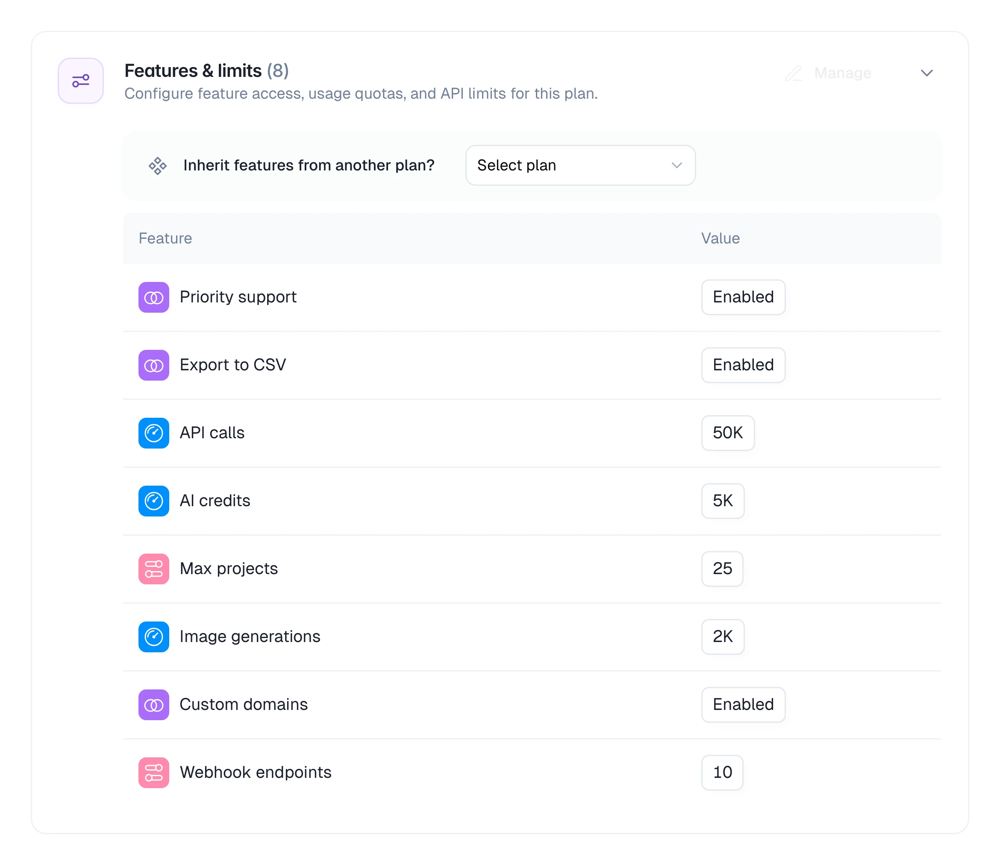
</Frame>

---

## Publishing & Versioning

We protect your live customers by creating a separate version when you edit a plan.

### How it works
* **Safe editing**
    When you edit a **Published** plan, we automatically create a new **Unpublished** version. Your live plan remains untouched so customers can keep buying without interruption.
* **Unpublished version**
    You will see a yellow **Unpublished version** badge indicating you are working on a draft version. You can make as many changes as you want here without affecting the live site.
* **Publishing**
    When you click **Publish updates**, this new version replaces the old one. The first time you publish a plan, click **Publish** and confirm. A dialog then shows the plan's checkout link to copy. In live mode, customers can buy the plan only after your [business is approved](/getstarted/review-process).

<Frame>
  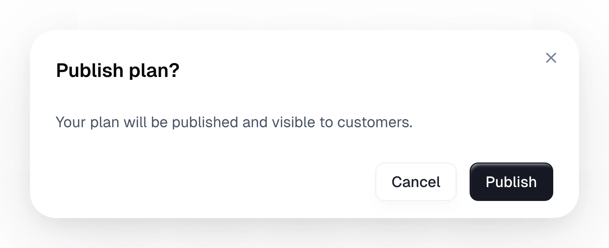
</Frame>

<Frame>
  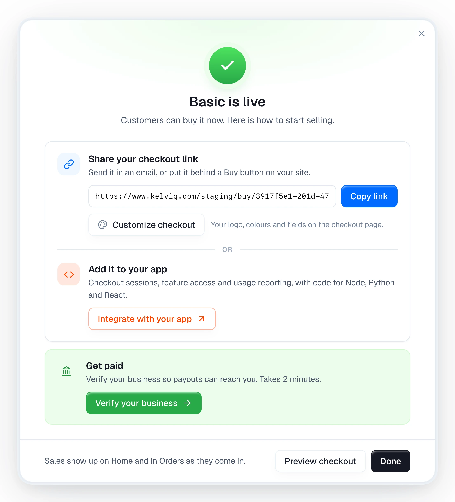
</Frame>

### Pushing updates
Because the new version replaces the old one, you need to decide what happens to your current subscribers.

When you click **Publish updates**, the **Publish your changes** dialog asks what happens to existing customers.

<Frame>
  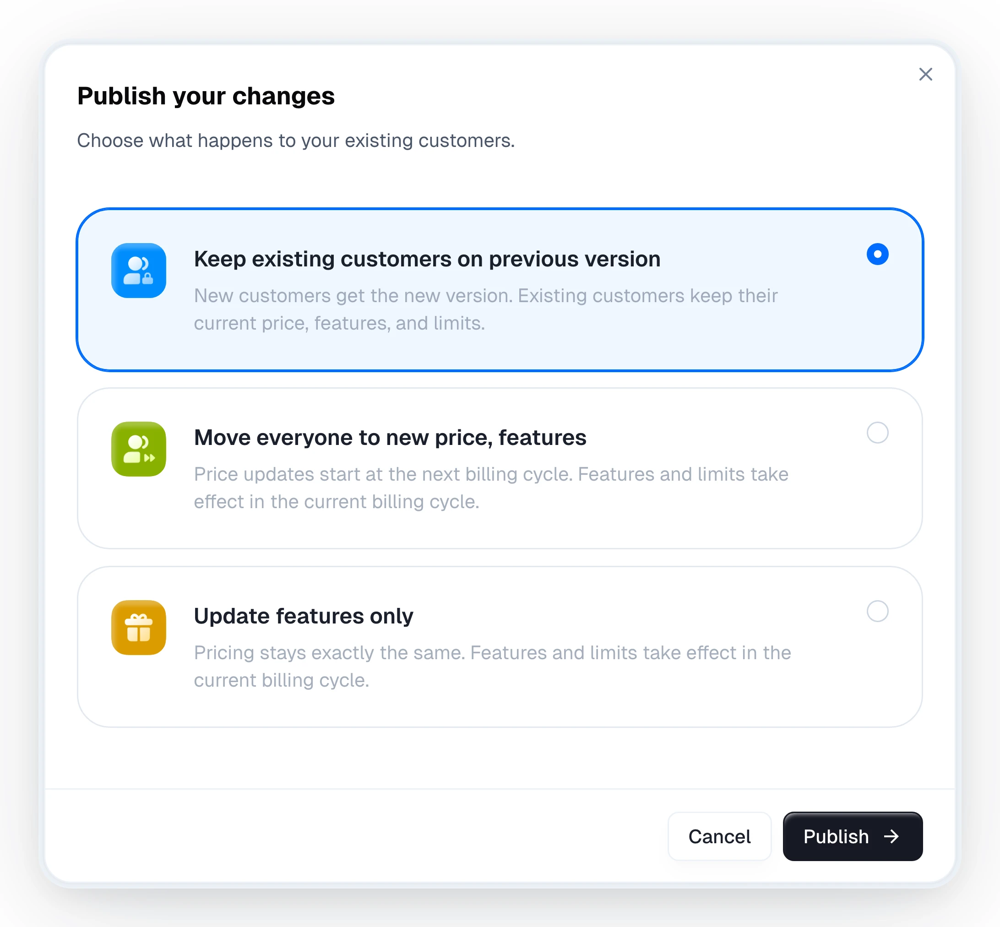
</Frame>

* **Keep existing customers on previous version:** New customers get the new version. Existing customers keep their current price, features, and limits.
* **Move everyone to new price, features:** Price updates start at the next billing cycle. Features and limits take effect in the current billing cycle.
* **Update features only:** Pricing stays exactly the same. Features and limits take effect in the current billing cycle.

If you grandfather existing customers, they keep their current price and only new customers see the updated price. If you migrate existing customers, the new price applies to their future renewals.

Most recurring card and debit-card payments do not require the customer to approve the new price again. Some payment methods have additional rules. For example, an Indian UPI AutoPay mandate may require the customer to approve a renewal when the updated amount exceeds the applicable regulatory threshold.

If you change your mind while editing, open the **⋯** menu and choose **Restore last published version** to discard the unpublished version and revert to the live state.

### Plan actions

Click the **⋯** menu next to the **Publish** button (**Publish updates** on a plan with unpublished changes) to see more options.

<Frame>
  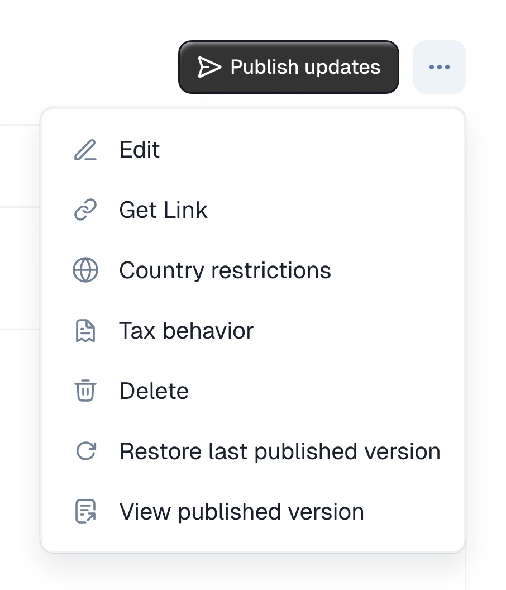
</Frame>

| Action | Description |
|--------|-------------|
| **Edit** | Open the plan configuration to make changes |
| **Get Link** | Copy the direct checkout link for this plan |
| **Country restrictions** | Limit which countries can purchase this plan |
| **Tax behavior** | Choose whether prices include tax or tax is added at checkout |
| **Delete** | Remove the plan |
| **Restore last published version** | Shown on a plan with unpublished changes. Discard unpublished changes and revert to the live version |
| **View published version** | Shown on a plan with unpublished changes. Preview what customers currently see on the live plan |
