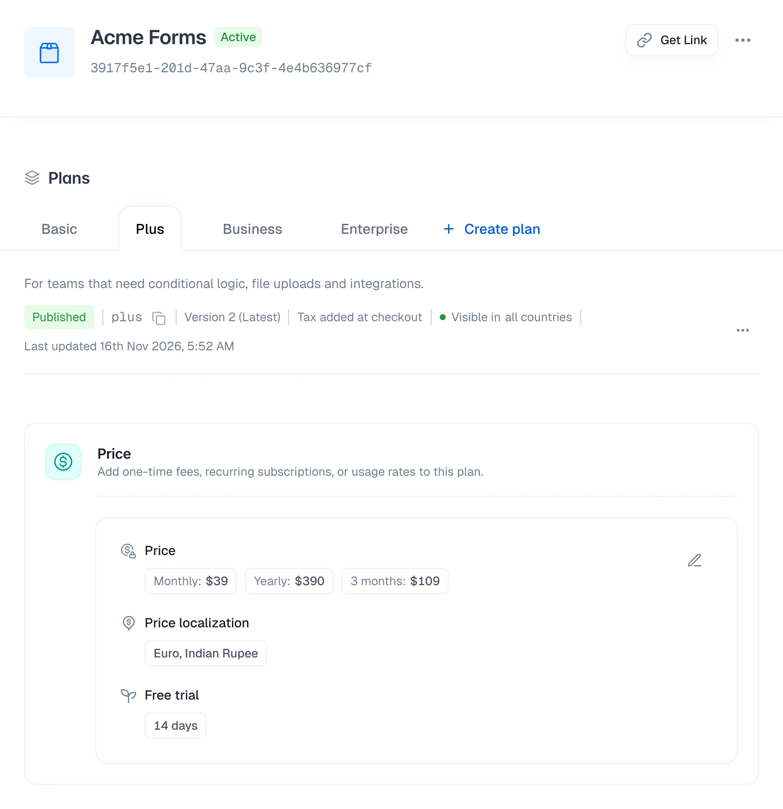
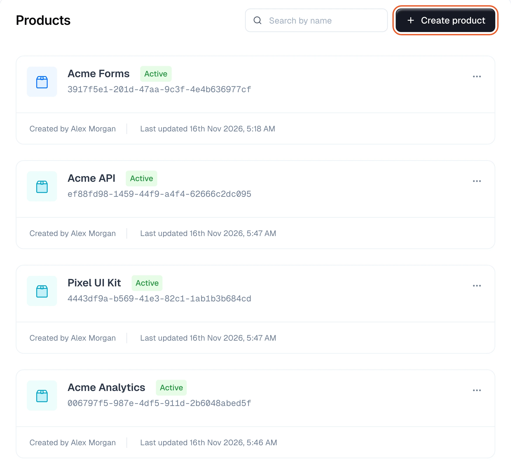
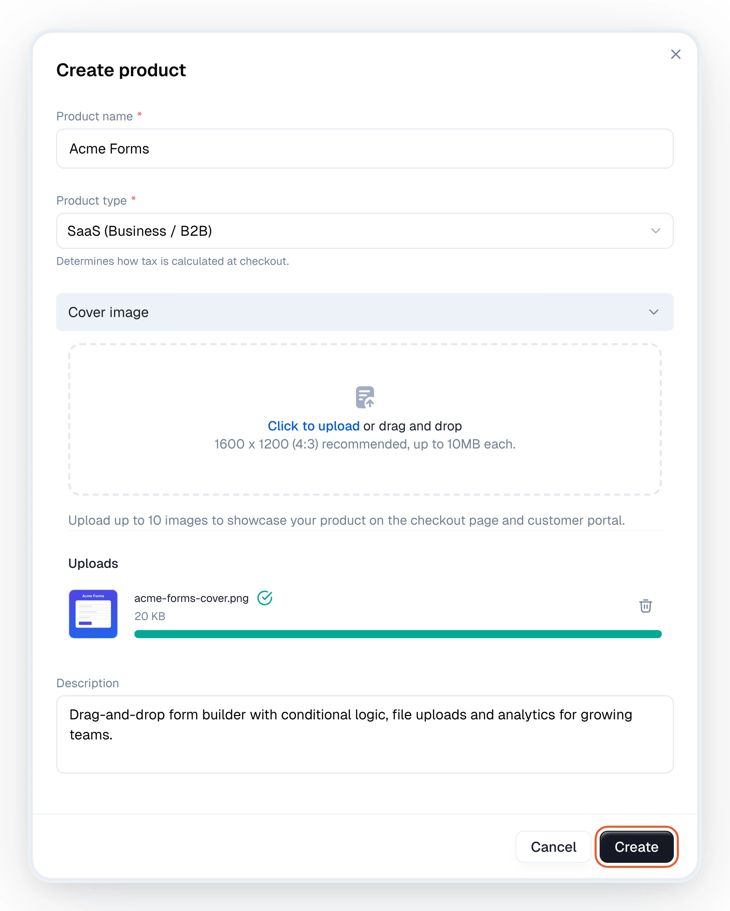

A product is the top-level container for what you sell. It groups together your pricing plans, features, and assets into a single family.

Before you can create plans or configure billing logic, you need to define the product they belong to.

<Frame>
  
</Frame>

## Create a product

Follow these steps to set up a new product.

<Steps>
  <Step title="Go to Products">
    Go to **Product catalog → Products** in the sidebar.
  </Step>
  <Step title="Start creation">
    Click **Create product** in the top right corner.
    <Frame>
      
    </Frame>
  </Step>
  <Step title="Enter details">
    Fill out the basic information for your product.

    * **Product name** — The public name shown to customers, such as “Pro Templates”.
    * **Product type** — What you sell, such as SaaS (Business / B2B) or E-books & Publications. It decides how tax is calculated at checkout.
    * **Cover image** — Upload up to 10 images to showcase the product on checkout and in the customer portal. 1600 × 1200 px (4:3) is recommended, up to 10MB each.
    * **Description** — A short summary of the offering.
    <Frame>
      
    </Frame>

    Kelviq assigns an internal UUID when the product is created. You do not need to create or manage a separate product identifier in the dashboard.
  </Step>
  <Step title="Finish">
    Click **Create**. You will be redirected to the product details page.
  </Step>
</Steps>

## Default currency

Each product has a default currency. Checkout shows that currency first, so set it to the currency most of your buyers pay in.

To change it, open the product's **⋯** menu and choose **Settings**.

<Warning>
  After you change the default currency, add a price in that currency to every plan in the product. A plan without one only appears in countries where it has a [localized price](/product-catalog/location-based-pricing).
</Warning>

## Next steps

Now that you have a product container, you can define the pricing plans and deliverables inside it.
