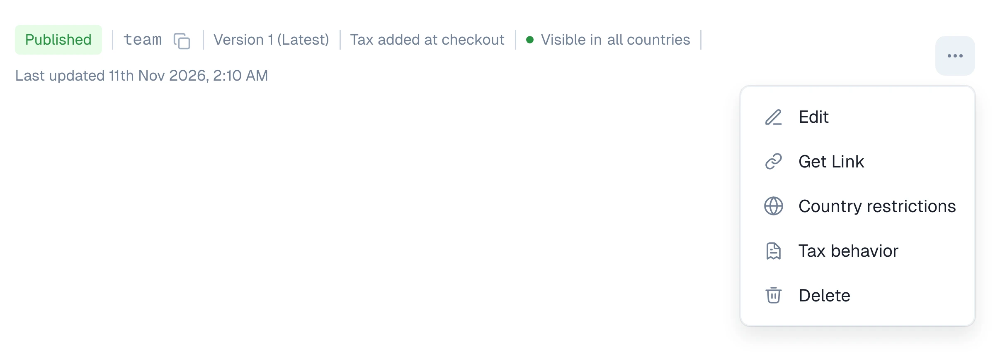
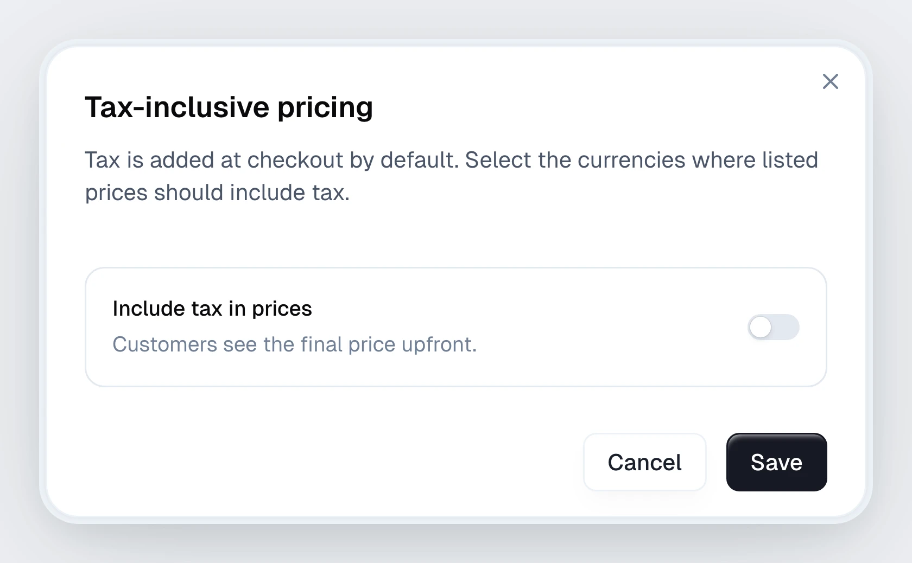
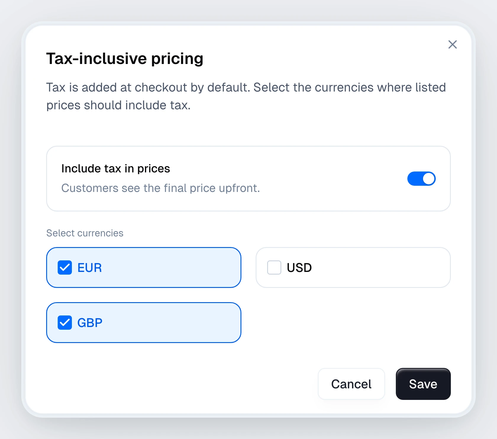
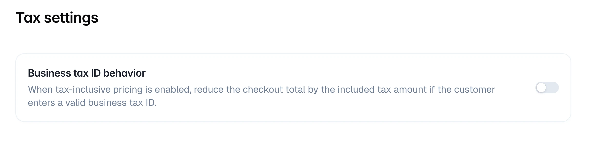

You manage your tax configuration in two places. You set how prices display on individual plans and you set how business exemptions are handled globally.

## Plan tax behavior

By default Kelviq adds tax on top of your listed price at checkout. If you want customers to see the final price upfront you can enable tax inclusive pricing. You configure this per plan.

To change how prices are displayed, open the plan, click the **three dots** menu at the top right, and select **Tax behavior**. You can also click **Tax added at checkout** under the plan name.

<Frame>
  
</Frame>

The **Tax-inclusive pricing** dialog opens.

<Frame>
  
</Frame>

Turn on **Include tax in prices**, then under **Select currencies** pick the currencies where the listed price should include tax, and click **Save**. 

<Frame>
  
</Frame>

If the plan has only one currency, only that currency is listed. This lets you mix billing styles on a single plan. You can select EUR to give European buyers an inclusive experience while leaving USD unchecked so North American buyers pay tax at checkout.

## Business tax ID behavior

When a business customer enters a valid tax ID at checkout, Kelviq verifies it and applies the reverse charge, so no tax is added.

If you enabled tax inclusive pricing in the steps above you need to tell Kelviq how to handle the final math for these exempt B2B customers.

Open **Settings → Tax settings**.

<Frame>
  
</Frame>

Turn on the **Business tax ID behavior** toggle. When this is active Kelviq automatically reduces the checkout total by the included tax amount if the customer enters a valid business tax ID. 

If it's off, the customer pays the same total and the tax portion goes to your balance.