Usage-based pricing charges customers for what they use: API calls, tokens, compute, or any other Meter feature.

## Set up a usage plan

The example below is a **Pro** plan: \$29 a month, 10,000 API calls included, then \$0.002 per call. [How usage limits work](/product-catalog/usage-limits) explains what happens at the limit.

<Tabs>
  <Tab title="Dashboard">
    Open the plan's pricing and expand **Usage charges**, then follow the steps below.

    <Frame>
      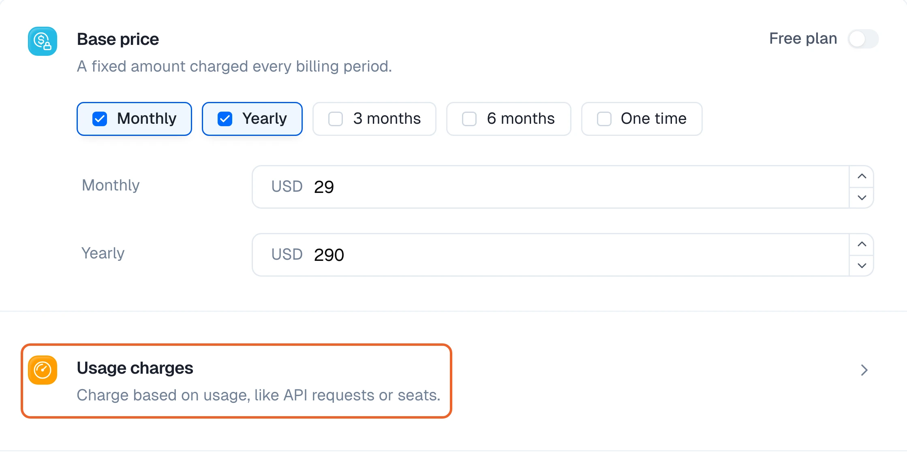
    </Frame>
  </Tab>
  <Tab title="CLI">
    Define the plan in `kelviq.config.ts`. The entitlement sets the included 10,000 calls. The Pay-as-you-go price bills calls past that at the end of each month.

    ```ts kelviq.config.ts
    import { feature, plan } from '@kelviq/cli/config';

    export const apiCalls = feature({
      identifier: 'api-calls',
      name: 'API calls',
      type: 'METER',
      featureDetails: {
        featureSubType: 'PRE_AGGREGATED_USAGE',
        units: { singular: 'call', plural: 'calls' },
      },
    });

    export const pro = plan({
      identifier: 'pro',
      name: 'Pro',
      product: 'my-app',
      entitlements: [
        { feature: 'api-calls', value: 10000, reset: 'EVERY_MONTH', hardLimit: false },
      ],
      prices: [
        {
          priceType: 'PAID',
          currency: 'USD',
          chargeCatalogPrice: [
            {
              feature: null,
              priceModel: 'FLAT',
              paymentType: 'ADVANCE_COMMITMENT',
              reset: 'NEVER',
              charges: [{ chargePeriod: 'MONTHLY', priceData: { amount: 29 } }],
            },
            {
              feature: 'api-calls',
              priceModel: 'TIERED',
              paymentType: 'PAY_AS_YOU_GO',
              reset: 'EVERY_MONTH',
              charges: [
                {
                  chargePeriod: 'MONTHLY',
                  priceData: { currency: 'USD' },
                  tiers: [
                    { upTo: 10000, unitAmount: 0, flatAmount: 0 },
                    { upTo: 'inf', unitAmount: 0.002, flatAmount: 0 },
                  ],
                },
              ],
            },
          ],
        },
      ],
    });
    ```

    Preview the change, then push and publish it:

    ```bash
    npx kelviq push --dry-run
    npx kelviq push --publish
    ```

    See the [CLI overview](/cli/overview) and the [config reference](/cli/kelviq-config).
  </Tab>
</Tabs>

### 1. Select or create a Meter feature

In **Metered feature**, choose the metric you want to track, such as API requests or tokens consumed. To create a new one, type its name in the field, or [create a Meter feature](/product-catalog/create-a-feature) from **Product catalog → Features** and return to the plan.

<Frame>
  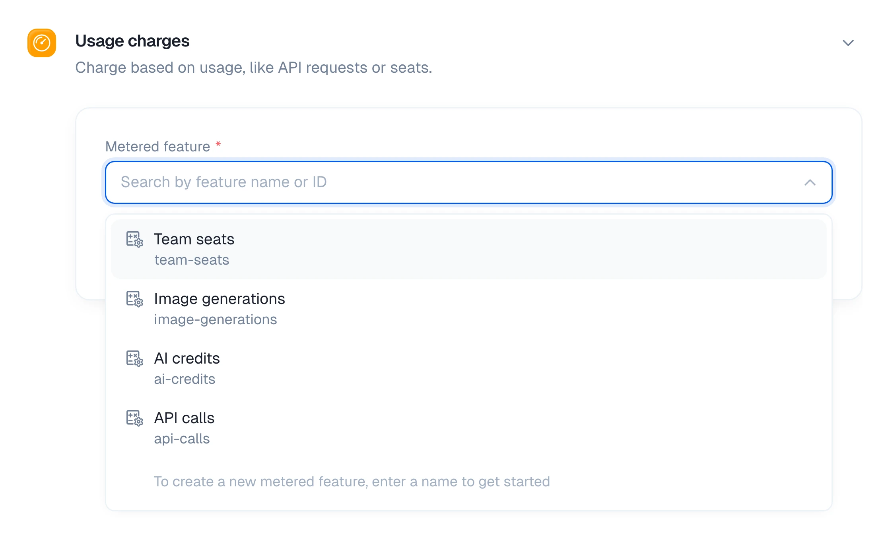
</Frame>

### 2. Choose your billing model

In **Billing model**, select how payments are structured.

<Frame>
  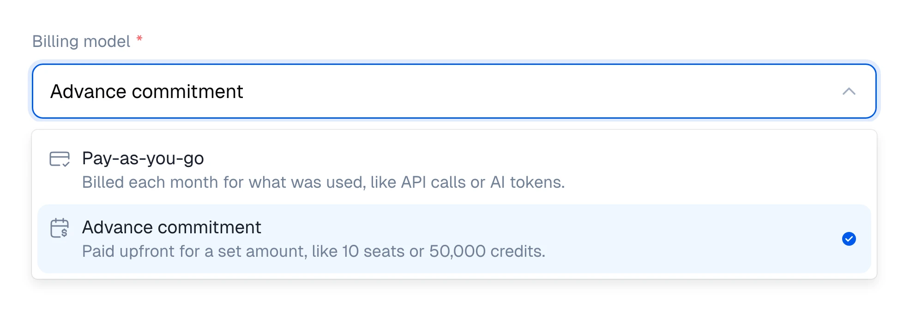
</Frame>

**Advance commitment**
Customers pay upfront for a baseline allotment of usage. This gives your users a predictable budget. They buy a set bucket of AI tokens or API requests at the start of the month. They consume what they paid for and avoid surprise overages.

**Pay-as-you-go**
Customers pay for their recorded usage at the end of the monthly subscription period. You can bill for API calls, tokens, storage, compute time, or another Meter feature, either on its own or alongside a monthly base price. See [Pay as you go](/product-catalog/pay-as-you-go) for setup, usage reporting, sandbox testing, and troubleshooting.

<Note>
  Pay-as-you-go bills monthly from reported usage, so Monthly is the plan's only billing period. Stair-step pricing and credit rollover work with Advance commitment prices.
</Note>

### 3. Configure the pricing model

Kelviq supports five distinct ways to calculate the cost. Here is how the math works for each model.

<Frame>
  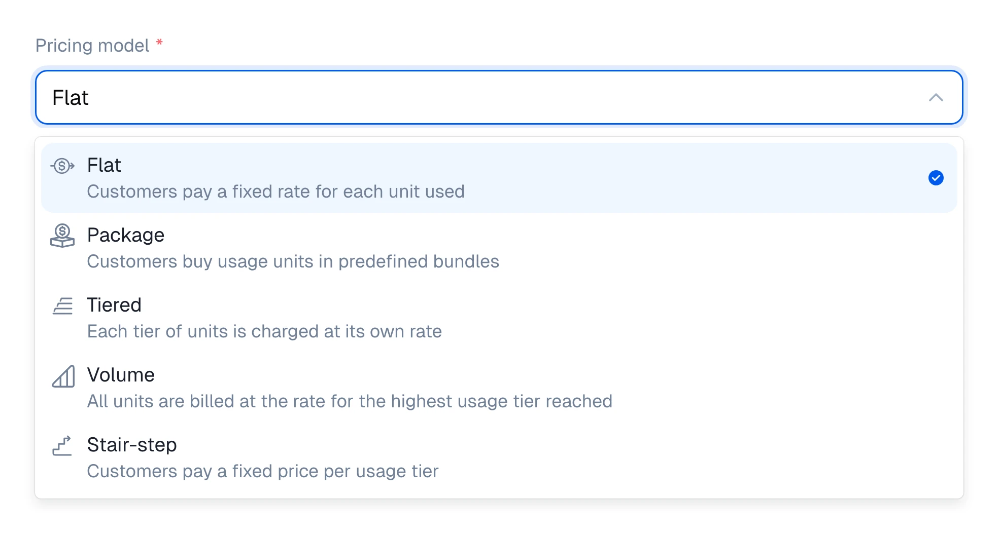
</Frame>

---

#### Flat

The simplest way to charge for usage. Set one fixed rate for every unit consumed. No tiers, packages, or volume discounts. The total scales directly with usage.

**Best for** API products and services where the cost of serving each unit stays relatively consistent.

**Example** A translation API charging for each API call.

**Sample calculation**

| | |
| --- | --- |
| Rate | \$0.01 per API call |
| Usage | 15,000 API calls |
| **Total** | 15,000 × \$0.01 = **\$150** |

<Frame>
  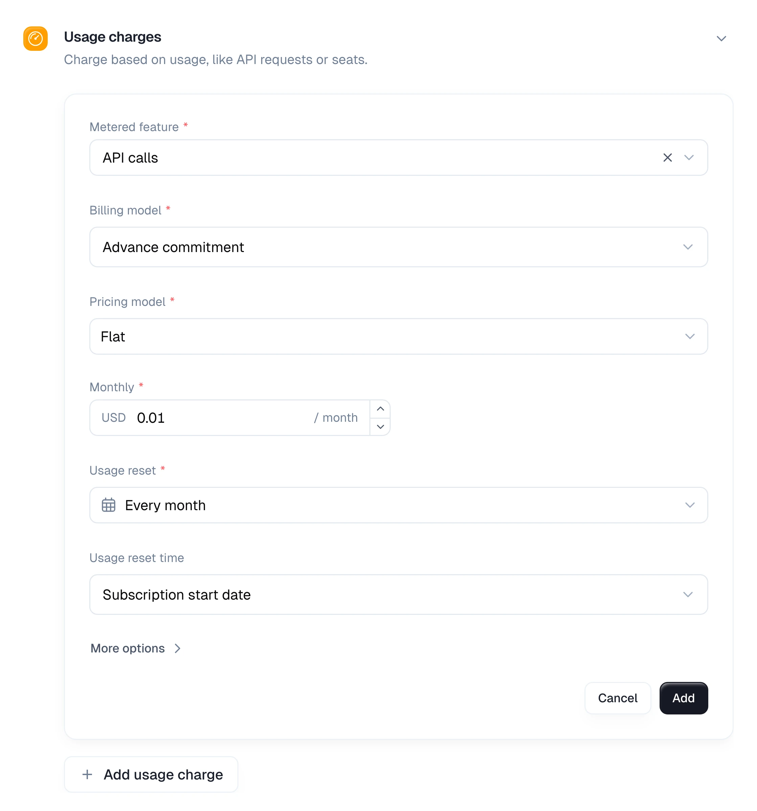
</Frame>

---

#### Package

Instead of charging for every unit individually you sell usage in predefined packages. When a customer exceeds one package they are charged for the next full package, even if they only use part of it.

**Best for** Products that want simple pricing, predictable billing increments, and a minimum charge for reserved usage.

**Example** An AI image generator selling images in packages of 100.

**Sample calculation**

| | |
| --- | --- |
| Package | 100 images for \$10 |
| Usage | 205 images |
| Packages required | 3 |
| **Total** | 3 × \$10 = **\$30** |

<Frame>
  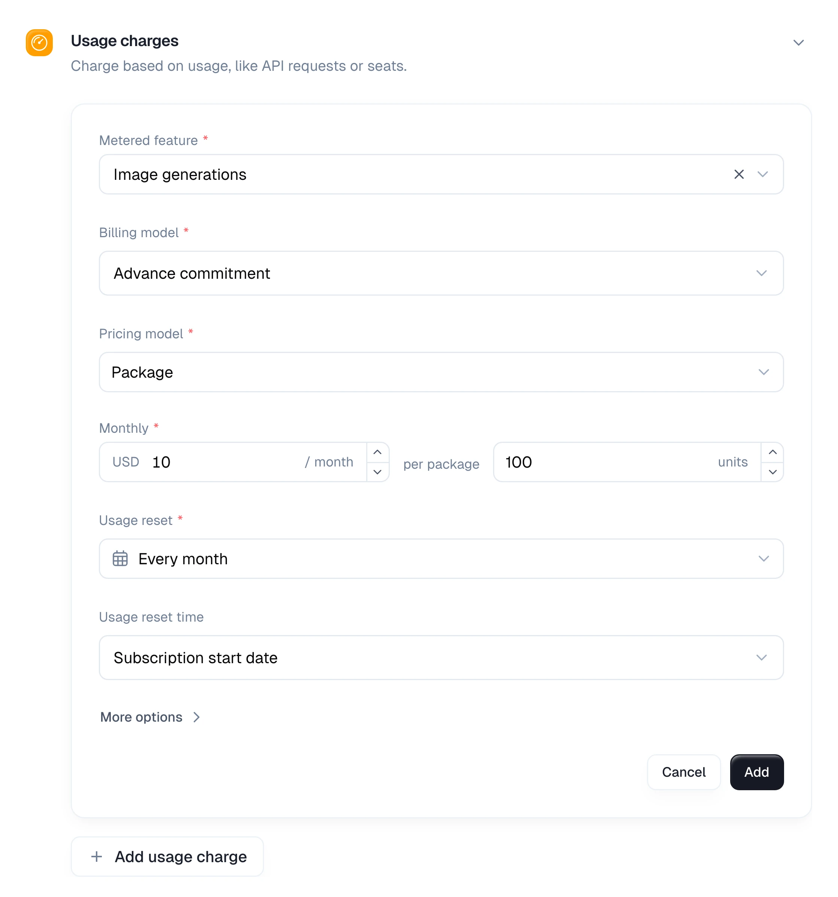
</Frame>

---

#### Tiered

Units are filled into pricing buckets. As usage increases it moves into cheaper brackets, while units in earlier brackets remain charged at their original rate.

**Why it's useful** Encourages higher adoption while helping you cover fixed costs for lower-volume users. Especially useful for developer platforms.

**Example** An LLM wrapper platform charging based on token usage.

**Sample calculation**

| Tier | Rate |
| --- | --- |
| First 1,000 tokens | \$0.10 / token |
| Next 4,000 tokens | \$0.05 / token |

A customer uses 3,500 tokens.

| | |
| --- | --- |
| Tier 1 | 1,000 × \$0.10 = \$100 |
| Tier 2 | 2,500 × \$0.05 = \$125 |
| **Total** | \$100 + \$125 = **\$225** |

Kelviq tracks each pricing bracket automatically.

<Frame>
  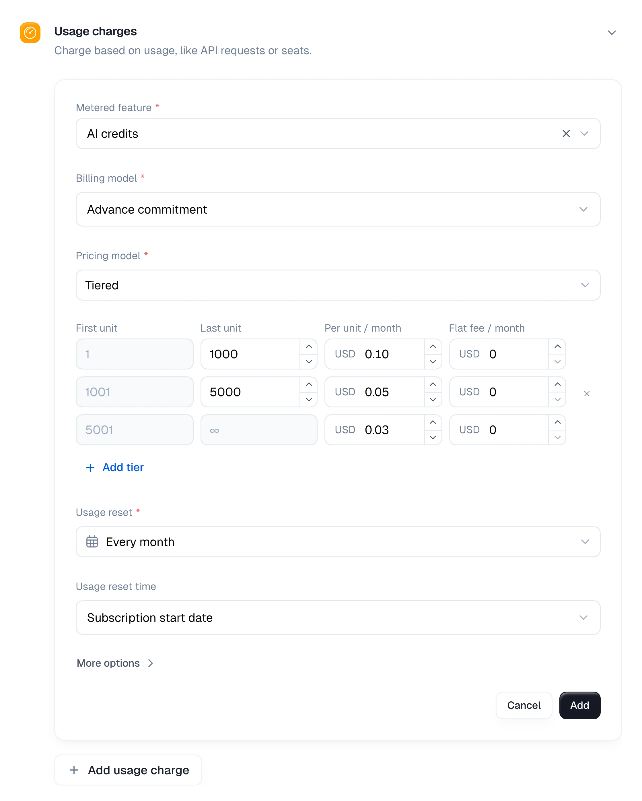
</Frame>

---

#### Volume

Similar to tiered pricing, but with one major difference. Once usage reaches a specific threshold, every unit consumed during that billing cycle is charged at the new rate.

**Why it's useful** Creates a strong incentive for high-volume customers to expand their usage by rewarding them with a lower rate across their entire bill.

**Example** An API platform charging based on the number of requests processed.

**Sample calculation**

| Volume | Rate |
| --- | --- |
| 1 to 100,000 API calls | \$0.01 / call |
| 100,001+ API calls | \$0.007 / call (applies to all calls) |

A customer makes 120,000 API calls.

| | |
| --- | --- |
| **Total** | 120,000 × \$0.007 = **\$840** |
| Without the volume discount | 120,000 × \$0.01 = \$1,200 |

Kelviq automatically applies the correct rate when customers cross a volume threshold, with no custom billing logic required.

<Frame>
  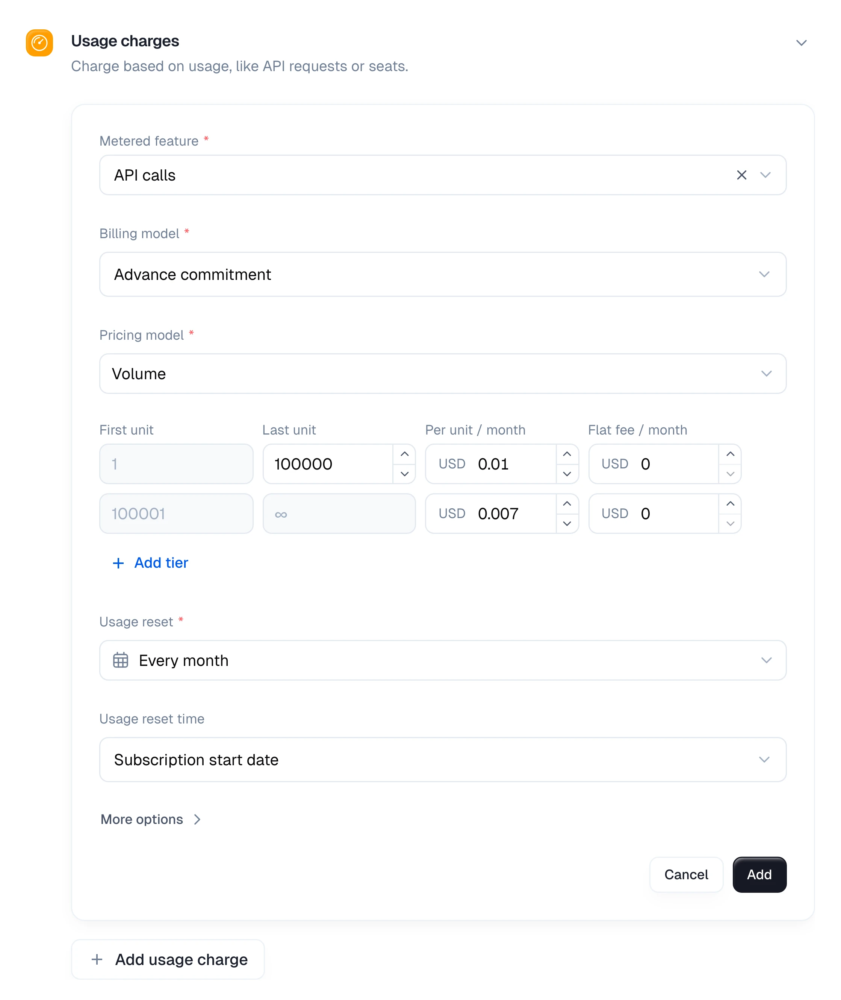
</Frame>

---

#### Stair-step

Customers pay a fixed fee based on the usage bracket they fall into, regardless of the exact number of units used within that bracket. There is no per-unit rate.

**Why it's useful** Combines the simplicity of subscription plans with the flexibility of usage-based scaling.

**Example** An email delivery platform charging based on monthly email volume.

**Sample calculation**

| Step | Price |
| --- | --- |
| Up to 10,000 emails | Flat \$50 |
| 10,001 to 50,000 emails | Flat \$150 |

A customer sends 12,000 emails. They fall into the second step and pay a flat **\$150**.

Kelviq automatically moves customers into the correct pricing step as their usage grows, with no custom billing logic required.

<Frame>
  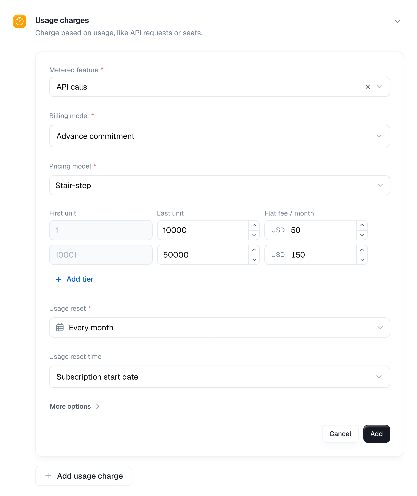
</Frame>

---

### 4. Set the pricing rules

Once you pick a **Pricing model** you define the exact boundaries.

If you select Tiered you specify the **First unit** and **Last unit** for each tier. You can charge a **Per unit** price and a **Flat fee** within that same tier. Click **Add tier** to add another row.

You can also localize usage prices in **Price localization**. This lets you define different per unit rates for specific countries and currencies.

#### Price localization and usage controls

When you add a localized price, Kelviq carries over the base price's usage reset, usage alert, and credit rollover settings. This keeps entitlement behavior consistent while allowing the monetary price and currency to vary by region.

Update these controls on the base price when you want the same behavior across its localized prices.


### 5. Set the usage reset cadence

Configure how often the usage meter resets. Credit rollover is calculated when this reset happens.

Use **Never** for a lifetime limit, or choose a recurring reset such as every week or every month. A meter set to **Never** has no period boundary at which to roll unused credits forward.

For monthly resets, set **Usage reset time** to **Start day of month** or **Subscription start date**.

<Frame>
  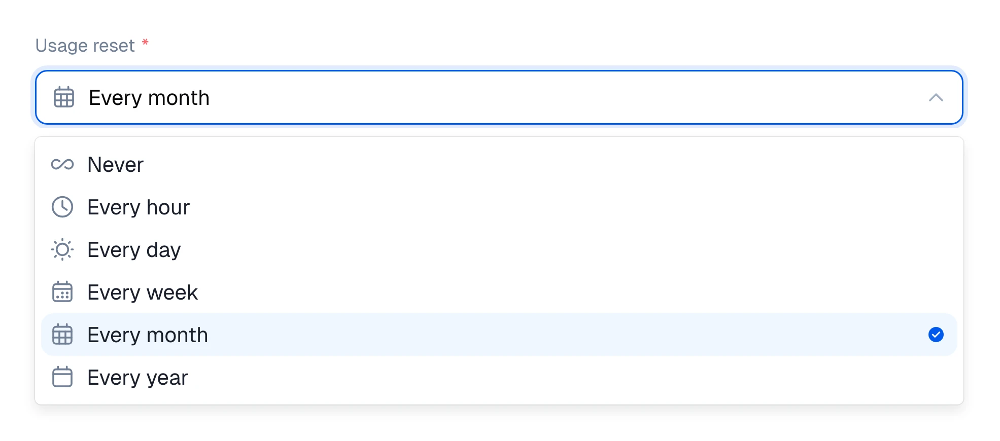
</Frame>

### 6. Configure rollover and alerts

#### Credit rollover

Credit rollover lets a customer keep part of an advance commitment they did not use before the meter resets. It is available for **Advance commitment** usage prices, not **Pay-as-you-go** prices.

To configure it:

1. In the plan's price editor, under **Usage charges**, pick the Meter feature and choose **Advance commitment** as the billing model.
2. Click **More options**, then turn on **Credit rollover**.
3. Enter the **Percentage** of unused units to carry forward. The value can be from 0% to 100%.
4. Enter a **Limit** in units to cap the rollover amount.

<Frame>
  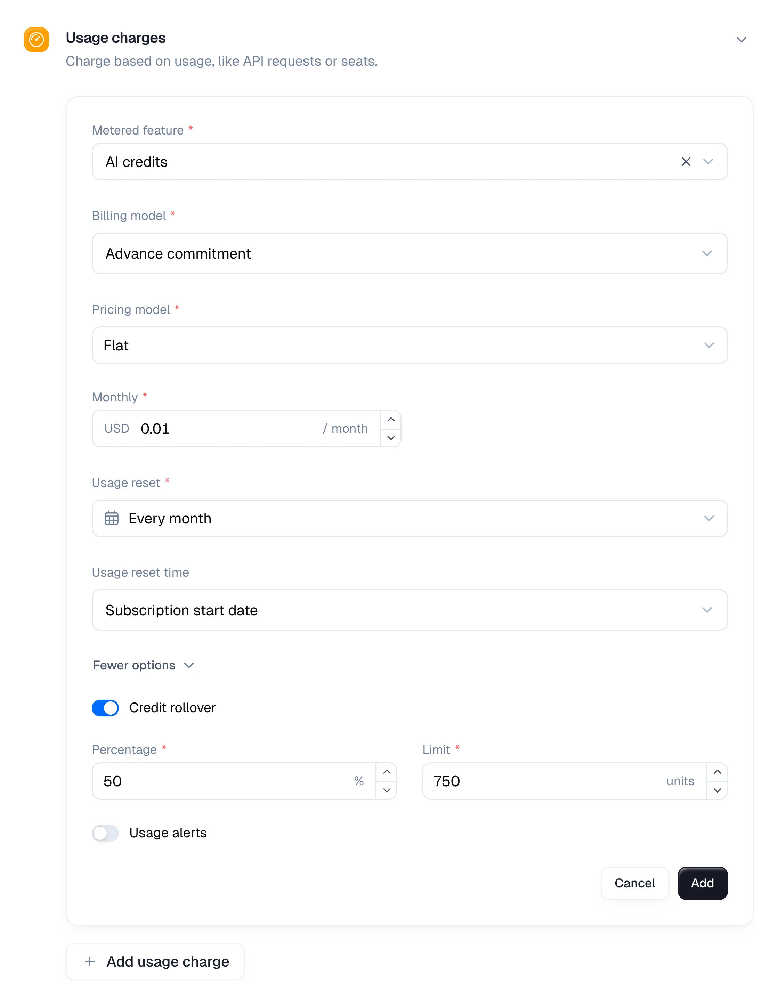
</Frame>

For example, suppose a plan includes 10,000 credits each month. The customer has 2,000 credits left when the meter resets, and rollover is set to 50% with a 750-unit limit. Fifty percent of the unused balance is 1,000 credits, so the limit reduces the rollover to 750. The customer's next period starts with 10,750 credits.

<Note>
  The rollover limit and the usage hard limit do different jobs. The rollover limit caps the credits carried into a new period. The hard limit stops additional usage when the customer's balance reaches zero.
</Note>

#### Usage alerts

Usage alerts watch a Meter feature for percentage or absolute-unit thresholds. When a customer crosses a threshold, Kelviq sends `feature.usage_alert` to your subscribed webhook endpoint. Your application can then send an email, show an in-app warning, or start an upgrade flow.

See [Usage alerts](/product-catalog/usage-alerts) for dashboard and API configuration, the webhook payload, a Node.js handler, and sandbox testing steps.

### 7. Stack multiple usage metrics

<Frame>
  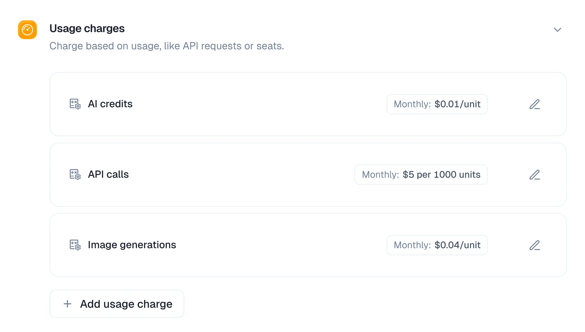
</Frame>

AI products rarely track just one variable. You can add as many metered usage features as you want to a single plan. Click **Add usage charge** at the bottom of the section to set up another metric.

## Check access and report usage

Report usage from your backend each time the feature is used, then check what's left before the next request.

<CodeGroup>

```ts Node
import { BEHAVIOUR_CHOICES } from '@kelviq/node-sdk';

// Count one API call
await client.reporting.reportUsage({
  customerId: 'cust_123',
  featureId: 'api-calls',
  value: 1,
  behaviour: BEHAVIOUR_CHOICES.DELTA,
});

// Check what's left
const ent = await client.entitlements.getEntitlement({
  customerId: 'cust_123',
  featureId: 'api-calls',
});

if (!ent || (!ent.hasAccess && ent.hardLimit)) {
  // No access, or a hard limit was reached: block or ask the customer to upgrade
}
// Past a soft limit, let the call through: it's billed as overage
```

```python Python
# Count one API call
client.reporting.report_usage(
    customerId="cust_123",
    featureId="api-calls",
    value=1,
    behaviour="DELTA",
)

# Check what's left
ent = client.entitlements.get_entitlement(
    customerId="cust_123",
    featureId="api-calls",
)

if not ent or (not ent.hasAccess and ent.hardLimit):
    # No access, or a hard limit was reached: block or ask the customer to upgrade
    ...
# Past a soft limit, let the call through: it's billed as overage
```

</CodeGroup>

`remaining` is the usage left in the current period. `hasAccess` turns `false` when it reaches 0; `hardLimit` tells you whether to block. See the [Node SDK](/backend-integration/node-sdk#entitlements) and [Python SDK](/backend-integration/python-sdk) for every method.

## Model a plan with different kinds of limits

Not every plan limit should be a meter. Choose the feature type based on what the value means and how your application will use it.

| Plan capability | Feature type | Suggested configuration |
| --- | --- | --- |
| Messages | Meter | Reset every month |
| Training runs | Meter | Reset every day |
| Active agents | Customizable | Store the plan's allowed count |
| Knowledge sources | Customizable | Store the plan's allowed count |
| WhatsApp access | Boolean | Enable on the plans that include it |
| Analytics | Boolean | Enable on the plans that include it |
| Priority support | Boolean | Enable on the plans that include it |

For metered limits, consider usage alerts at 80% and 90%. These thresholds give customers time to reduce usage or upgrade before they reach a hard limit. Rollover and overage are optional; turn them on only where they fit your pricing. See [How usage limits work](/product-catalog/usage-limits).

When a customer changes plans, Kelviq retains their existing usage counters and evaluates them against the new limits. A customer who has already consumed more than the downgraded limit may therefore become over limit as soon as the downgrade takes effect.
