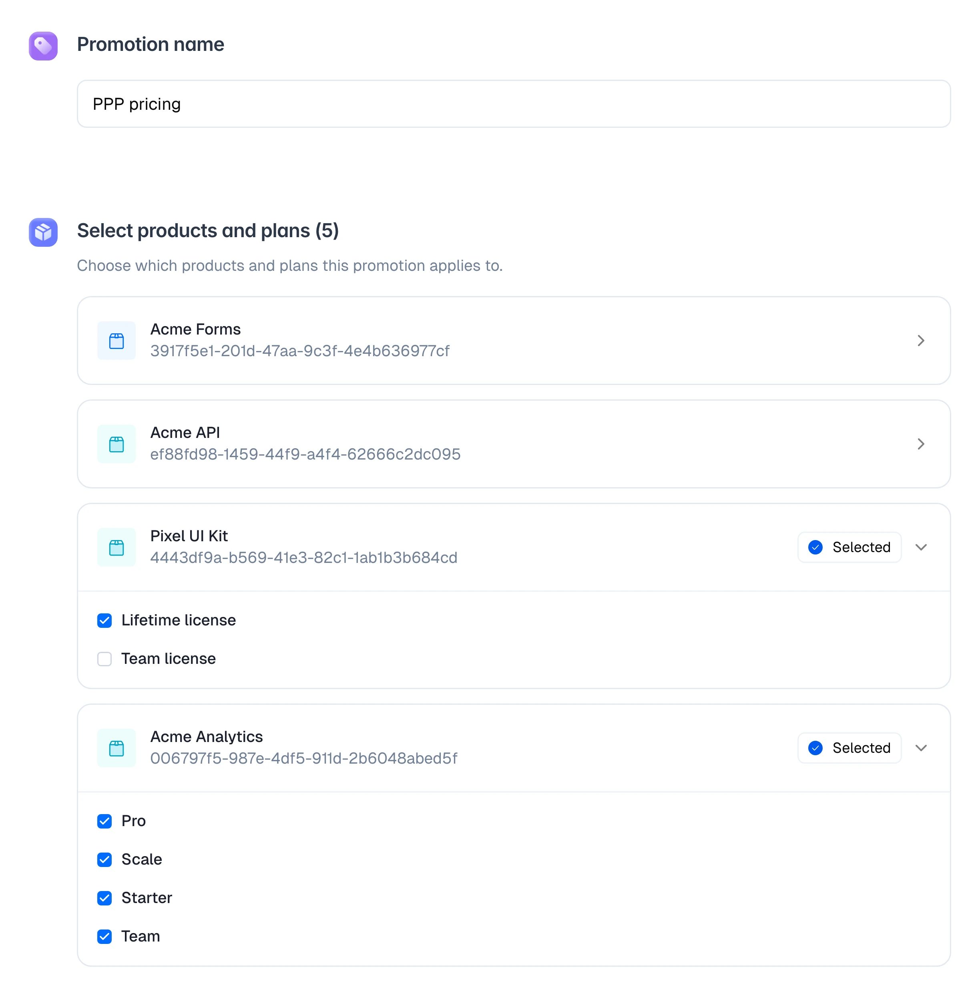
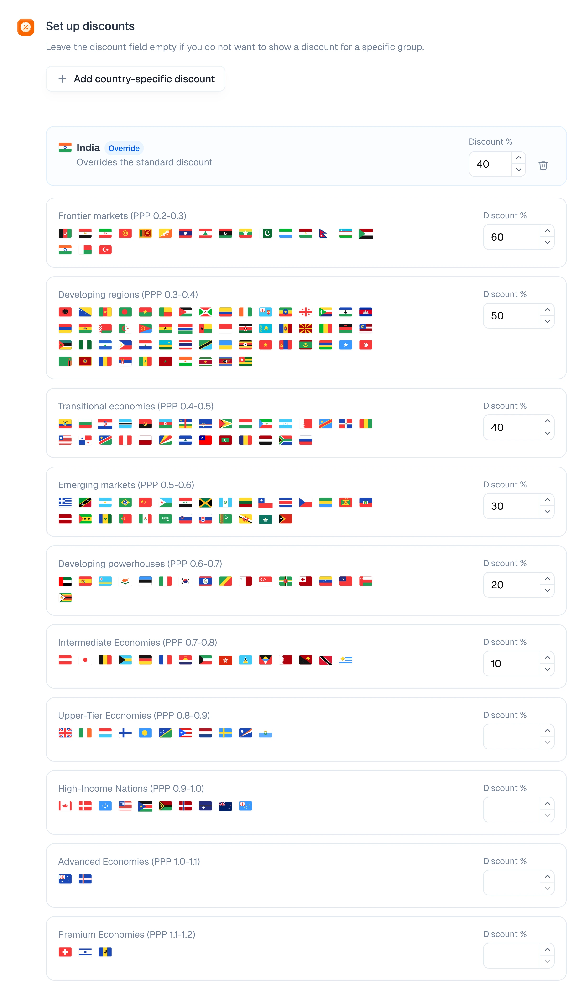
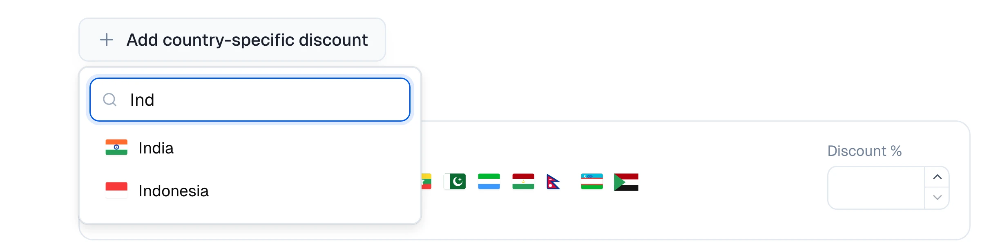
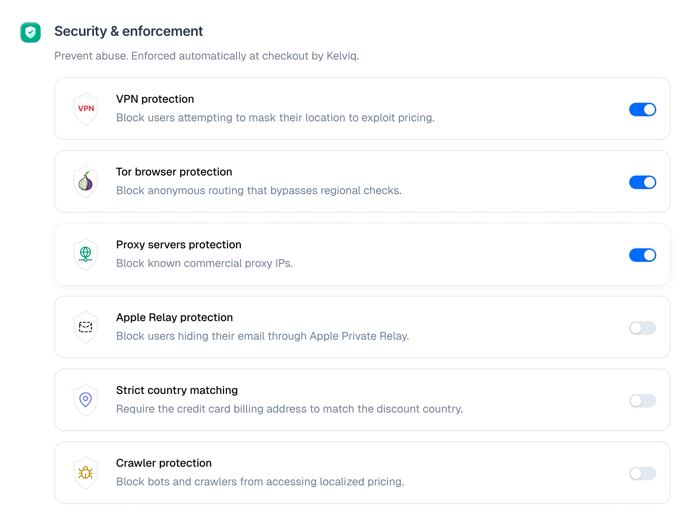
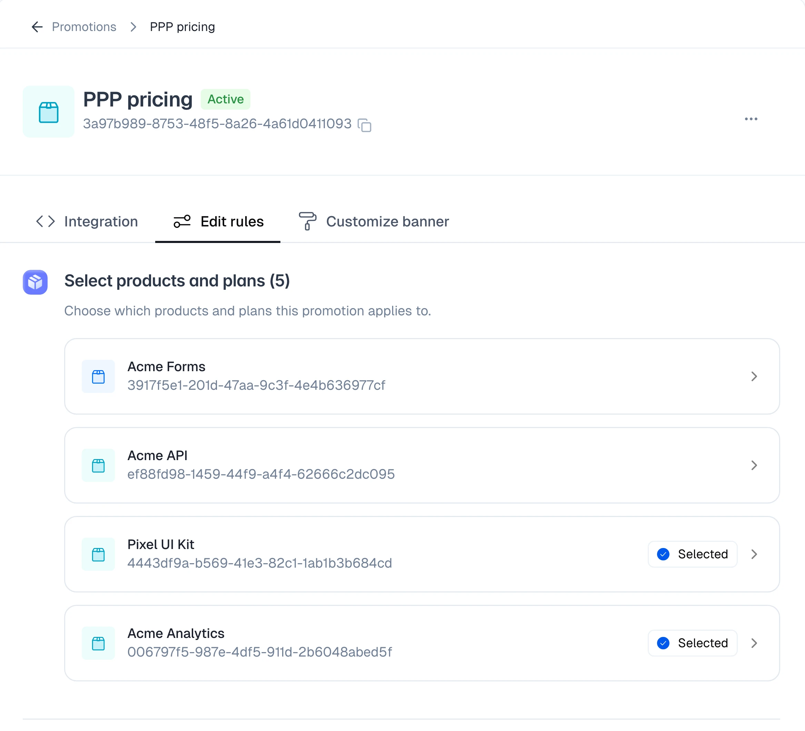

A promotion ties a set of purchasing power parity (PPP) discounts to one or more of your products and plans. Once created, eligible visitors will see their local discount automatically.

<Steps>
  <Step title="Navigate to Promotions">
    Go to **Promotions** in the sidebar, then click **Create promotion**.
  </Step>

  <Step title="Enter a promotion name">
    Give the promotion a descriptive internal name (e.g. *PPP pricing* or *Black Friday*). This is not shown to customers.

    **Promotion name** is required.
  </Step>

  <Step title="Select products and plans">
    Choose which products and plans this promotion applies to. You can select multiple products, and for each product you can pick one or more plans.

    <Note>
      Only published plans can be selected. Draft and unpublished plans are listed but greyed out. To use one, open the product in **Product catalog → Products**, then publish the plan.
    </Note>

    At least one plan must be selected before you can create the promotion.

    <Frame>
      
    </Frame>
  </Step>

  <Step title="Set up PPP group discounts">
    Kelviq groups countries into economic tiers based on purchasing power. Enter a discount percentage for each group you want to target.

    * Enter a value between 1 and 100 in the **Discount %** field for the relevant group.
    * Leave the field empty (or set it to 0) for groups you do not want to discount.

    Each group row shows the flags of the countries in it. Set a discount for at least one group or country before you create the promotion.

    <Frame>
      
    </Frame>
  </Step>

  <Step title="Add country-specific overrides (optional)">
    To override the group discount for a specific country:

    1. Click **Add country-specific discount** and search for the country by name.
    2. Click the country to add it to the list.
    3. Enter the discount percentage for that country under **Discount %**.

    <Frame>
      
    </Frame>

    Country overrides take precedence over the group discount. For example, if India is in a group with 30% off but you want to offer 40% for India specifically, add India as a country override with 40%.
  </Step>

  <Step title="Configure security & enforcement">
    Under **Security & enforcement**, toggles prevent abuse by blocking users who are masking or misrepresenting their location. All toggles are **off by default**. Turn on the ones you need.

    | Toggle | Description |
    |--------|-------------|
    | **VPN protection** | Block users connecting through a VPN |
    | **Tor browser protection** | Block anonymous traffic routed via Tor |
    | **Proxy servers protection** | Block known commercial proxy IP addresses |
    | **Apple Relay protection** | Block users hiding their location through Apple Private Relay |
    | **Strict country matching** | Require the card's billing address to match the discount country |
    | **Crawler protection** | Block bots from accessing localized pricing |

    <Frame>
      
    </Frame>
  </Step>

  <Step title="Create the promotion">
    Click **Create promotion**. You will be taken to the promotion detail page where you can integrate the banner and customize its appearance.
  </Step>
</Steps>

## Editing a promotion

To update discounts, products, or security settings after creation, open the promotion, go to the **Edit rules** tab, make your changes, and click **Update rules**. Changes take effect immediately.

<Frame>
  
</Frame>
