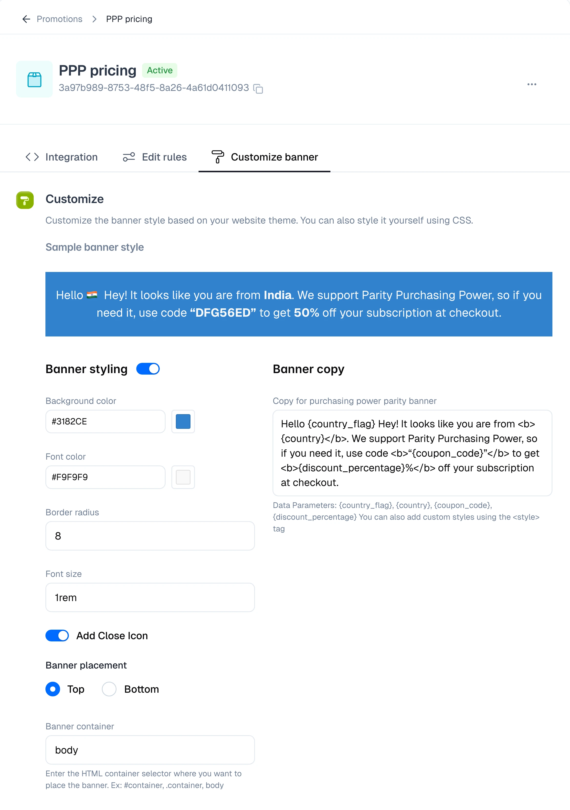

Open a promotion and go to the **Customize banner** tab to control how the discount banner looks and behaves on your site.

<Frame>
  
</Frame>

## Banner styling

* **Background color** — the banner's background color.

* **Font color** — the main text color.

* **Border radius** — corner rounding of the banner, in pixels.

* **Font size** — text size in pixels.

* **Add Close Icon** — when on, a close button lets visitors dismiss the banner.

* **Banner placement** — **Top** or **Bottom**.

* **Banner container** — the CSS selector of the element to place the banner in, such as `#container`, `.container`, or `body`.

Turn off the switch next to **Banner styling** to render the banner without Kelviq styles and style it with your own CSS. The styling fields above are disabled while it's off.

## Banner copy

**Copy for purchasing power parity banner** is the text visitors see. You can use these placeholders:

* `{country_flag}` — the visitor's country flag
* `{country}` — the visitor's country name
* `{coupon_code}` — the discount code
* `{discount_percentage}` — the discount percentage

You can also add custom styles with a `<style>` tag.

## Save changes

Click **Update banner** to apply your changes. The banner updates in real time for new visitors.
