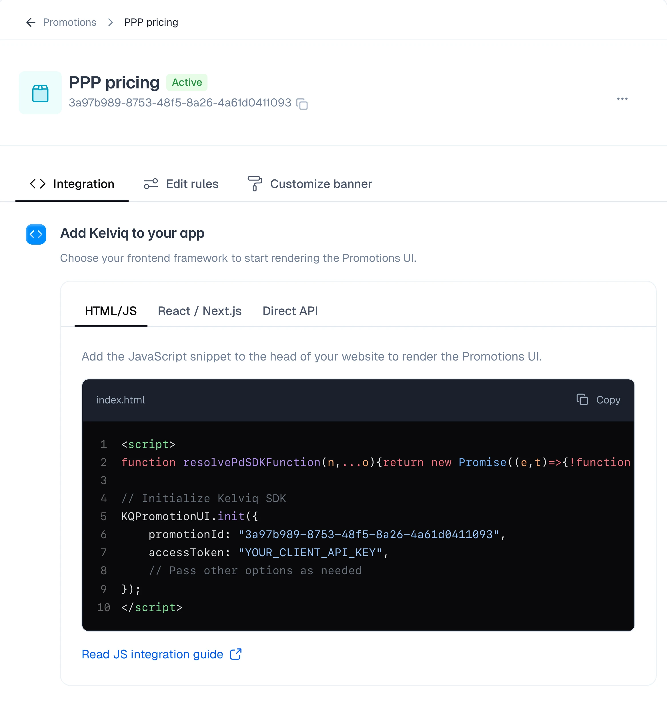

After creating a promotion, open it and go to the **Integration** tab. Under **Add Kelviq to your app**, pick **HTML/JS**, **React / Next.js**, or **Direct API** and copy the snippet. Your `promotionId` and Client API key are already filled in, and the banner renders automatically for eligible visitors.

You will need two values:

* **`promotionId`** — the unique ID of the promotion (pre-filled in the snippet).
* **`accessToken`** — your Client API key (pre-filled in the snippet). It's also in **Settings → API keys → Client API key**.

<Frame>
  
</Frame>

---

## HTML / JS

Add the script snippet to the `<head>` of your page. It loads the SDK asynchronously, initializes it with your promotion, and renders the banner automatically. You can also call `getUpdatedPrice()`, `updatePriceElement()`, and `updatePrice()` to display discounted prices on the page.

<Card title="Promotions UI JS SDK" href="/frontend-integration/promotions-ui-js">
  Installation, `init()` options, auto price update with data attributes, JS API reference, and CSS hooks.
</Card>

---

## React / Next.js

Install `@kelviq/react-promotions-ui`, wrap your app in `<KQProvider>`, and place `<KQBanner />` where you want the banner to appear. Use `KQPriceFormatted` or the granular price components to show discounted prices anywhere on the page.

<Card title="React Promotions UI SDK" href="/frontend-integration/react-promotions-ui">
  Installation, `KQProvider` props, `KQBanner`, `KQPriceFormatted`, granular price components, and sandbox setup.
</Card>

---

## Direct API

Fetch promotion data directly from the REST API if you want to apply discounts in a custom checkout flow or build your own UI. The response includes the active discount percentage for the caller's detected location.

The ready-to-use `curl` snippet is available in the **Integration** tab of your promotion.

<Card title="GET /promotions" href="/api-reference/promotions/get-promotions">
  Full API reference — request parameters, response schema, and example response.
</Card>
