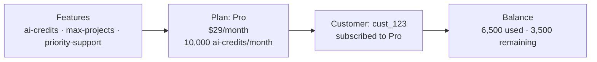

Kelviq has four building blocks: products, plans, features, and customers. This page uses one example throughout: **Acme AI**, a writing assistant with a Free and a Pro plan.

---

## Products

A product is the thing you sell. In the example, the product is **Acme AI**.

[Learn more about products →](/product-catalog/products)

---

## Plans

A plan packages a product's price and features. Acme AI has two:

| | Free | Pro |
| --- | --- | --- |
| Price | \$0 | \$29/month |
| `ai-credits` | 500/month | 10,000/month |
| `max-projects` | 3 | 50 |
| `priority-support` | Off | On |

[Learn more about plans →](/product-catalog/plans)

---

## Features & limits

A feature is something a plan grants. You create a feature once and add it to as many plans as you like, each with its own value. In the API and SDKs, the value a plan gives a feature is called an entitlement.

There are three feature types:

| Type | What it does | In the example |
| --- | --- | --- |
| **Boolean** | Turns something on or off | `priority-support` |
| **Meter** | Counts usage against a limit that can reset | `ai-credits` |
| **Customizable** | Stores a number or setting for each plan | `max-projects` |

Your app checks the feature, not the plan. Moving `priority-support` to the Free plan is a dashboard change, not a deploy.

[Learn more about features & limits →](/product-catalog/entitlements) · [How usage limits work →](/product-catalog/usage-limits)

---

## Digital downloads

A digital download is a file that your customers can download after purchasing.

Examples: e-books, software, music, videos.

[Learn more about digital downloads →](/product-catalog/digital-downloads)

---

## License keys

A license key is a code that your customers can use to activate a digital download.

Examples: software activation, game keys, e-books.

[Learn more about license keys →](/product-catalog/license-keys)

---

## Links

Links allow you to share important URLs with customers after they purchase your plan.

Examples: Discord servers, Slack workspaces, Notion pages, member-only dashboards.

[Learn more about links →](/product-catalog/links)

---

## Customers

A customer is a person or company that buys from you. Create a customer with your own ID, such as `cust_123`, when someone signs up in your app. When they buy Pro, Kelviq links the subscription to that customer and their `ai-credits` balance starts at 10,000.

Each time they use a credit, your backend reports it. After 6,500 credits, Kelviq shows 3,500 remaining until the monthly reset.

[Learn more about customers →](/customers-management/overview)

---

## Typical workflows

### AI and usage-based products

Billing for actual work delivered rather than just seat access.

1. Create features like AI tokens, API calls, or workflow runs
2. Create a product
3. Create plans with a base fee plus usage charges
4. Set usage limits on each plan, with a soft or hard limit
5. Integrate the SDK to report usage back to Kelviq as the AI performs work
6. Customer subscribes and pays automatically based on their actual consumption

### One-time products

Selling digital downloads, license keys, or access links:

1. Create a **product**
2. Create a **plan** with one-time pricing
3. Add **digital downloads**, **license keys**, or **links** to the plan
4. Share your checkout link or embed a pricing table
5. Customer purchases → receives their files, keys, and links

### SaaS subscriptions

Selling recurring access with feature limits:

1. Create **features** (e.g., API calls, storage, AI tokens)
2. Create a **product**
3. Create **plans** with recurring pricing (monthly/yearly)
4. Add **features & limits** to each plan (e.g., 1,000 API calls/month)
5. Integrate the **SDK** to check feature access and enforce limits
6. Customer subscribes → SDK controls what they can access

---

## Integrate with your app

To bring everything you set up in the dashboard into your app, use one of these options:

- **SDKs** ([Node](/backend-integration/node-sdk), [Python](/backend-integration/python-sdk), [React](/frontend-integration/react-sdk), [JavaScript](/frontend-integration/js-sdk)) — check feature access and enforce usage limits in code
- **[APIs](/api-reference/authentication)** — use for custom needs such as syncing usage or triggering upgrades

<Tip>
**Webhooks are optional.** The SDKs and UI widgets read access from Kelviq directly. Use [webhooks](/guides/webhooks) when you want events in your own systems.
</Tip>

[See the full integration guide →](/quickstart/integrate-with-your-app)

---

## Need help?

Have questions, need help with implementation, or want a walkthrough?  
Email us at **hi@kelviq.com** or [book a demo](https://cal.com/alok-vats-fkpnc9/30min).

---