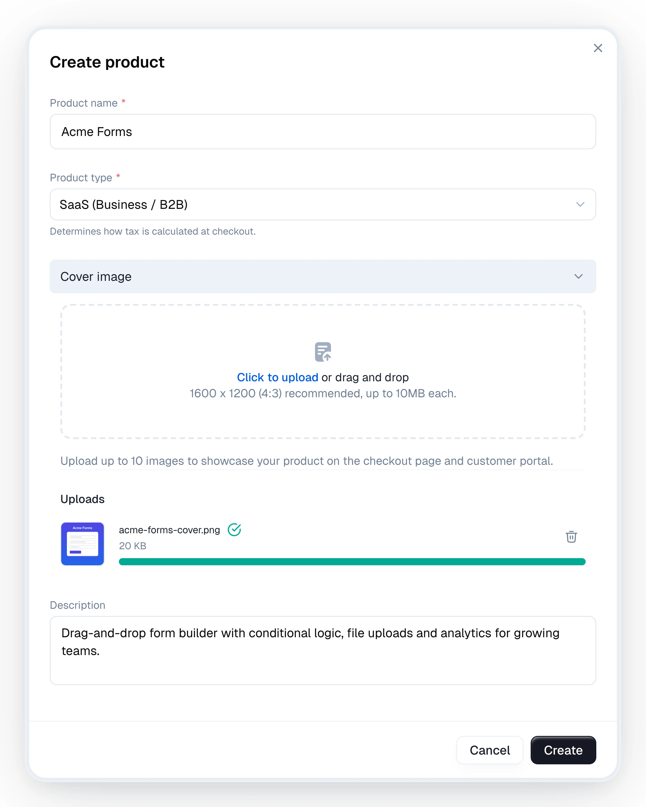
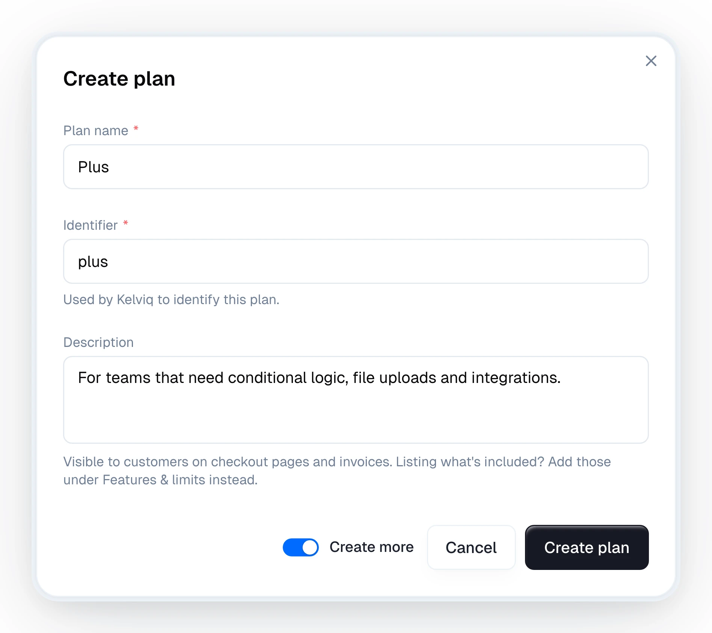
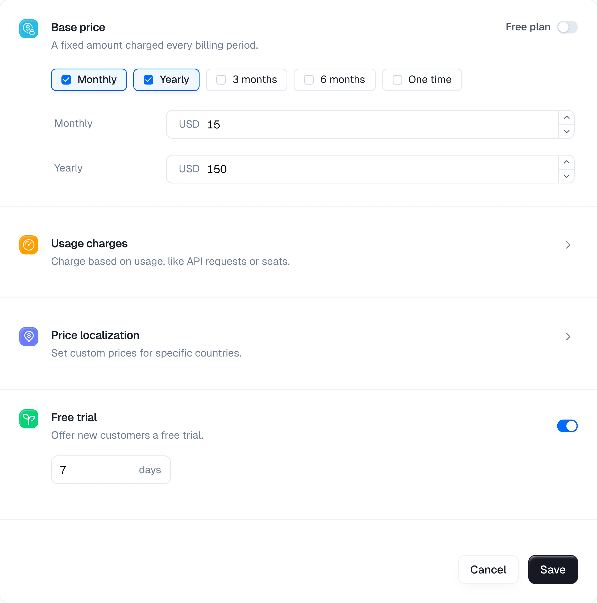
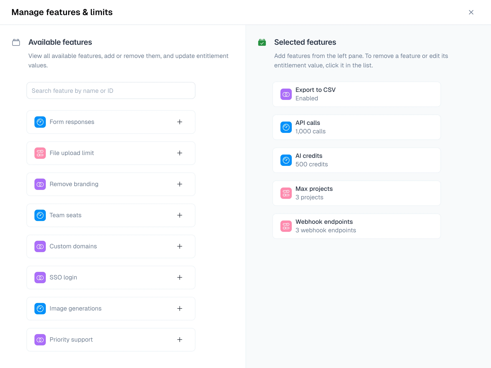
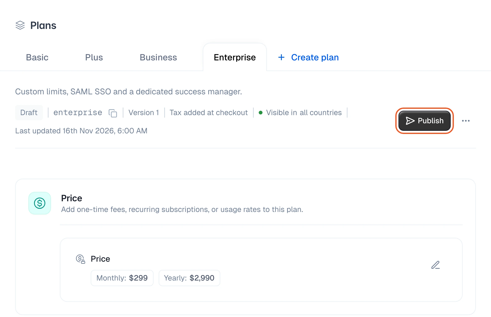
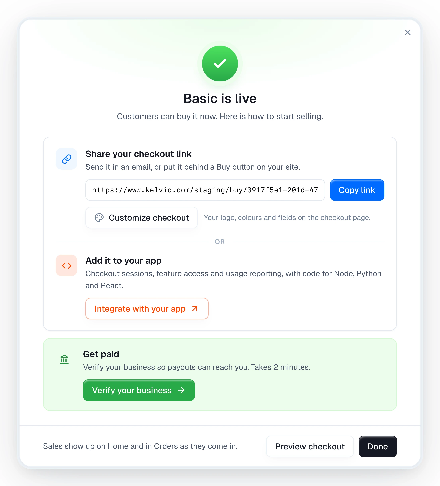

Before you can integrate Kelviq into your app, you need to configure your **products, plans, and features** in the dashboard.  
This defines your pricing and what each plan includes.

<Tip>
  Using Claude Code, Cursor, or another coding agent? [Set up with AI](/guides/set-up-with-ai) gives you a prompt that creates your products, plans, and features for you. You approve each change.
</Tip>

---

## Create a product

1. In the sidebar, go to **Product catalog → Products** and click **Create product**
2. Enter a **Product name** (e.g., "Design Course", "Premium Templates")
3. Pick a **Product type**. It decides how tax is calculated at checkout.
4. Optionally add cover images and a description. They show on checkout and in the customer portal.
5. Click **Create**. You land on the product page.

<Frame>
  
</Frame>

---

## Create a plan

From the product page:

1. Click **Create plan**
2. Enter a **Plan name** (e.g., "Pro"). The **Identifier** fills in from the name; it's the ID your code and checkout links use.
3. Optionally add a **Description**. Customers see it on checkout and invoices.
4. Click **Create plan**. You land on the plan page, where the plan stays a **Draft** until you publish it.

<Frame>
  
</Frame>

---

## Add pricing to the plan

On the plan page, click **Set price** in the **Price** section. The price editor opens in place:

1. Under **Base price**, select billing periods, such as **Monthly**, **Yearly**, **3 months**, **6 months**, or **One time**. You see only the periods enabled for your organization. Turn on **Free plan** for a plan with no price.
2. Enter a price for each selected period
3. (Optional) Turn on **Free trial** and set the trial length in days
4. Click **Save**

<Frame>
  
</Frame>

### Usage-based pricing

To charge for consumption, such as compute or agent runs:

1. In the price editor, open **Usage charges**
2. Pick the Meter feature to bill, such as AI tokens or workflow executions
3. Set the price per unit
4. Keep a flat base price too if you want hybrid pricing

See [Usage-based pricing](/product-catalog/usage-based-billing).

### Price localization

To offer localized prices in different currencies:

1. In the price editor, expand **Price localization**
2. Under **Choose a currency**, select a currency (e.g., Indian Rupee, Euro) and click **Add localized price**
3. Enter the price for each billing cycle in that currency, then click **Add** in that currency's panel
4. Click **Save** at the bottom of the price editor

This allows you to set specific prices for different markets rather than relying on automatic currency conversion.

---

## Add digital downloads

If your plan includes downloadable content (e-books, software, course materials):

1. Click the **Digital downloads** section
2. Upload files that customers will receive after purchase
3. Files are securely delivered to customers upon successful payment

---

## Add license keys

To automatically generate unique license keys for each purchase:

1. Click the **License keys** section
2. Toggle license key generation **on**
3. Keys are automatically created and delivered to customers after purchase

You can use these keys to validate customers in your application.

---

## Add features and limits

Click **Add features** in the **Features & limits** section (**Manage** if the plan already has features) to configure feature access and usage quotas for this plan.

1. Under **Available features**, click **+** next to a feature
2. Set its value for this plan (for a Boolean, keep **Allow access** on) and click **Add**
3. The feature moves to **Selected features**. Click it there to change its value or remove it.

<Frame>
  
</Frame>

Create features first in **Product catalog → Features**.

### Feature types

Features are created independently and can be attached to multiple plans with different values:

- **Boolean** — on or off
  Examples: priority support, bonus content access, community access, custom branding

- **Customizable** — a fixed numeric limit, no usage reporting
  Examples: number of downloads, max projects, storage limit (10 GB, 100 GB)

- **Meter** — tracked consumption, usage events sent to Kelviq, resets each billing cycle
  Examples: API calls, AI generations, video renders, exports per month

Once added, features appear in the plan's feature list. You can reorder or remove them as needed.  

---

## Publish the plan

Click **Publish** on the plan page, then **Publish** again to confirm. Plans stay drafts until you publish them, and customers can only buy published plans.

<Frame>
  
</Frame>

The first time you publish a plan, a dialog gives you the checkout link (**Copy link**), **Integrate with your app**, which opens [Integrate with your app](/quickstart/integrate-with-your-app), **Customize checkout** and **Preview checkout**. Its title depends on where you are:

* In sandbox: **[plan name] is live in sandbox**.
* In live mode, before your business is approved: **[plan name] is published**. A **Get paid** card takes you to verify your business, or a note says your details are in review if you've already submitted them. Customers can buy the plan once your business is approved.
* In live mode, once approved: **[plan name] is live**.

<Frame>
  
</Frame>

---

## Next steps

Your plan is now published and ready for customers.
Next, you can integrate Kelviq into your app:

- Use [checkout links](/checkout/static-checkout-url) to let customers buy your plans
- Create a customer in Kelviq when a user signs up in your app
- Use the Kelviq [SDKs](/quickstart/integrate-with-your-app) to check feature access and track usage

---

## Need help?

Have questions, need help with implementation, or want a walkthrough?  
Email us at **hi@kelviq.com** or [book a demo](https://cal.com/alok-vats-fkpnc9/30min).

---
