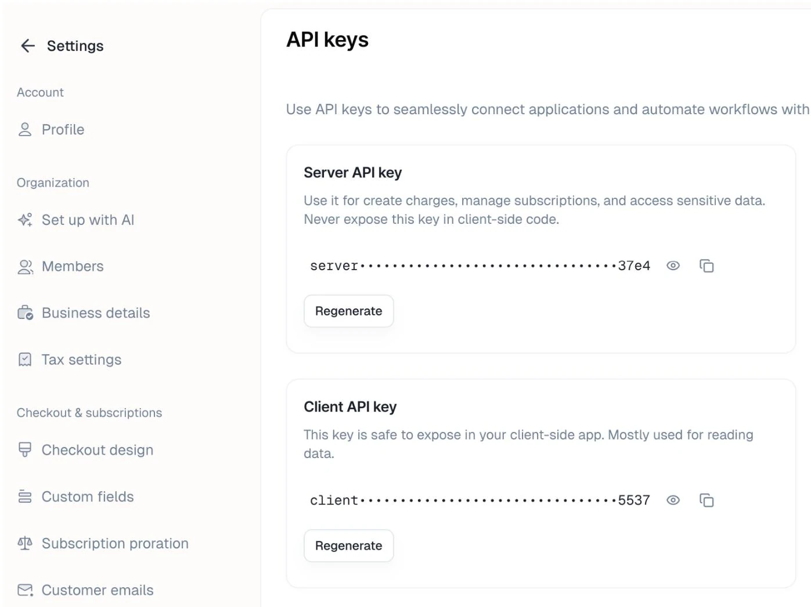

Your product and plans are published. This page connects them to your app: customers buy through a checkout link, and your app checks what each customer is entitled to.

The page continues the **Acme AI** example from [Core concepts](/quickstart/core-concepts): a Pro plan with the identifier `pro`, and three features, `priority-support` (Boolean), `max-projects` (Customizable), and `ai-credits` (Meter).

<Tip>
  Only selling through links, with no app code? You need just [Checkout links](#2-checkout-links). Everything else on this page is for apps that check feature access or track usage.
</Tip>

Code samples use the [Node SDK](/backend-integration/node-sdk) on the server and the [React SDK](/frontend-integration/react-sdk) in the browser. The [Python SDK](/backend-integration/python-sdk) has the same server methods, and the [JavaScript SDK](/frontend-integration/js-sdk) covers browsers without React.

---

## Before you start

### Get your API keys

Open **Settings → API keys**. The **server key** goes in your backend and must never ship to a browser. The **client key** goes in your frontend and only reads data.

<Frame>
  
</Frame>

### Work in sandbox first

New accounts start in sandbox, where you can complete the whole flow with test cards. Sandbox and production keep separate keys, customers, and checkout links, so keep everything on this page in one environment:

- Tell each SDK which environment to use: `environment: 'sandbox'` on the Node client, `environment="sandbox"` on the React provider.
- Copy checkout links from the dashboard while in sandbox mode. Sandbox links include `/sandbox/` in the path.

When you are ready to take live payments, switch the dashboard to production and repeat the steps with production keys and links.

---

## 1. Create a customer

Create a customer in Kelviq when someone signs up in your app, using your own user ID as the `customerId`. Every later call, from checkout to entitlement checks to usage reports, uses this same ID.

```bash
npm install @kelviq/node-sdk
```

```ts
import { Kelviq } from "@kelviq/node-sdk";

const client = new Kelviq({
  accessToken: process.env.KELVIQ_SERVER_API_KEY!,
  environment: "sandbox", // omit in production
});

// On signup
await client.customers.create({
  customerId: "cust_123", // your app's user ID
  email: "customer@example.com",
  name: "Ada Lovelace",
});
```

If you skip this step, Kelviq creates a customer at checkout with its own ID. That is fine for link-only selling, but your app then has no ID to check entitlements with.

---

## 2. Checkout links

Every published product has a checkout link. You can use it as is, or add query parameters to choose the plan and attach a customer.

### Get a checkout link

1. Go to **Product catalog → Products** and open your product
2. Click **Get Link** to open the link builder
3. Choose the plans to include and the default billing period
4. Copy the generated URL

### Attach the customer

A checkout link on its own does not know who is buying. To tie the purchase to the customer from step 1, add `customer_id` to the link. Use `?` before the first parameter and `&` before each one after it.

```html
<a href="https://www.kelviq.com/sandbox/buy/{PRODUCT_UUID}/?plan_identifier=pro&customer_id=cust_123">
  Upgrade to Pro
</a>
```

Without `customer_id`, the link still works for emails, landing pages, and marketing campaigns. See [Static checkout URL](/checkout/static-checkout-url) for every parameter, including `success_url` for the page to return to after payment.

### Or create the checkout from your backend

When the customer is already logged in to your app, you can build the checkout on the server instead of in a link. The session carries the customer ID and the return URL, and nothing has to be assembled in the browser.

```ts
import { CHARGE_PERIOD_CHOICES } from "@kelviq/node-sdk";

const { checkoutUrl } = await client.checkout.createSession({
  planIdentifier: "pro",
  chargePeriod: CHARGE_PERIOD_CHOICES.MONTHLY,
  customerId: "cust_123",
  successUrl: "https://example.com/upgrade/success",
});

// Redirect the customer to checkoutUrl
```

### After the purchase

When checkout completes, Kelviq creates the subscription and the customer's entitlements are live right away. Your app can read them with the checks in the next step. If you also want the event in your own systems, such as sending a welcome email, subscribe to `checkout.completed` and `subscription.created` through [webhooks](/guides/webhooks). Webhooks are optional.

<Warning>
  A visit to `success_url` is not proof of payment. Check an entitlement or wait for the webhook before granting access.
</Warning>

---

## 3. Check feature access

Your app checks features, not plans. Moving `priority-support` to a different plan is a dashboard change, not a deploy.

### React: set up the provider

Wrap your app in `KelviqProvider` with the client key and the signed-in user's customer ID. Every hook and component below reads from it.

```bash
npm install @kelviq/react-sdk
```

```tsx
import { KelviqProvider } from "@kelviq/react-sdk";

function App() {
  return (
    <KelviqProvider
      accessToken={process.env.NEXT_PUBLIC_KELVIQ_CLIENT_API_KEY!}
      customerId="cust_123"
      environment="sandbox" // omit in production
    >
      <Dashboard />
    </KelviqProvider>
  );
}
```

See [`KelviqProvider`](/frontend-integration/react-sdk#kelviqprovider) for the full list of props.

### React: show or hide UI

```tsx
import { ShowWhenBooleanEntitled } from "@kelviq/react-sdk";

<ShowWhenBooleanEntitled
  featureId="priority-support"
  loadingComponent={<p>Checking…</p>}
  fallback={<a href="/upgrade">Upgrade for priority support</a>}
>
  <ContactSupportButton />
</ShowWhenBooleanEntitled>
```

### React: read all entitlements

```tsx
import { useAllEntitlements } from "@kelviq/react-sdk";

function EntitlementsList() {
  const { data: entitlements, isLoading } = useAllEntitlements();

  if (isLoading) return <p>Loading…</p>;

  return (
    <ul>
      {Object.values(entitlements ?? {}).map((ent) => (
        <li key={ent.featureId}>
          {ent.featureId}: {ent.hasAccess ? "Enabled" : "Disabled"} ({ent.featureType})
        </li>
      ))}
    </ul>
  );
}
```

The provider fetches entitlements once when it mounts. When the customer returns from checkout, call `refreshAllEntitlements` from the `useKelviq` hook so the new plan shows without a reload.

### Node: enforce a limit on the server

Anything that must not be bypassed belongs on the server. `max-projects` is a Customizable feature: each plan stores its own limit in `usageLimit`. `getEntitlement` returns `null` when the customer does not have the feature, so treat that as no access.

```ts
const ent = await client.entitlements.getEntitlement({
  customerId: "cust_123",
  featureId: "max-projects",
});

const maxProjects = ent?.hasAccess ? ent.usageLimit ?? Infinity : 0;

if (currentProjectCount >= maxProjects) {
  throw new Error("Upgrade required");
}
```

The Node SDK caches entitlements for 60 seconds. If you handle subscription webhooks, call `client.entitlements.invalidateCache({ customerId })` there to drop the cache early.

---

## 4. Report usage (Meter features)

For Meter features such as `ai-credits`, send usage events from your backend each time the customer consumes something. Kelviq counts them against the plan's limit and resets the count each billing cycle.

```ts
import { BEHAVIOUR_CHOICES } from "@kelviq/node-sdk";

await client.reporting.reportUsage({
  customerId: "cust_123",
  featureId: "ai-credits",
  value: 1,
  behaviour: BEHAVIOUR_CHOICES.DELTA,
});
```

`DELTA` adds `value` to the customer's current usage. `SET` replaces current usage with `value`, for numbers you already count yourself, such as seats in use.

---

## Next steps

- [Pricing table and paywall components](/frontend-integration/react-ui) for a drop-in pricing page
- [Customer portal](/customer-portal/overview) so customers can manage their own subscription
- [Webhooks](/guides/webhooks) for events in your own systems

---

## Need help?

Have questions, need help with implementation, or want a walkthrough?  
Email us at **hi@kelviq.com** or [book a demo](https://cal.com/alok-vats-fkpnc9/30min).
