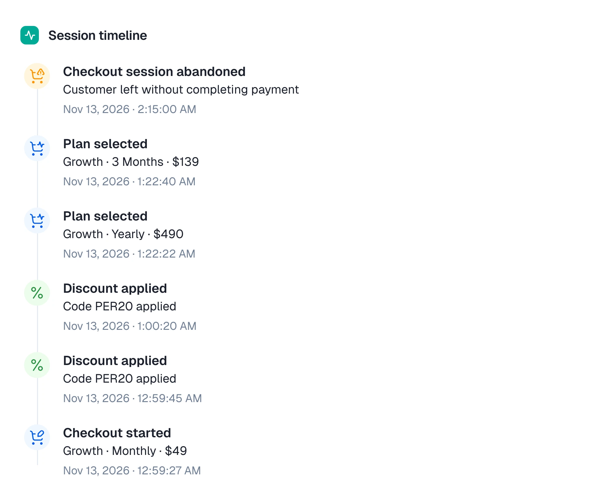
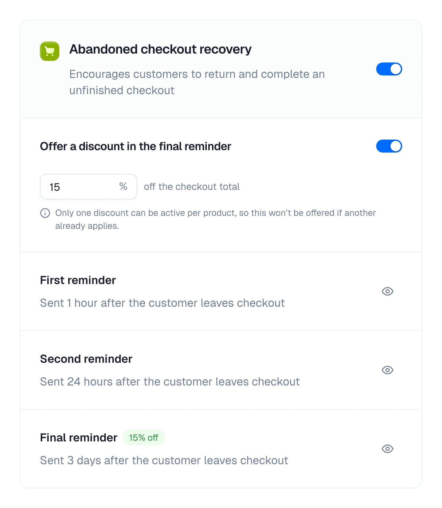

Abandoned cart recovery emails customers who start a checkout but do not complete payment. Kelviq detects the abandoned checkout, sends up to three reminder emails over three days, and expires the checkout after four. You do not need to build anything: detection, scheduling, and deduplication are handled for you.

The feature is on by default for every organization. You can turn it off in **Settings → Customer emails**.

## How a checkout becomes abandoned

Kelviq marks a checkout as abandoned when all of the following are true:

* The checkout was created at least one hour ago.
* Its status is `open` or `processing`.
* The customer has not touched it in the last 30 minutes.

Recent customer activity delays the marking, so a customer who is still filling in payment details is not emailed.

When a checkout is marked as abandoned, **Checkout session abandoned** is added to its timeline in [Checkout sessions](/sales/checkout-sessions#session-details).

<Frame>
  
</Frame>

A reminder also needs somewhere to go: the customer must have an email address, taken from the linked customer record or the email entered during checkout.

## Reminder schedule

Timings are counted from when the customer leaves checkout. They match **Settings → Customer emails → Abandoned checkout recovery**.

| Email | Sent |
| --- | --- |
| First reminder | 1 hour after the customer leaves checkout |
| Second reminder | 24 hours after |
| Final reminder | 3 days after |

The background jobs that send these run hourly, so an email can arrive up to an hour after its nominal time.

The reminders are sequential. The second email is only sent after the first, and the third only after the second. Each email includes a **Return to checkout** link that takes the customer back to their session, and each send is recorded so a customer is never emailed twice for the same step.

The subject lines are:

1. `You left {productName} in checkout`
2. `Still interested in {productName}?`
3. `Last reminder about your {productName} checkout`

## What happens at expiration

Four days after creation, an unpaid checkout expires:

* The checkout status becomes `expired` and its payment status becomes `canceled`.
* The recovery link in earlier emails stops working.
* No further reminders are sent.

Completed, closed, or expired checkouts never receive reminders.

## Offer a discount in the final reminder

In **Settings → Customer emails**, open the **Abandoned checkout recovery** section, turn on **Offer a discount in the final reminder**, enter a percentage and press Enter. The **Final reminder** row then shows the discount, for example **15% off**. The final reminder then offers that much off the checkout total. Only one discount can be active per product, so the offer isn't sent if another discount already applies to the checkout.

<Frame>
  
</Frame>

## Turning it off and on

Use the switch on the **Abandoned checkout recovery** section in **Settings &rarr; Customer emails** to control the feature for your whole organization.

* Turning it off stops future reminder emails. Emails that were already sent cannot be recalled.
* Turning it back on resumes eligible reminders for checkouts that have not yet expired.

<Note>
  Kelviq runs the reminder schedule and writes the emails. You choose whether reminders go out and the discount in the final reminder.
</Note>

To watch recovery in action, open [Checkout sessions](/sales/checkout-sessions). An abandoned checkout stays in its `open` or `processing` state until the customer returns and pays or the session expires.
