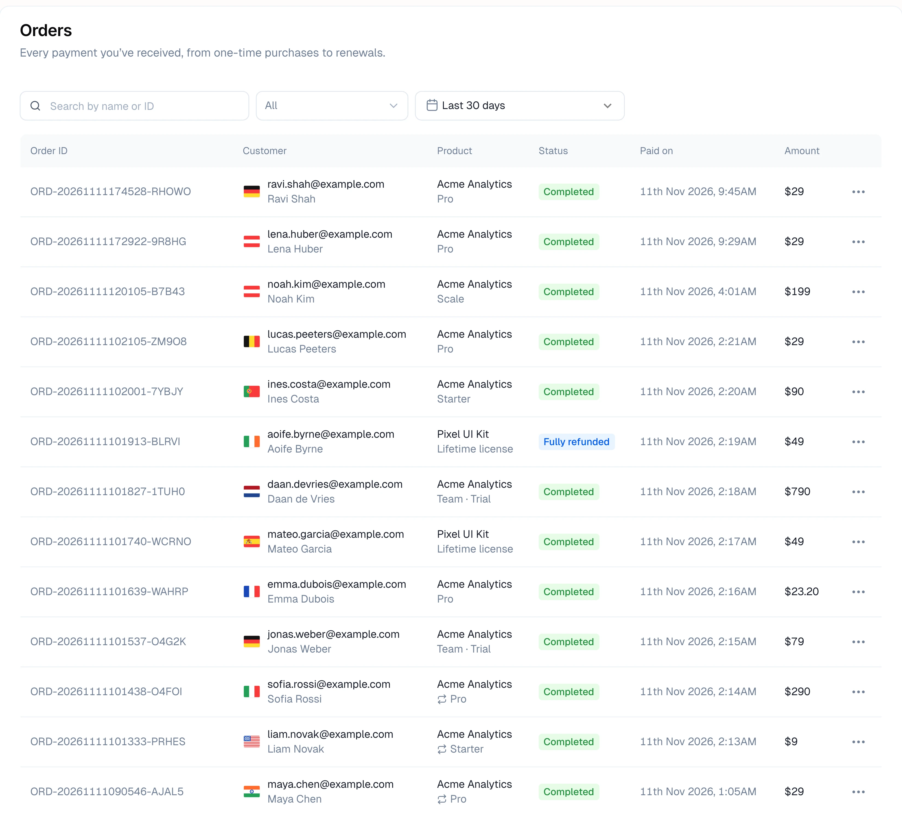
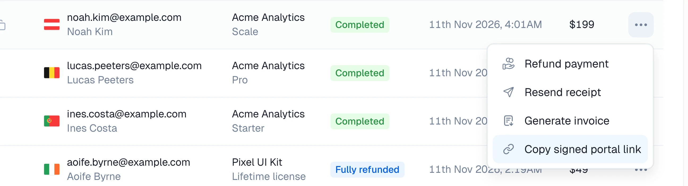
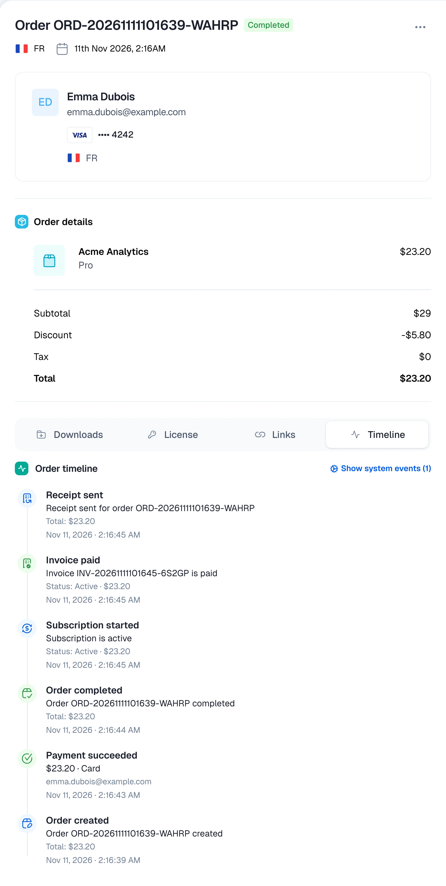

An order is created for each purchase made through your checkout: one-time payments, the first payment of a subscription, and each renewal. Open **Sales → Orders** to see them.

<Frame>
  
</Frame>

Each row shows the order ID, the customer's email and name, the product and plan, the status, when the order was paid, and the amount. Renewals have a repeat icon next to the plan, and trial orders say **Trial**. Search by name or order ID, filter by status, and change the date range with the filters above the list.

## Order statuses

| Filter | Badge in the list | What it means |
| --- | --- | --- |
| **Pending payment** | **Pending payment** | The order was created and the payment hasn't completed yet. |
| **Complete** | **Completed** | The payment succeeded. |
| **Failed** | **Payment failed** | The payment was attempted and declined, or it errored. No money was collected. |
| **Refunded** | **Fully refunded** | The full amount was refunded to the customer. |
| **Partial refund** | **Partially refunded** | Part of the amount was refunded. The rest stays with you. |
| **Canceled** | **Cancelled** | The payment was canceled before it completed. Nothing was charged. |
| **Fraudulent** | **Fraudulent** | The payment was identified as fraudulent. |

The same values come back as `status` from the [Orders API](/api-reference/orders/list-orders): `PENDING`, `COMPLETE`, `FAILED`, `REFUNDED`, `PARTIAL_REFUND`, `CANCELLED`, and `FRAUDULENT`.

## Quick actions

Click **⋯** at the end of a row:

* **Refund payment:** refund the full amount or part of it.
* **Resend receipt:** email the receipt to the customer again.
* **Generate invoice:** create and download the invoice for the order.
* **Copy signed portal link:** copy a link that signs the customer in to their [customer portal](/customer-portal/overview).

<Frame>
  
</Frame>

## Order details

Click a row to open the order's details. Clicking the customer opens their customer page instead.

<Frame>
  
</Frame>

The panel shows the order status and date, the customer's name, email, and country, and each item with its subtotal, discount, tax, and total. Click **⋯** at the top for the same actions as the list.

The tabs below the totals show what the customer received and what happened to the order:

* **Downloads:** the files the customer can download, each with a download button.
* **License:** the license key issued for the order. Use **Edit activation limit**, **Manage expiry**, or **Deactivate**.
* **Links:** the links shared with the customer after purchase.
* **Timeline:** every event on the order, newest first, such as **Order created**, **Order completed**, receipts and invoices sent, and payment results. Use it to check, for example, whether a customer was sent their receipt.

## Custom field responses

If the checkout collected [custom fields](/checkout/custom-fields), the customer's answers are saved on the order. You can see them in the order details panel. They're returned as `customFieldsData` on the order in the API and as `custom_fields_data` in the `order.created`, `order.updated`, and `order.refunded` [webhooks](/guides/webhooks#custom-field-responses).
