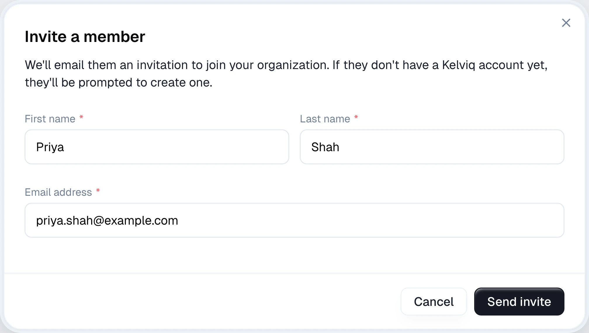
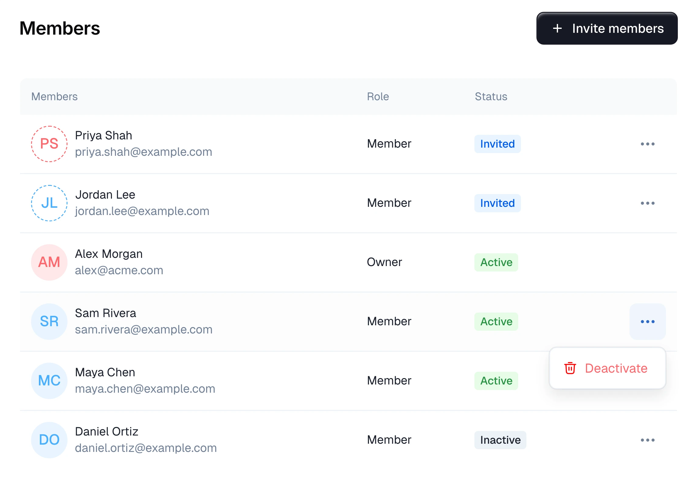

Members are the people who can sign in to your organization's dashboard. Kelviq doesn't charge per seat, so invite as many teammates as you need.

Open **Settings → Members** to see everyone in the organization with their role and status. The person who created the organization is its **Owner**.

## Invite a member

1. Click **Invite members**.
2. Enter their first name, last name, and email address.
3. Click **Send invite**. If a field is empty or the email isn't valid, the error shows under that field.

<Frame>
  
</Frame>

Kelviq emails them an invitation to join your organization. If they don't have a Kelviq account yet, they're asked to create one. They show as **Invited** until they accept, then as **Active**.

## Manage invitations and members

Click **⋯** next to a person:

<Frame>
  
</Frame>

* **Resend invite** sends the invitation email again, for someone who's still **Invited**.
* **Cancel invite** withdraws an invitation that hasn't been accepted.
* **Deactivate** takes away a member's access to the organization immediately. They show as **Inactive**. Click **Activate** to bring them back.

The **Owner** can't be deactivated.
