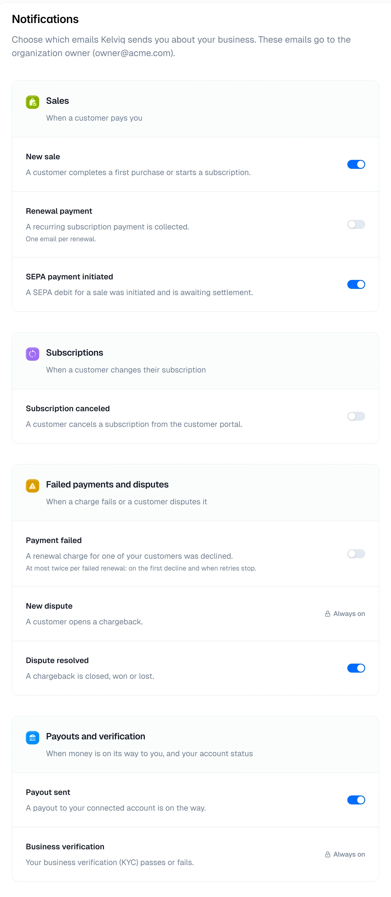

Kelviq can email you when something happens in your business: a new sale, a canceled subscription, a dispute, a payout on its way. Open **Settings → Notifications** to choose which of these emails you get.

The emails go to the organization owner's email address. Only the owner sees the **Notifications** page. Other members don't get these emails and can't change them.

<Frame>
  
</Frame>

Use the switch next to an email to turn it on or off. The change saves right away and applies to future emails only.

## The emails

| Email | Sent when | On by default |
| --- | --- | --- |
| **New sale** | A customer completes a first purchase or starts a subscription. | Yes |
| **Renewal payment** | A recurring subscription payment is collected. One email per renewal. | No |
| **SEPA payment initiated** | A SEPA debit for a sale was initiated and is awaiting settlement. | Yes |
| **Subscription canceled** | A customer cancels a subscription from the [customer portal](/customer-portal/overview). | No |
| **Payment failed** | A renewal charge for one of your customers was declined. At most twice per failed renewal: on the first decline and when retries stop. | No |
| **New dispute** | A customer opens a chargeback. | Always on |
| **Dispute resolved** | A chargeback is closed, won or lost. | Yes |
| **Payout sent** | A [payout](/payouts/overview) to your connected account is on the way. | Yes |
| **Business verification** | Your [business verification](/getstarted/review-process) passes or fails. | Always on |

**Renewal payment**, **Subscription canceled** and **Payment failed** are off by default because they can be frequent. Turn them on if you want an email for each one.

**New dispute** and **Business verification** are always sent. A new dispute carries the deadline for sending evidence, and missing it loses the dispute. Business verification covers your account and compliance status.

<Tip>
  These emails are for you. To act on the same events in your app, use [webhooks](/guides/webhooks). The emails Kelviq sends your customers are in [Customer emails](/settings/customer-emails).
</Tip>
