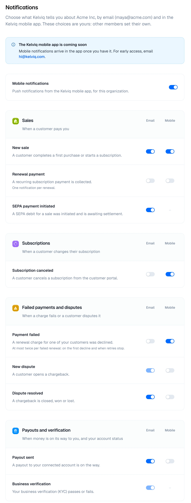
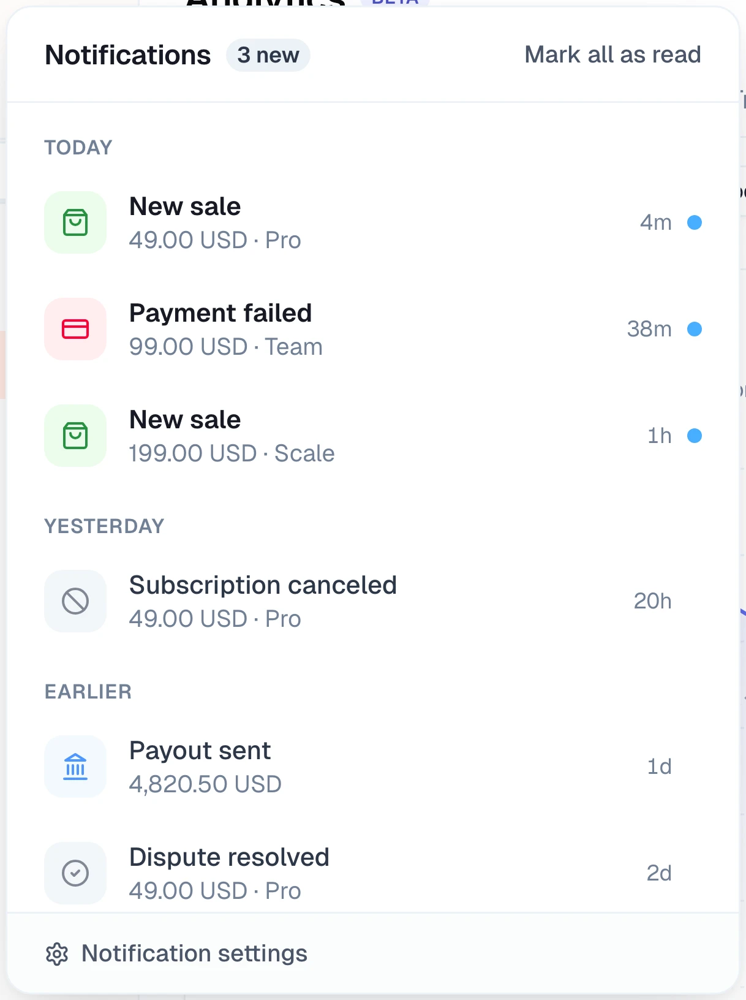

Kelviq tells you when something happens in your business: a new sale, a canceled subscription, a failed renewal, a payout on its way. Open **Settings → Notifications** to choose what you hear about, by **Email** and on **Mobile**.

Your choices are your own. Every member of the organization sets theirs, and they apply only to the organization you're in.

<Frame>
  
</Frame>

Use the switches to turn a notification on or off. The change saves right away and applies to future notifications.

## The events

These are the defaults for the organization owner.

| Event | Sent when | Email | Mobile |
| --- | --- | --- | --- |
| **New sale** | A customer completes a first purchase or starts a subscription. | On | On |
| **Renewal payment** | A recurring subscription payment is collected. One per renewal. | Off | Off |
| **SEPA payment initiated** | A SEPA debit for a sale was initiated and is awaiting settlement. | On | None |
| **Subscription canceled** | A customer cancels a subscription from the [customer portal](/customer-portal/overview). | Off | On |
| **Payment failed** | A renewal charge was declined. At most twice per failed renewal: on the first decline and when retries stop. | Off | On |
| **New dispute** | A customer opens a chargeback. | Always on | Off |
| **Dispute resolved** | A chargeback is closed, won or lost. | On | Off |
| **Payout sent** | A [payout](/payouts/overview) to your connected account is on the way. | On | Off |
| **Business verification** | Your [business verification](/getstarted/review-process) passes or fails. | Always on | None |

**New dispute** and **Business verification** emails can't be turned off. A new dispute carries the deadline for sending evidence, and missing it loses the dispute.

## Other members

Members start with every email off and turn on the ones they want. They see only the events their role lets them see: sales and disputes need access to orders, subscriptions and failed payments need access to subscriptions. **Payout sent**, and the always-on emails, go to the owner only.

## Mobile notifications

Mobile notifications arrive in the Kelviq mobile app, which is coming soon. For early access, email [hi@kelviq.com](mailto:hi@kelviq.com). The **Mobile notifications** switch at the top turns them all off for this organization and keeps your choices for when you turn it back on.

## The bell

The bell next to search in the sidebar lists what happened in your organization, under **Today**, **Yesterday** and **Earlier**. The count on it shows new sales, failed payments and new disputes you haven't seen.

<Frame>
  
</Frame>

Click a notification to open its order, subscription or **Payouts** page. Use **Mark all as read** to clear the count, and **Notification settings** to get back to this page. The bell isn't shown in sandbox, because notifications are for live events.

<Tip>
  Notifications are for people. To act on the same events in your app, use [webhooks](/guides/webhooks). The emails Kelviq sends your customers are in [Customer emails](/settings/customer-emails).
</Tip>
